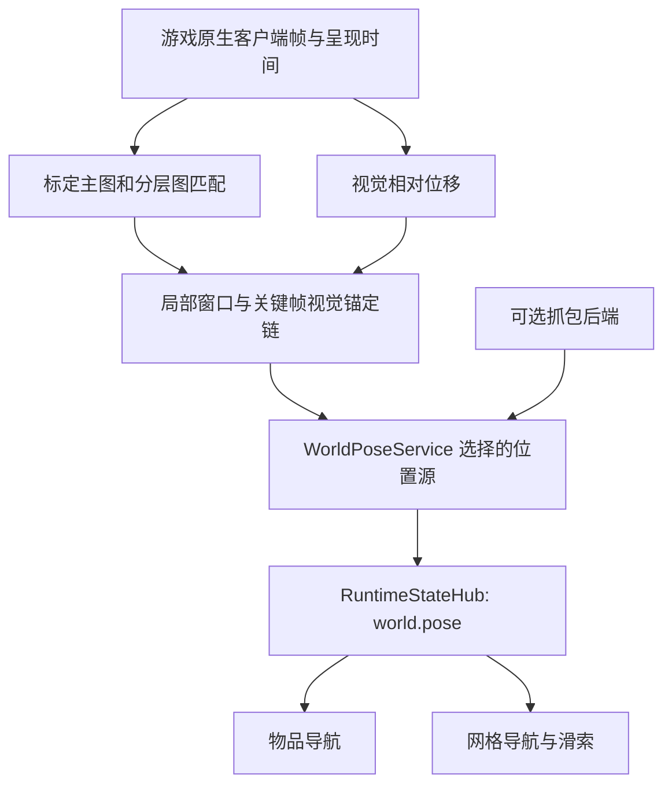

# 小地图定位

返回：[文档索引](../zh-CN/README.md) / [API 参考](API.md) / [开发指南](DEVELOPMENT.md) /
[网格导航](网格导航.md)

本文只说明实时定位链路。路径规划、路线跟随和游戏输入见[网格导航](网格导航.md)。

## 1. 职责边界

`WorldPoseService` 在首次读取时懒创建，由执行器共享，支持两个独立位置源：

- 视觉源：标定地图匹配提供绝对 X/Z，里程计、局部窗口和关键帧视觉锚定链约束相对位移；
- 抓包源：可选后端直接提供角色 X/Y/Z、地图、速度和朝向。

生产定位不再启动或读取官方地图 WS、本地 WS，也不以抓包坐标引导视觉搜索。
物品导航、网格导航和滑索通过 `RuntimeStateMixin.world_pose()` 读取 `world.pose`，
检查可信状态后再执行动作。视觉源不能测量真实高度，`y=None`，界面显示“高度未知”。

## 2. 模块

| 模块 | 职责 |
|---|---|
| `position_service.py` | 选择独立位置源、处理帧时间、发布统一契约 |
| `calibrated_map_store.py` / `map_set_locator.py` | 加载资源、在已安装地图中自动选择地图 |
| `minimap_map_locator.py` | ROI 掩膜缓存、图标排除、绝对匹配、自适应局部搜索和连续帧确认 |
| `layered_minimap_locator.py` | 将主图与分层图变换到相同世界坐标并竞争楼层证据 |
| `visual_position_source.py` | 将标定地图锚点与视觉位移链组合成独立视觉源 |
| `capture_pose_mixin.py` | 抓包后端的生命周期、会话和坐标可信状态 |
| `wgc_frame_timing.py` | 将 WGC SystemRelativeTime 与具体 NumPy 帧关联 |
| `runtime_state/world_pose.py` | 对外世界坐标契约 |
| `data/official_map_client.py` | 可选设施资源的 HTTP 认证与查询；与定位无关 |

`minimap_position_mixin.py`、`ws_position_mixin.py` 和旧融合器保留供历史工具/测试使用，
不在生产 `WorldPoseService` 的继承链中。物品导航也不再挂载旧版 WS 导航实现。

## 3. 数据流



消费者按需请求采样；没有消费者时不会在后台固定频率截图。切换来源、地图或资源目录，
修改视觉链配置、分辨率变化和帧时间回退都会清空旧基准。切换源不融合两个源的坐标。

## 4. 坐标系

### 4.1 世界系

- 水平位置统一为 `(x, z)`，单位为米；
- 朝向使用罗盘方位角：正北 `0°`、正东 `90°`、正南 `180°`、正西 `270°`；
- 世界 `+x` 为东，世界 `+z` 为北。

### 4.2 地图系

- 图像坐标使用 OpenCV 约定：`x` 向右、`y` 向下；
- 小地图纹理移动方向与玩家移动方向相反；
- 相位相关得到内容位移 `(dx, dy)` 后，玩家地图系位移为 `(-dx, -dy)`；
- 轴映射负责把地图系像素转换为世界米：

```text
world_delta = map_to_world_px @ map_delta_px
```

## 5. 位置源

### 5.1 标定地图与视觉链

全局 `Position Config` 的 `视觉地图资源目录` 默认为 `assets/nav-grid-data/localization/maps`。
安装资源时保留以下布局，也可显式指向另一个项目导出的资源根目录：

```text
<root>/maps/map02/4/map02_4.webp
<root>/maps/map02/4/map02_4_mapping.json
<root>/layers/catalog.json
<root>/layers/map02/.../<layer>.webp
```

配置填写 `<root>/maps`。生产代码没有对开发机或相邻仓库路径的隐式依赖，也不会下载资源。
标准资源包位于 `nav-grid-data` 子模块的 `localization/` 目录。源码安装需初始化子模块并
拉取 LFS 内容：`git submodule update --init -- assets/nav-grid-data`，然后执行
`git -C assets/nav-grid-data lfs pull`。发布同步流程会展开整个子模块，并通过 `deploy.txt`
中的 `assets` 条目包含地图与分层资源；不依赖标注资源仓库自动更新。
已有自定义目录或仍存在的旧资源目录保持原值；失效的旧默认目录 `assets/localization/maps`
会在配置加载前备份并迁移至新的打包资源目录。
图片路径由清单指定，兼容旧 PNG；图片尺寸必须与 mapping 的 `image_size` 一致。地图 ID 留空时自动比较已安装标定图；
`Nav Config` 指定地图 ID 可缩小首次搜索范围。自动搜索先比较主图，只展开候选主图的分层。
主图位置有歧义时，先按主图结果安排地图的搜索顺序，再用该地图的低分辨率楼层索引排序。
这个顺序只决定先搜索哪里，不提供可信坐标。原图全局精匹配通过后，仍进入附近所有重叠分层的竞争。
每轮最多尝试 8 个索引候选；未确认时回退原有逐层全局搜索，并给下一张地图的索引机会。
当前搜索范围内的重叠分层会保留在缓存中，移出范围后再按内存目标淘汰，避免初始化循环淘汰。
首轮加载和解码大型资源会较慢，超过两秒的结果不会对外发布为可信坐标。

首次定位和丢失后重新定位要求至少两帧时间相邻且空间一致的观察。彩色匹配要求完整蒙版
ZNCC ≥0.45、候选差距 ≥0.10，不作残差裁剪；保留的灰度算法要求 robust NCC ≥0.85、
未裁剪 NCC ≥0.65、候选差距 ≥0.08。这是不同评分空间的门槛，不能直接比较数值。
灰度差距允许由完整环带或鲁棒证据给出，但所用证据必须
与所有其他候选都拉开差距，不能从不同候选各取一个有利分数。图标排除掩膜由当前画面独立生成，至少保留 55% 环带和
每象限 35% 环带。图标与环带有任一重叠像素即生成排除掩膜，不设覆盖率激活阈值。
白色设施图标以亮白或彩色核心为种子，扩展到相连的浅色抗锯齿边缘，再按小地图尺寸排除
黑色描边。彩色路径再剔除纯白及周围 2 px，若剩余覆盖率或分布纹理不足则拒绝；
灰度路径保留原有掩膜回退。策略只由当前画面决定，
不按候选匹配分数挑选掩膜，也不降低 NCC、候选差距或连续帧确认门槛。
灰度鲁棒评分相对未裁剪分数最多提高 0.20，限制相似地形的虚高候选。加载画面、纹理不足、遮挡过多、过期帧或资源错误均拒绝发布坐标。
通过严格证据门槛、仅等待连续帧确认时，视觉源标记 `visual_confirmation_pending`。
网格导航在 WGC 呈现时间有效时立即请求下一帧，省去固定控制周期等待；同一呈现时间的
重复帧保留已有证据但不增加确认次数，并短暂等待最多 1/60 秒，防止空转。
资源未齐、弱候选、无真实时间戳及抓包来源仍按原控制周期等待；确认帧数、最长帧间隔、
搜索范围和识别门槛不会因等待确认而放宽。
局部搜索窗口按标定仿射矩阵换算世界米半径，并在世界坐标下过滤候选，避免非 4 px/m
或非等向标定缩小搜索范围。里程计未采样时不重复加入缓存环带帧；新的绝对锚点仍可发布。
存在有效视觉链时固定在同地图周围 80 米内恢复匹配，未知楼层不触发跨地图扫描。
没有有效视觉链时，跟踪器保留随帧间隔和最大运动速度扩大局部范围、失败后全图搜索的流程。

### 5.2 分层资源与楼层证据

与 `nav-grid-editor` 协作确认的 `layers/catalog.json` 当前使用 schema 1。
只将 `map_category=layered` 的图层与对应 `map_name` 主图共同定位；独立场景不能仅凭归档目录
推断共享坐标系，必须有自己的标定后再接入。图层边界按以下公式转换：

```text
X = west + u * (east - west) / width
Z = north - v * (north - south) / height
```

图层会重采样到 4 px/m，变换包含 OpenCV 像素中心偏移。主层契约 ID 为 `__main__`。
视觉目录 `localization/layers/catalog.json` 与导航层声明索引是不同入口。导航从网格目录
优先读取 `catalog.json`，不存在时读取数据仓的 `levels.json`；层 ID 须与网格元数据的
`tier` 一致。目录声明不代表该层已有可走网格，缺少网格时仍须保留 `no_grid` 语义。
X/Z 相同但楼层不同的候选不能合并成一个楼层证据。楼层差距不足、相关资源缺失或目录声明
缺失楼层时，仍可接受有充分证据的水平位置，但必须发布 `tier_id=None`、`tier_trusted=False`。
视觉源声明 `tier_evidence_required=True`；网格导航在楼层未确认或没有对应网格时拒绝猜主层。
抓包源有真实 Y，可继续使用现有高度范围和拓扑规则。不能把视觉未知高度补成零。

原生瓦片分层按游戏小地图的叠加方式匹配：先通过各自标定对齐主图和当前层，再使用
`alpha * 当前层 + (1 - alpha) * 0.3 * 主图` 合成。0.3 是当前实机样本的固定压暗系数，
所有候选一致使用；不为单个候选拟合亮度。合成图按区域读取，边界补入主图背景，
因此当前层之外的暗色道路仍能参与匹配和消歧。

角色中心必须落在当前层原始 alpha 的覆盖范围内；仅保留 2 px（约 0.5 m）的边缘容差。
覆盖范围独立于截图亮度，黑色但不透明的像素仍属于当前层；损坏资源不能解释成透明区域。
全局搜索、局部搜索及细化均在选取前若干峰之前应用覆盖掩膜，细化后再次检查中心，
避免透明区的高分背景候选占用名额。该筛选不改变 NCC、分差和连续帧确认门槛。

合成图不能只用整体 NCC：亮层与暗背景的均值差可能淹没背景道路的位移证据。彩色匹配
从截图已通过图标遮罩的像素中，用 Otsu 划分亮暗两组。只有暗部占 55%–95%、亮部均值
至少为暗部两倍、暗部灰度标准差不低于 4，且四象限均保留至少 35% 有效像素时启用。
最终分数为完整 NCC 与暗部独立归一化 NCC 的等权平均；原始完整 NCC 仍单独参与可信门槛。
全局粗搜、局部选峰及细化评分使用同一规则。暗部掩膜只取自当前截图，对所有地图、
楼层与候选相同，不按候选 alpha 或残差选像素；缺少分布纹理时退回原评分。

导航运行期间会将分层网格的不可变拓扑快照交给视觉源。首次定位仍独立确认；之后仅用
最近两秒内已发布的可信绝对位置，按移动速度上限、网格连通性及显式有向连接限定可达层。
未知格按不可行走处理，楼梯两端也必须落在已标注可走格；不能穿过未知区域推断跨层。
目标层和导航的计划段号不是楼层观测，不参与建立锚点。无有效小地图、异常视觉重锚、
时钟回退、锚点过期或导航结束都会清除约束；整层数据缺失不当作已知阻挡。

不可达层在匹配竞争前排除。最优候选自身不可达时拒绝本帧，但同层其他候选仍保留参与
分差计算，避免有限候选列表隐藏其他可达峰后产生虚假唯一性。两个同层候选均可达时，
拓扑不能消歧，仍需新的视觉证据。NCC、候选分差与连续确认门槛保持不变。

### 5.3 抓包直通（实验技术）

另一条路完全绕开上面两条：游戏主 TCP 连接里周期性上报主控角色的世界坐标，
一个**独立的外部程序**被动抓包并离线解密后，通过本地 HTTP 暴露**同一个世界坐标系**的坐标
——与官方地图 WS 逐位一致，并且额外自带真实高度、朝向与速度。

```text
endfield-capture-backend.exe serve --no-dashboard --no-map-ws --port 8765
        ▲                                    │
        └──── GET /api/state（轮询）──────────┘
```

| 模块 | 职责 |
|---|---|
| `src/localization/capture_position_source.py` | 只读后端，翻成定位契约。**不含**任何抓包/解密代码，因此应用侧不需要新增依赖 |
| `src/localization/capture_backend_installer.py` | 从 GitHub Release **下载** exe 并检查更新；校验 sha256、原子落盘、失败不阻断 |
| `src/localization/capture_backend_launcher.py` | 按需拉起后端 exe，并做探活、冷却重试与整棵进程树的收尾 |
| `src/patches/capture_backend_autostart_patch.py` | 在**游戏启动之前**触发上面那个拉起器 |

#### 后端程序的获取与更新

exe 不再需要用户手工放置：打开「使用实验技术」后由本应用从
`luqing233/endfield-capture-backend` 的 Release 下载，并在有新版时**静默更新**。

| 时机 | 做什么 |
|---|---|
| 勾上风险开关（确认后） | **后台**预下载，不阻塞界面。那时用户还没启动游戏，正好用这段时间 |
| 点「启动游戏」前 | **阻塞**补齐（缺了就下载/更新）。宁可启动多等十几秒，也不能让游戏先连上 |
| 点「检查并更新后端」 | 手动触发一次，忽略节流 |

安装位置是 `<应用目录>/downloads/capture_backend/`。**不能放 `configs/`**：那里的东西会被配置
导出整个打包，而导入侧对单个成员硬性限制 16 MB（`config_transfer_patch._MAX_IMPORT_MEMBER_BYTES`），
18 MB 的 exe 一旦进去，导出的配置包就再也导不回来。`downloads/` 已被 `.gitignore` 覆盖。

取版本有两条路，主用 GitHub REST API（额外给出官方 sha256 摘要，可校验完整性）；实测**未认证**
访问会按 IP 限流（撞到过 403），所以拿不到就退回不加 API 的 `/releases/latest` 302 重定向拿 tag
——这条路不消耗配额，代价是没有官方摘要，只校验文件大小并告警一次。

下载**下到哪儿都不会阻断游戏**：拿不到新版就用手上这个旧的，一个都没有就报「后端不可用」。
下载先落到 `.download` 暂存文件，校验通过才 `os.replace` 成正式 exe——不存在"半截 exe 被拉起"
的窗口。

指定了「实验技术后端程序路径」或环境变量 `EF_CAPTURE_BACKEND` 时**完全跳过联网**：用户自带后端
就不该再去下载。同理「自动启动后端」关掉时也不下载。

#### 运行产物的保留策略

后端每局建一个 `runs/<YYYYMMDD-HHMMSS>/`，里面是 `capture.pcap` + `positions.jsonl`
（+ `service.json`），**一局约 20 MB**，不设上限能攒到几个 GB。

我们拉起**自己下载的那份**时显式传 `--runs-dir` 指到 `<托管目录>/runs`，并在每次拉起**探活成功
之后**按「只留最近 5 局」清理一次。顺序很关键：后端是先建目录、再起 HTTP 服务的，所以端口应答
时新目录必然已存在——放在 `_launch` 之后立刻清会早于它建目录，稳态会留成 6 份而不是 5 份。

清理**只动名字像时间戳的目录**（`^\d{8}-\d{6}$`）。认不出的一律不碰：这个函数会删东西，宁可漏删
也不能误删用户放在那儿的东西。时间戳定宽，所以字典序就是时间序。

用户**自带**的后端不加 `--runs-dir`——那会把它自己的产物挪到我们的目录里，属越界。

**顺序是成败关键**：后端必须**早于游戏的主连接**就绪，否则拿不到登录握手，后端会明确报
「缺少连接起点」而不是解出错数据。

拉起的时机不能放在普通任务里——任务要等游戏窗口能截屏才会被执行（`can_capture()`），
那时登录握手早就过去了。所以补丁包装了 `StartController.do_start`，那是游戏进程存在之前的
最后时机；`WorldPoseService` 的按需采样会再兜底一次（后端中途挂了、或玩家在游戏已经跑起来
之后才打开开关）。

直通模式下整条校准体系都不参与（坐标本来就是绝对值，没有锚点可设、没有漂移可修），
所以只要坐标可用 `sync_needed` 就恒为假——否则导航的 `CALIBRATE` 状态会停下来等一个永远
不会到来的静止校准。

#### 会话边界：坐标是绑在一条 TCP 连接上的

「绝对」不等于「当前」。坐标由**某一条** TCP 连接解出，而那条连接会随离开游戏、换账号、
重启游戏而结束。后端把最后一条坐标一直留着（它的 `state.last` 没有清空点），于是：

> 旧会话结束之后、新会话报出第一条坐标之前，`/api/state` 给的仍是**上一局**的坐标。

那可能是另一张地图、乃至另一个账号的位置。多账号日常任务正好撞在这条路上：
`BaseEfTask.iter_multi_account_context` 对每个账号先调 `login_flow`，紧接着就跑送货等导航任务。
**切号的实际动作是离开游戏再重新进入**（`login_flow` 走 UI：退出到登录界面 → 选账号 → 进入），
而重新进入会建立新的 TCP 连接，所以每一轮切号都自带一次"旧连接结束 + 新连接就绪"的交替。

这条对实现是有利的：**切号不会复用连接**，因此后端侧那个"同四元组复用会让 flow 永久失效"
的隐患在真实切号路径上不会出现（见下文反面情形）。但它同时说明空窗期是**真实存在且必然发生**
的——游戏退到登录界面、选账号、再进入，这段时间里 `lastPosition` 一直是上一个账号的坐标。

所以直通模式的信任是**两条一起判**，任一不成立就不给导航用（`_capture_trust`）：

| 判据 | `trust_reason` | 说明 |
|---|---|---|
| 产出这条坐标的连接已不再喂数据 | `capture_session_ended` | 连接的 `flows[].status` 是终态（`连接已结束` / `解码停止：…`），或它在 `flows` 里已查不到，或这条连接已 30 秒没收到任何报文（兜住终态没被捕捉到的情形） |
| 认不出地图 | `capture_no_parent_map` / `capture_unknown_map` | 见 5.3 下方「不猜」一节 |

两条都**只扣信任、不清空坐标**：`x`/`z` 照给，让导航停在 `WAIT_TRUST` 时能把真正的原因
打出来，而不是含糊地报「未锚定」。网络侧信息不足时（老版本后端不报 `flows`）一律**当活着的
处理**——缺信息不等于会话已死，没有证据就不扣信任。

导航等待态的文案会带上 pose 里的 `trust_reason` / `odom_reason`（形如
`等待坐标: capture_unavailable`），所以一眼能分清是「融合链还没锚定」还是「抓包源没数据」——
这两种情况该查的东西完全不同。

**抓包模式不启动小地图定位链**：`start_minimap_position()` 在本模式下直接返回，
`minimap_position_ready` 也恒为真。两处短路缺一不可——导航入口
（`navigate_grid_to` → `ensure_runtime_position_service`）会**无条件**调前者、紧接着检查后者，
而抓包根本不需要比例尺/里程计/融合/地图 WS。不短路的话有两重代价：拿不到比例尺时导航会
**立刻失败**并报一条指向全局「导航配置」和游戏窗口的错（该查的其实是抓包后端）；拿得到时也会
白建两个对象并启动地图 WS——正是本模式声明要绕开的那一整套。

`sync_seq` 在抓包源上的含义是"**坐标基准变了**"，不是"坐标变了"：换连接时它**一定**推进
（连接的 id 参与判定），所以"登出后在原地重新登录"这种坐标逐位相同的重登也会让导航失效
已走过的已知格；而**同一连接内怎么移动都不推进**。后者是必须的——导航把 `sync_seq` 变化当
"真重锚 → 世界坐标整体平移"，抓包源移动时每拍坐标都在变，若按"采样变了"推进，移动本身就会
每拍清空导航的"走过的已知格"，偏航回退（网格导航文档 §7.5）会退化成"没有已知格可返回"。

**三类终态由两条判据分别接住**，缺一不可——后端的 `snapshot` 会把状态**计算覆盖**成
`等待 TCP 补包`（`any(gaps) and not flow.failed` 时顶替真实状态），而收到 FIN 的连接并不是
`failed`，所以**连接结束时若还有没补齐的 TCP 空洞，它的终态就被遮住了**：

- `解码停止：…` 只可能出现在 `failed` 时 → 覆盖不生效 → 状态判据接住（立即）；
- `连接已结束` 被空洞覆盖遮住时 → 此时 `lastPacket` 已停止更新 → 30 秒静默判据接住。

30 秒是个刻意偏松的值：误判为「还活着」只是让陈旧窗口变长，误判为「已死」却会把一条正常
连接的导航停掉；而活着的游戏连接不会这么久完全静默（移动中约 0.27 秒一条，静止时仍有其他
对象的报文）。代价是登出后最长 30 秒的陈旧窗口——但比改动前的「永久信任」已经是严格改善。

后端侧还有几条边界值得记着（核实的是 `endfield-capture-backend` 的 `decoder.py` / `server.py`）：

- **只抓 30000 / 40000 两个端口**。重登若换到别的端口，后端看不见那条连接，"自动接管新连接"
  也就不成立；
- `flows[]` 只回**最近 12 条**，更早的连接查不到——这也是"查不到即判死"的依据；
- **`--seed-pcap` 不是重登录的解法**：它只能把*同一条仍在使用的连接*的密钥流接上（所以
  "上次 `runs/` 里的 `capture.pcap`"可用）。游戏重启换了连接后，重放出来的是另一条已经死掉的
  连接，反而会解出一批陈旧坐标；
- 契约**没有任何版本字段**，也没有 reset / 重连 / 健康检查端点（`/api/state` 200 即探活，
  应用侧 `probe_backend` 用的就是它）；
- 每次轮询都会**全量返回** `trajectory`（最多 1200 点，且跨连接混在一起）。应用侧不消费它，
  但会在 0.2 秒的轮询周期里反复传输与解析——真嫌这个开销，就换成后端的命名管道
  （`serve --pipe --no-http`，事件驱动、不占端口，字段与 `lastPosition` 完全一致），
  应用侧目前还没接。

#### 会话交替是自愈的：离开游戏再进入会新建一条 TCP 连接

**离开游戏再重新进入（含多账号切号）走新 TCP 连接**。所以整条恢复路径是顺的，不需要任何额外处理：

```
离开游戏  → 旧连接收 FIN → 旧 flow 终态 → 应用扣掉信任（WAIT_TRUST），导航停车
重新进入  → 新连接 SYN → 后端按四元组新建 flow → 抓到新握手 → 报出新坐标
          → 新 flow 活着且地图认得出 → 信任恢复，导航接着走
```

关键在于**后端不需要重启**：它按 TCP 四元组归档连接，新连接自然是一条新 flow，
只要后端还在抓包，新一轮握手就会被捕获。这也是"默认不在停止定位时关闭后端"更有力的理由
——后端的客户端材料（DLL 私钥、公钥模数）是进程级的，会话 key/nonce 才是每连接现解的，
所以它可以跨掉线一直用下去。同理，应用侧**不需要**在切号时做任何特殊处理（也不必去拉一次
后端）：`do_start` 若被再次调用，补丁只会探到后端已在跑并直接采用。

中间那段空窗期就是上面那条 `capture_session_ended` 生效的窗口：旧 flow 已经结束、新 flow
还没报出坐标，此时 `lastPosition` 仍是上一局的。窗口长度就是离开游戏到重新进入的耗时。

> 反面情形（后端侧尚未处理的边界，实际不会碰到）：若游戏**复用**同一条四元组发起新会话，
> 后端的 `Reassembler.feed` 只在基线为空时才接受 SYN，新明文握手会被当成加密帧、整条 flow
> 永久失效（重开游戏才能恢复，重启后端也没用）。这种情况由 30 秒静默判据接住。
> **真实的切号与重登都走新连接，所以这条不构成风险**——但如果是用 `kill_game` 那种
> `TerminateProcess` 强杀游戏（危险状态守卫、任务完成后勾选的「仅退出游戏」走的就是它），
> 对端来不及发 FIN，旧 flow 会一直停在「正在解码」、`lastPacket` 也停更，这时**只剩 30 秒
> 静默判据**在兜底，窗口内旧坐标仍会被当成可信。

#### 绝不要在游戏运行期间重启后端

比上面那条更硬的一条约束：**会话密钥由服务端在登录响应里下发，每个账号、每次登录都不同**
（后端用客户端内嵌的 RSA 私钥从登录响应里解出 32 字节 key + 12 字节 nonce）。所以
"重新登录"在协议上就是一次**全新的握手**，密钥只在那一刻出现过一次。

推论：**重启后端不能解决任何解码问题，只会制造问题**——它把一个本来会被自动接管的局面
（新连接新握手）变成必须重开游戏才能恢复（新后端看到的是一条没有 SYN 的连接，只会报
`缺少连接起点`）。同理，「停止定位时关闭后端」打开后如果应用在游戏还开着时退出，下一次
开启应用时后端虽然会被重新拉起，但**当次登录已经救不回来了**，只能重开游戏。

应用侧对这条约束的复查（结论：满足）：

- `stop_capture_backend()` 的生产调用点是 `WorldPoseService.on_destroy()`；
- 服务销毁由包装后的 `TaskExecutor.destroy()` 触发，而它来自**执行器循环结束或
  `MainWindow.closeEvent`**，即**应用退出**，不会因为任务禁用/重新加载/切号而触发；
- 真正杀进程还要 `实验技术停止定位时关闭后端` 为真，**默认为假**——所以默认连应用退出都不会
  动后端（这也正是它默认为假的原因）；
- 反之，`ensure_capture_backend()` 每拍都会走一遍，但它**只会拉起、从不重启**已在跑的后端
  （`BackendLauncher.running` 挡住重复启动，健康期 5 秒内连探活都省掉）。

唯一残留的坑是**人为**的：若用户打开了「停止定位时关闭后端」，又在游戏还开着时退出应用，
就必须重开游戏才能恢复定位。这条已写在那个配置项的说明里。

#### 校验抓包是否真的接上了，没接上就重建连接

坐标缺失有好几种成因，**混在一起就没法决定该做什么**——所以 `CapturePositionSource.health()`
把连接状态单独分类出来（`CaptureHealth`），只看连接、不看坐标：

| 状态 | 含义 | 该做什么 |
|---|---|---|
| `ok` / `decoding` | 有坐标 / 握手已成、坐标在路上 | 正常 |
| `no_connection` | 后端在跑，但一条游戏连接都没看到 | **重建连接** |
| `handshake_pending` | 连接已发现，握手还没完成 | 等 |
| `backend_down` | 后端不可达 | 查后端本身 |
| `missed_handshake` | **抓包晚于该连接建立** | **重建连接** |

判定口径是"**后端在跑、但当前没有坐标且不会自己恢复**"：`no_connection`（这一局的位置源已经
没了）与 `missed_handshake`（后端没看到 SYN，推不出密钥流）都属于这一类，换一条连接让它从头抓
握手就行。`handshake_pending`（握手正在进行）再等一会就好，`backend_down`（后端根本没起来）
重建也没用——对它们动手只会白白打断玩家。`连接已结束`（人家正常结束）与 `解码停止`（这条流真
出问题了）也不值得重建。

**「一条死连接 + 一条活连接」必须判成正常**：后端把历史连接一直留着，拿旧的死连接判断会让
每一次正常抓包都被误判成需要重建。

重建动作是**回登录界面再进入**（`force_new_capture_connection`），**不切换账号**——用户口径是
"这个流程不需要重新选择账号"，所以不走会点「最近」、重选账号的 `login_flow`。实际动作委托给
`LoginMixin.relogin_same_account`：回到主界面 → 点 `main_out` 登出入口 → 通用确认 → 回到登录
界面（这时能匹配到 `fL.logout`，游戏显示"点击任意位置继续"）→ 点一下屏幕中央继续进入。拿不到
可用的重进实现、或没回到登录界面，都**干净失败**并提示手动进入一次，绝不乱点。

> 登录界面的「最近 / 登录」按钮仍只能走 `click_text`（`login_ocr` → `login_screenshot`，**从屏幕
> 截窗口**；普通帧通道在那种界面上取不到有效画面）——那条路是 `login_flow` 切号用的，本重进流程
> 不用它。为此 `WorldPoseService` 混入了 `LoginMixin`（它没有 `__init__`/`default_config`，
> 不会带进「多账户模式」那套配置），重进直接用它现成的 `relogin_same_account`。

两次重建之间至少隔 `CAPTURE_RELOGIN_INTERVAL_SECONDS`（20 秒）。`ensure_capture_session` 在
"没坐标"时每拍都会被调，没有这个间隔三次尝试会在一分钟内打光——实测两次只隔了 14 秒，而每次
都要把玩家从游戏里踢回登录界面。

三个时机都会校验（`ensure_capture_session`）：**启用后第一拍**、**每次导航前**、**每次切号后**。
最后一条值得说明：切号本身会重建连接、后端会自动接管（登录密钥随之重抓），**不需要为它做特殊
处理**——但"应该会发生"和"确实发生了"是两回事，所以还是要校验。

最多尝试 **3 次**，**成功即清零**（重登后能正常抓包，下次再出问题理应还能修）；用尽就停手并
报错——无人值守时反复登出比不修更糟。可用「抓包失败时自动重新登录」关掉。

> **首次使用建议盯一眼**：重建动作依赖游戏界面的特征模板（登出入口 `main_out`、登录界面的
> `fL.logout`）。版本不符时匹配不到，这一步会干净失败并提示"请手动退回登录界面再进入一次"，
> 而不会乱点。这种情况把它关掉、手动退一次即可。

`map_id` 参与导航的换图判定，而导航侧算的是
`str(pose.get("map_id") or session.request.map_id or "")`——**会静默回退到调用方请求的地图**。
所以「认不出地图」必须在定位源里就扣掉信任，不能只靠导航自己判断：实测场景 463 是**自带独立
坐标空间的可走区域**（那 11 秒里角色以 5.0 的速度正常行走，坐标在 `(16, 107, -41)` 附近，
而 map02 的 y≈320、相距约 1400 个世界单位），拿它当 map02 会在错的网格上、从错的起点规划
路线。这条与 `_resolve_map_id` 的「不猜」是同一条原则，只是贯彻到了 pose 的信任位上。

上报是**事件驱动**的：移动中约每 0.27 秒一条，**完全静止时没有位置包**，同图传送会有数秒到
数十秒的空档。`CaptureSample.age_seconds`（后端 Unix 墙钟减去当前墙钟）因此**只显示不拦截**
——静止时年龄大是正常的。它不进信任判定，它的用处是出现「坐标跳变」或「导航拿着旧位置走」时
一眼看出数据源当时到底有没有在更新。后端跑在本机、需要 Npcap 驱动与客户端文件，属于用户自行
选择开启的功能（开关带风险确认，见 `src/patches/danger_switch_patch.py`）。

## 6. 视觉链与时间

标定地图的强匹配是绝对锚点，里程计给相邻帧的相对位移。局部窗口和关键帧图使用视觉重叠边
约束漂移，再将位置转换回世界 X/Z；绝对锚点超过两秒未刷新时撤销定位可信状态。
加载、传送、地图变化和定位丢失不能延续旧视觉链。两个来源都不要求导航停车等待 WS 校准，
发布 `sync_supported=False`；`sync_seq` 只在坐标基准改变时推进。

WGC 的 `SystemRelativeTime` 是 QPC 100 ns 时间，使用带前后界限的本机时钟观察转换到 UTC。
本机实测 WGC 回调可能比其帧时间早数毫秒，因此允许最多 20 ms 的领先；保留原时间戳，
不平移或拟合延迟，超出领先界限或落后两秒的时间戳拒绝使用。
时间戳关联具体图像根数组，保留帧在下一次截图后仍可读到原来的时间；不会给新帧套旧时间。
其他截图方式或缺少元数据时使用标明 `sample_time_fallback` 的接收时间，不能宣称真实呈现时间。
`frame_t` 与 `position_t` 是 UTC；`sample_t` 仍为执行器活动时钟，用于运行时快照新鲜度。

抓包时间是本机收包时间，仍可能与游戏模拟和小地图刷新不同步。验证仅在同一会话/场景且
相邻包间隔不超过 0.5 秒时插值，不外推，不应用固定延迟补偿。残差同时包含地图标定、
小地图刷新和收包延迟，不能称为纯视觉误差。

## 7. 配置

全局 `Nav Config` 的地图 ID 是视觉搜索的可选提示。地图查询接口的凭证继续用于物品资源等业务，
生产定位不需要这些凭证，也不再读取旧的 WS/手工轴映射标定值。

运行时参数保存在全局 `Position Config`：

- `视觉地图资源目录`；
- `位移提交阈值(像素)`；
- `关键帧视觉锚定链校正` 及其窗口、边间隔、响应、锚点权重和修正上限；
- 关键帧间隔、边数、响应和局部软锚点权重。

退役的 WS 等待和航点静止校准设置会在框架删除旧键前备份到配置目录下的
`position_source_migration_backup/v1/Position Config.json`。物品导航旧版实现选项与账号覆盖
迁移到“统一定位”，其他设置保留。

实验技术（抓包直通，见 5.3）另有一组，默认关闭；打开风险开关后才出现：

- `使用实验技术`：总开关，带风险确认；
- `实验技术后端端口`：默认 `8765`，探活与拉起都用它；
- `实验技术后端程序路径`：留空则自动探测（**托管下载目录**、同级
  `endfield-capture-backend/dist/`、环境变量 `EF_CAPTURE_BACKEND`、`PATH` 等）。填了就完全
  不联网——用户自带后端；
- `实验技术自动启动后端`：默认开；
- `实验技术停止定位时关闭后端`：**默认关**。后端状态绑在当前这一局连接上，关掉再拉起等于
  丢了登录握手，必须重启游戏才能恢复；
- `检查并更新后端`：按钮，立刻查一次更新（见 5.3「后端程序的获取与更新」）。

分辨率、来源、地图资源或视觉链配置变化时，定位器重建并重新确认。

## 8. `world.pose` 契约

主要字段：

| 字段 | 含义 |
|---|---|
| `x` / `z` / `y` / `height_available` | 世界坐标；视觉源 Y 未知，抓包源有真实高度 |
| `heading` / `heading_score` | 同帧箭头或抓包朝向及置信度 |
| `map_id` / `source` | 当前地图和独立位置源 `visual_map` / `capture` |
| `position_trusted` / `trust_reason` | 水平位置可信状态和原因 |
| `tier_id` / `tier_trusted` / `tier_margin` | 独立于水平位置的楼层证据 |
| `tier_evidence_required` | 视觉网格导航必须等待楼层证明 |
| `sample_t` / `frame_t` / `position_t` | 执行器活动采样时间 / UTC 呈现时间 / UTC 收包时间 |
| `frame_time_source` / `frame_clock_uncertainty_s` | 呈现时间来源和时钟映射不确定度 |
| `visual_confidence` / `visual_margin` | 绝对匹配分数和空间竞争差距 |
| `speed` / `rest` / `odom_ok` / `odom_reason` | 运动及里程计状态 |
| `sync_seq` / `sync_supported` | 坐标基准序号；两个来源均不需要停车静止校准 |
| `visual_anchor_chain_*` | 视觉图的校正量、节点/边/锚点及求解状态 |

历史 `ws` 等字段为兼容旧记录格式保留，不是生产定位的数据来源。
消费者必须检查 `position_trusted`。快照过期后不得拿旧坐标执行动作。

## 9. 调试与测试

定位相关调试任务位于 `src/tasks/localization/`：

- `MinimapRealtimePosition`：逐拍查看位置、来源、朝向、速度、匹配分数和楼层可信状态；
- `MinimapPositionRecorder`：逐拍落盘融合状态、原始里程计位移、校准残差和小地图切片，
  结束后生成 `fused` / `odom` 两种像素对齐拼接图；
- `MinimapRegionCheck`：检查当前分辨率下的小地图环带区域；
- `MinimapScaleCapture`：采集静止截图与 WS 坐标，用于比例尺标定；
- `MinimapTurnToHeading`：验证朝向读取和转向闭环。

采样记录的产物在 `logs/minimap_position_recorder/<时间戳>/`：`samples.jsonl` 是逐拍
数据，`calibrations.jsonl` 是每次静止校准的残差，`patches/` 是 BGRA 圆环切片，
`stitch_*_fused*.png` / `stitch_*_odom*.png` 分别是按融合坐标和连续里程计轨迹拼接的
参考图。需要换拼接参数时用：

```powershell
uv run --locked python scripts/data-capture/stitch_minimap_recorder.py `
  logs/minimap_position_recorder/<时间戳>
```

常用测试：

```powershell
uv run --locked python -m unittest tests.TestMinimapOdometry tests.TestMinimapPositionFusion tests.TestMinimapPositionMixin -v
uv run --locked python -m unittest tests.TestRuntimeStateHub tests.TestRuntimeStateMixin -v
uv run --locked python -m unittest tests.TestCapturePositionSource tests.TestCaptureBackendLauncher tests.TestCaptureBackendInstaller -v
```

定位异常排查顺序：

1. `world.pose` 是否存在且未过期；
2. `anchor_set` 和 `position_trusted` 是否为真；
3. `odom_reason` 是否长期不是 `ok` 或 `shift_too_small`；
4. `visual_confidence`、`visual_margin` 和 `tier_trusted` 是否足够；
5. 资源目录、mapping 尺寸和 `map_id` 是否匹配当前地图。

视觉源冷启动需要解码基础地图，再检查候选坐标附近的重叠分层；`layer_scan_pending`
表示这次检查尚未完整，不能提前发布坐标。若长时间循环出现
`insufficient_acquisition_evidence`，查看 DEBUG 日志 `Visual acquisition rejected`
里的 `ncc/full/margin/search_s`，区分匹配证据不足与资源初始化耗时，不能当成正常预热一直等。
这些拒绝诊断只记录评分，候选坐标仍不会作为可信位置发布。

图标遮罩由当前画面生成，对所有候选使用同一套像素，满足覆盖率、四象限和纹理检查后
持续启用。不能设置“图标面积达到 10% 才启用”的开关：图标动画跨过该边界会让整套遮罩
突然消失，导致同一地点从通过首次确认变成反复全图搜索。首次确认仍要求严格匹配与连续两帧。

开了实验技术时改看这几条：

1. `trust_reason` 是不是 `capture_unavailable`——是就说明后端没数据，先看后端本身；
2. 后端日志 `logs/capture_backend/backend-<端口>.log`：缺 Npcap 驱动、客户端目录不对、
   「缺少连接起点」（抓包晚于登录握手，需重开游戏或用后端的 `--seed-pcap`）都会写在那里；
3. exe 没下下来：看日志里那句「拿不到抓包后端的发布信息」（网络不通或 GitHub 接口被限流）
   或「下载抓包后端 vX 失败」。装到哪儿了、装的是哪个版本看
   `downloads/capture_backend/installed.json`；点「检查并更新后端」可立刻重试；
3. `capture_age` 是不是一直很大——上报是事件驱动的，静止时没有新包属正常，**不拦截**；
4. `trust_reason` 是 `capture_session_ended`——坐标还在，但它来自已经结束的一条连接
   （离开游戏、换账号、重启游戏）。等新连接报出第一条坐标即可自愈；一直不变就说明新连接没解出来，
   回去看第 2 条；
5. `capture_flow` 是不是变了——切号会换一格，这是判断「换了一局」最直接的现场信息；
6. `capture_map_id_source` 是 `no_parent_map` 或 `capture_unknown_map`——该场景没有可用的导航
   网格，导航会明确停车（前者是**正确结果**：试炼场这类场景本就不属于任何大地图，不是故障）。

日志里那句「还没有解出角色坐标」会**自动分成两种**，因为它们的处理方式正好相反：

- 一般情形 → 提示确认后端早于本局连接启动；
- `flows[]` 里有一条停在「缺少连接起点」→ 直接提示**重开游戏**，并说明**重启后端没有用**
  （它看到的仍是一条没有 SYN 的连接）。这条的典型成因就是后端被重启过——而后端**绝不该在
  游戏运行期间被重启**，见上文。

独立视觉链真实帧回放（抓包仅在预测完成后作评估）：

```powershell
uv run --locked python -X utf8 scripts/replay_world_pose.py --map-root <root>/maps --dataset <采样目录> --output logs/dual_source_replay
uv run --locked python -X utf8 scripts/testing/run_ci_test_group.py --group localization-minimap
```

回放报告区分可信发布数量、可插值真值数量、超过两米的误接受、不同速度误差和冷/热耗时。
分层像素坐标与合成竞争测试通过不等于真实游戏楼层切换已通过；必须另采独立楼层标签或真实 Y 对照。

发行定位资源使用原分辨率彩色 WebP Q90，通过 manifest 与楼层 catalog 解析图片路径，
兼容旧 PNG 资源。基础图解码为 BGR；楼层保留颜色，匹配前将 alpha==0 的像素置零。
粗匹配采用 0.5 尺度彩色 NCC，精匹配采用逐通道去均值的带蒙版 ZNCC。
截图蒙版在原有图标排除规则上叠加纯白（B=G=R=255）及其周围 2 px（5×5 膨胀）排除。
彩色候选使用完整蒙版分数，不作残差裁剪加分；采纳要求分数至少 0.45、候选分差至少 0.10，
并继续经过地图/楼层竞争、连续帧确认和时效检查。manifest 记录实际文件大小与 SHA-256。

定位资源由 `nav-grid-editor` 导出并在导航数据仓库发布。本项目默认从 `assets/nav-grid-data`
加载，也可以在本地配置中选择 editor 导出的完整数据包。加载器以清单中的图片路径为准；没有清单的
旧目录仍可读取。可在仓库根目录运行以下只读校验，检查路径、摘要、尺寸、标定矩阵和目录关联：

```powershell
uv run --locked python -X utf8 scripts/nav/verify_localization.py --root assets/nav-grid-data/localization
```

绝对匹配暂时失效时，有效视觉链提供同地图、以当前视觉预测位置（不可用时取最后可信位置）
为中心的 80 米搜索范围。只比较与该圆相交的楼层区域；目录完整且附近没有分层区域时，
不加载楼层资源。楼层暂时未知不会清空已有视觉链，也不会更新绝对锚点或重置累计误差预算；
此时楼层仍不可信。已确认换层、换地图、视觉连续性断裂、采样超时或误差预算耗尽会撤销旧链。
这条局部恢复路径要求已有有效视觉证据，不能用来给首次冷启动猜测搜索坐标。

2026-11-11 两次失败的证据与处理范围：

- 木桥约 `(-589, -301)` 的失锁同时暴露了灰度候选不准确和未知楼层清空视觉链的问题。
  同批 80 帧的彩色 WebP Q90 回放中，66 帧有坐标参考，65 帧正确采纳，木桥 4/4 通过，
  8 帧加载画面全部拒绝。工厂困难帧仍未达到采纳门槛；这些是离线证据，不能代替实际换层验证。
- 首墩约 `(-1366.81, -1651.33)` 是没有历史锚点的冷启动问题。原灰度主图首选偏离约
  847 米、分差仅 0.0073；正确楼层 `scene_map02_lv004_layer_tips_1` 在该地图轮询的第 15 位。
  整理后的彩色实现用 3 张历史截图循环搜索 18 次，约 39.8 秒仍未建锚，错误候选仍被拒绝。
  此回放只核对冷启动搜索行为，重复截图不构成新的独立定位证据。WebP 加载适配、彩色匹配和
  80 米链恢复没有解决该逐层扫描延迟，后续修复针对的是冷启动候选获取。

2026-11-12 首墩冷启动修复：原流程把同一地图内的位置歧义当成所有地图都需要平均轮询，
并按目录顺序完整搜索楼层。现在将搜索顺序与可信证据分开：优先为最可能的地图构建每米
0.5 像素的楼层缩图索引，不保留额外的完整楼层副本；当前截图只用来排序候选楼层，索引分数
不参与采纳门槛。候选仍在原始楼层上做全局精匹配，远处相似峰参与分差计算，附近重叠楼层
全部完成检查后，再与同一帧的其他主图候选竞争。等待后台索引加载时不重复搜索主图。
索引未命中仍可回退原扫描；首版索引只在内存缓存，不修改资源包及其清单。

同机用原失败目录的 `frame-0.png`、`frame-5.png`、`frame-11.png` 回放，对比 `a56c71f9`
与修复版本，均重新创建资源缓存，启用后台资源线程并使用相同采纳门槛。旧版本运行至
44.9 秒仍没有可信坐标；修复版本在 24.8 秒确认 `scene_map02_lv004_layer_tips_1`，
水平误差 0.38 米、完整匹配分 0.9497、空间分差 0.1929、楼层分差 0.4767。
回放按单调时钟轮换历史截图，超过两秒的搜索结果丢弃并清除确认计数；修复版本两次超时
结果均未采纳，最后两个有效样本耗时约 0.18 / 0.21 秒，经两帧确认后才接受。
这些数据验证失败截图上的搜索和确认流程，不代表新增实机观测；文件系统缓存及硬件会影响耗时。

后续冷启动优化将派生缩图保存到本地 `cache/localization/layer-index/`，新进程无需再次解码
整套楼层原图。缓存按资源根目录、楼层集合和色彩模式隔离，以目录元数据、图片尺寸、文件大小、
修改/创建时间及索引算法版本校验；资源变化后重建，截断文件或错误数组形状也会触发重建。
缓存通过临时文件原子替换，写入失败仍可使用内存索引，构建期间资源变化时不发布磁盘缓存。
缓存只保存只读缩图，不保存截图、匹配分数、位置或已确认的楼层。

资源解码期间保留候选楼层提示，避免每拍重新排序；候选被否决后再重新排序。
已有楼层加载任务未完成时跳过重复全图匹配，完成后重新使用当前帧执行原图精匹配、
重叠楼层与其他主图竞争及连续帧确认。首次无索引的准备成本仍存在；要消除新装资源的这部分
耗时，需要在资源准备阶段预生成索引，不能将复用索引的耗时当成首次生成耗时。

本轮最终代码在同一失败截图集上的新进程回放：空索引目录为 23.3 秒，复用约 33 MB 的本地
索引为 12.6 秒，均确认首墩正确楼层，误差 0.38 米。复用回放的最后两次采样约为
0.20 / 0.22 秒，通过连续两帧确认；最终完整匹配分 0.9497、空间分差 0.1929、楼层分差
0.4767。复用回放在全量测试结束后单独运行，未复用进程内地图或位置锚点；这仍是历史截图
回放与本机文件缓存条件下的测量，不是实机导航或清空操作系统文件缓存后的计时。

冷启动分为基础地图解码、跨地图粗匹配、附近楼层解码与竞争、连续帧确认。
当前已用 `coarse_factor=0.5` 粗匹配后局部精匹配，并缓存粗图与楼层；首次定位仍需检查
候选地图和重叠楼层，不能用减少必要比较或放宽可信门槛换取更短启动。

生产服务通过 `CalibratedMapStore.load(..., background=True)` 使用有界工作线程：楼层索引排序
最多四路并行，跨基础图全局搜索仍最多两路并行。基础图、楼层原图和索引缩图的解码共用
进程内最多四个名额，并在每次启动任务前检查可用内存；不会修改 OpenCV 的全局线程设置。
每次地图比较共享同一份只读截图快照，全部任务完成后按原地图顺序统一比较，不能用最先完成
的候选提前发布。索引预热返回 `layer_index_pending`，楼层资源预热返回不可用或 `layer_scan_pending`；回退后的全局楼层轮询会
等待当前楼层加载，避免不断切换候选而取消尚未完成的解码。坏基础图等待五秒后重试。

解码预算按 `64 MiB + 原图像素数 × 12 + 输出像素数 × 8` 保守估算，覆盖解码、颜色转换、
重采样和临时缓冲；基础图读取清单尺寸，楼层还计入每米四像素的重采样结果。新增并发需要在
扣除 256 MiB 余量后，同时容纳运行中任务的预留量与新任务估算值。内存下降时停止新增并发，
等待已运行任务完成；恢复后重新扩容。内存不足或探测失败时保留单任务推进，因此这不是单张
大图的硬内存上限，也不能保证低内存机器不会发生系统换页。切换定位源时，旧源尚未结束的
解码仍占用同一个预算，避免新旧线程池各自启动四份大图。

索引协调使用独立的单线程，不占解码名额；每批最多提交四个缩图任务，解码线程只返回缩图，
不保留完整原图。排序共享只读缩图及当前帧模板，返回标量候选后统一排序。线程池按需创建并
在定位源内复用；任务失败会收齐同帧其他结果，防止与下一帧交叉。关闭时取消队列、停止索引
后续批次、丢弃迟到结果并清空楼层缓存；空闲工作线程不保留上一任务的图像或定位器引用。
失败 Future 保留异常位置，但清除已退出回溯帧中的局部变量，避免解码失败后仍通过异常持有大图。
资源线程为 daemon，阻塞的原生解码不会阻止进程退出；正在执行的原生调用仍需自然结束后释放。

2026-11-12 并发版本的失败截图回放：复用本地索引、无位置锚点，在当前低内存条件下实际最大
解码并发为一，约 12.5 秒确认正确楼层，误差 0.38 米，仍经过连续两帧确认。进程 RSS 峰值约
1.37 GiB，说明完整地图本身仍占较多内存；关闭后预算计数归零，没有残留解码、索引或排序线程。
四路排序与一／二／四路解码、内存变化、跨定位源预算、异常与取消、只读数据和结果一致性均有
回归覆盖；本机低内存回放不代表四路解码时的端到端性能。
随后保留本机 OpenCV 默认线程设置（20）补充回放，11.4 秒完成同样的确认，误差仍为 0.38 米；
实际解码并发仍为一，RSS 峰值约 1.40 GiB，关闭后预算归零且没有残留工作线程。

后台解码只返回独立资源对象，缓存接收、楼层判断、跟踪器和视觉锚定链仍顺序运行；
地图发现排除非法目录名和损坏标定；已确认加载失败的基础图在退避期间不阻塞其他有效地图。
其他候选地图只要仍有楼层扫描未完成，合并结果也不能提前接受。失败楼层解码退避五秒再试。
视觉源用可重入锁串行化采样、重置和关闭。关闭会取消未开始的工作，正在解码的任务
可完成，但结果不能写回已关闭的源；资源线程使用守护线程，其中挂起的解码 I/O 不阻塞解释器退出。
明确指定单张地图时保留其原仿射标定。
默认资源读取与离线回放仍可采用同步模式，便于对照；并行模式不修改 OpenCV 全局线程数，
避免影响应用内其他视觉任务。后续可继续试验候选优先级与粗图预生成，并保留全量回退。

2026-11-12 全图缩略索引与分块资源：在资源准备阶段生成全局粗匹配图、楼层排序缩图及
512×512 的 WebP 块。运行时先在完整粗图上搜索所有候选，再只解码精匹配 ROI 覆盖的块，
跨块区域按原像素坐标拼接。全图粗匹配分辨率、候选峰数量、空间分差、重叠楼层竞争与
连续两帧确认均保持原逻辑；不会把缩图排序分数当成定位证据，也不会只验证首选候选。

应用启动会在后台自动检查并补齐派生资源，新资源版本也会自动生成。以下手动命令保留用于
开发、提前准备或补充其他截图宽度：

```powershell
uv run --locked python -X utf8 scripts/nav/prepare_localization_tiles.py
# 为其他截图宽度补充精确粗图，已有宽度仍然保留：
uv run --locked python -X utf8 scripts/nav/prepare_localization_tiles.py --screen-widths 1366
```

默认覆盖截图宽度 1280、1600、1920、2560、3440、3840，输出到
`cache/localization/tiled-images/`。此目录是可再生成的本地派生资源，不提交到代码仓库；
也可随资源准备流程生成后复制到部署环境的同一路径。键由源文件 SHA-256、尺寸、楼层重采样
参数及格式版本决定，不依赖机器绝对路径。全局粗图严格复用原来的 `INTER_AREA` 尺度，
楼层排序缩图保留原有 alpha 处理顺序，精匹配块保留原有四像素每米的标定及像素中心。
派生 WebP 使用无损编码，保留 Q90 源图解码后的像素，避免二次有损压缩改变匹配分差。

每张图的解码块缓存最多 8 MiB，粗图缓存最多两个尺度；楼层总缓存计入这些动态占用，
保留当前重叠楼层工作集。分块没有新增线程池，沿用有界匹配与资源线程。关闭后清空缓存，
迟到的块解码结果不能回填。每块、粗图和排序缩图在读取时校验 SHA-256 与尺寸，损坏的
竞争资源使本轮匹配失败，不能跳过它来证明首选候选唯一。生成过程通过不可变代目录及
原子替换索引发布，失败重建不会损坏旧索引或正在使用的旧代。需要修复派生文件时运行
同一命令加 `--force`；旧代不自动删除，避免与正在读取它的定位进程冲突。

没有派生资源时兼容原整图路径；截图宽度未预生成时，受共享解码预算约束临时读取原图，
生成与旧算法完全相同的粗图，再继续分块精匹配。此兼容路径仍有整图内存开销，日志会提示
补充截图宽度；不会用近似缩图替换全局竞争。资源预生成本身需要解码原图，属于离线准备成本，
不计入下述导航冷启动耗时。

当前数据预生成 64 张图、4879 块，全部派生资源约 82.8 MiB。使用原首墩失败截图、空楼层
索引目录、无位置锚点及 OpenCV 默认 20 线程的新进程回放，6.389 秒确认正确楼层，进程 RSS
峰值约 328 MiB，运行期整图解码次数为零；此前同机整图实现为 11.441 秒、约 1.40 GiB。
最终同帧 NCC 0.9496697、空间分差 0.1929095、楼层分差 0.4767142、误差 0.3794 米与
整图实现相同，最后两次有效样本经连续确认后采纳；关闭后预算归零且没有残留资源工作线程。
这是历史失败截图回放，未清空操作系统文件缓存，不代表实机新观测或所有机器的耗时保证。
最终代码复测使用另一空索引目录，6.545 秒确认同一楼层、误差 0.3794 米，RSS 峰值约
309 MiB；可用内存恢复后解码并发达到二，仍未解码原整图，关闭后预算和资源线程均已清理。

使用 `nav-grid-editor` 导出的 v3 数据包时，将「视觉地图资源目录」设为包内的
`localization/maps`，并将「网格目录」设为含 `dataset.json` 的同一包根目录。定位端也可读取
旧的 v1 和 v2 瓦片包。替换前可以用 `scripts/nav/verify_localization.py --root <包目录>/localization`
核对文件摘要、标定、索引引用和瓦片覆盖。对 v3，校验器还会解码核对瓦片尺寸与原生有效区，
并报告未列入清单的文件。

独立包直接读取全局粗搜图和楼层排序图，启动跳过本地派生。精匹配按原生块读取所需区域，
楼层以全图像素原点重采样到 4 px/m。基础图、重叠楼层和连续帧的匹配门槛沿用现有逻辑。
从 v2 起，搜索图只存储有效矩形。全局粗搜按模板尺寸补出边缘黑区，分数放回原逻辑坐标，
纯黑窗口保留零分。范围接近全幅时走完整粗搜。缩小 OpenCV 输入可能改变近零分或并列峰的次序，
精匹配仍按原位读取瓦片并重新评分。楼层排序使用补零后的完整排序图。
v3 将原生精匹配瓦片的全零格标记在索引中，并对部分边缘格存储无损裁片。读取跨瓦片的精匹配窗口时，
按原坐标放置有效像素并补零，只解码有效区与窗口相交的瓦片载荷，重采样仍以完整原图为基准。
如果某张声明参与竞争的主图加载失败，全局定位等待资源恢复。如果当前截图宽度没有对应的
粗搜图，定位报告 `visual_search_width_unprepared` 和当前宽度，需要生产端补发对应的索引。
旧整图包仍可使用上述本地派生流程。
新增 16 项分块回归覆盖像素一致性、跨块匹配、远处重复候选、重叠楼层、连续帧确认、损坏
资源、原子发布及关闭后迟到解码；全量 3287 项和最终定位责任组 626 项通过。

启动自动准备由应用入口创建一个后台服务，读取当前「视觉地图资源目录」，校验对应资源包及
已生成文件摘要。有效资源直接复用；缺失、损坏或源图发生变化时逐张生成，进度和失败原因
写入日志。生成逻辑位于运行时模块，发行程序不依赖开发脚本或另行启动 Python 命令。
同一目录在单次应用运行中只提交一次，切换资源目录时进入同一个串行队列；生成整图时
共用定位解码预算，不会再额外启动四路生成。导航等待本目录准备完成后才加载地图，
避免提前走整图解码并在生成后继续持有大图；这段等待仍遵守任务原有的定位等待超时。

生成失败会结束等待并保留原图加载路径，本次运行不会反复重试生成。已确认损坏的派生索引
在修复成功前不可重新被定位器采用；下一次应用启动重新检查。退出时取消排队及后续分块
编码，未发布的本次临时目录会在取消清理时移除，旧的完整代仍可读取；正在进行的原生编解码
调用需要自然返回，守护线程不会阻塞程序退出。没有资源包清单的旧目录沿用原加载路径。

本机完整 64 张图的已生成资源后台检查约 5.15 秒，期间未解码原图，界面无需等待检查完成。
首次安装缺少派生资源时仍要支付一次生成成本，不能将此前约 6.5 秒的定位回放成绩当成
首次生成加定位的总耗时；准备完成后，后续启动校验并复用即可，普通用户无需执行命令。

2026-11-12 合成楼层定位的运行时重构：先计算搜索网格上的当前层 alpha 覆盖，覆盖为空时
直接返回 `minimap_search_region_uncovered`，不读取对应合成 RGB 区域，也不执行相关运算。
非空覆盖仍检查所有原有候选，原来的主图、重叠楼层竞争、拓扑约束和双帧确认继续生效。
未知网格仍不可行走；目标楼层不能充当当前楼层的观测证据。

alpha 视图改为单通道，按完整原图的重采样相位读取，缓存预算为原 RGB 预算的三分之一。
每个合成图最多缓存四张、不超过 256 KiB 的候选覆盖掩膜。掩膜按坐标取键，避免静止时
重复读取 alpha，同时不把旧截图或旧匹配分数当作新观测。图像资源、粗图和覆盖缓存均计入
驻留字节；资源关闭后不能复用覆盖缓存。

全图相关运算按 512×512 的输出区域分块，每块输入增加模板尺寸的重叠边缘，保留跨块窗口
及远处重复候选。稀疏图只计算可能触及有效像素的窗口，保留其余窗口的零分或掩膜 NaN
语义。此处限制的是 OpenCV 临时相关缓冲区，仍保留完整分数矩阵；浮点尾差可能改变并列
粗峰的次序，精匹配仍读取原像素重新评分。没有降低粗搜分辨率或减少候选数量。

在线全图粗图准备移至共享资源线程，不在截图的匹配时段同步构建合成图。调用方仅在
Future 完成后发布图像缓存，再用新截图搜索；等待期间不输出可信位置。每个定位器保留
两个已完成尺度，只保留当前宽度的待完成准备任务；切换宽度、关闭资源时取消过时任务。
离线同步回放保持可用。NCC、背景平衡权重、候选分差、两帧确认和截图时效阈值均未放宽。

同机实测（i9-13900H / 20 逻辑 CPU、16 GiB RAM，1920×1080 WGC，v3 包，管理员新进程，
磁盘派生资源已存在）：目标为 map02 的测试区深处 `(-322, -468)`，重构后在目标附近静止
验证，首轮最终可信位置约 `(-321.55, -468.08)`。该距离是对请求目标的偏差，不是独立测量的
定位绝对误差。以下比较来自导航冷源启动及独立的静止性能探针：

| 指标 | 重构前 | 重构后首轮 | 最终版本复测 |
| --- | ---: | ---: | ---: |
| 视觉源启动至首次可信定位 | 27.26 s | 18.71 s | 20.95 s |
| 静止探针整次定位平均 / P95 | 1111 / 1378 ms | 394 / 531 ms | 724 / 928 ms |
| 静止探针实际观测间隔平均 | 1312 ms | 593 ms | 924 ms |
| 探针测量段可信样本 | 0 / 65 | 35 / 35 | 35 / 35 |
| 定位图像缓存 | 193.03 MiB | 66.37 MiB | 86.22 MiB |
| 探针进程私有提交内存平均 | 1870.61 MiB | 1740.77 MiB | 1766.20 MiB |
| 探针 CPU 核心等效占用 | 2.02 | 1.38 | 1.50 |
| 新进程启动定位期间采样 RSS 峰值 | 1231.20 MiB | 977.55 MiB | 1027.25 MiB |

旧探针连续帧间隔全部超过 1 秒确认窗口，虽然有高分匹配仍未成为可信位置；新探针
两轮各 35 帧均通过原门槛。首轮六个覆盖为空的楼层原先每层约 153–162 ms，重构后平均
小于 0.5 ms，主图及两个有覆盖楼层继续实际匹配。最终复测在附近另一位置，搜索窗口还
触及 tips_11 的覆盖，因此该楼层参与计算，约 137 ms；其余五个空覆盖楼层平均小于 0.3 ms。
窗口覆盖变化、系统负载及缓存工作集会改变实际耗时，不能将首轮最好结果当成固定性能。
探针包含计时开销，不是无扰动的理论极限。

系统内存压力会影响时间和 RSS：旧探针可用物理内存约 460 MiB，新探针开始约 546 MiB。
旧进程工作集曾被系统大量换出，因此旧探针平均 RSS 429 MiB 反而低于新探针的 996 MiB；
不能用这两个稳态 RSS 判断内存改善，必须同时看私有提交和图像缓存。上述启动数据也不
代表首次安装生成资源、GUI 启动或移动跟踪速度。首轮新启动仍有两次全图搜索耗时约 5.02 s
和 4.49 s，结果因过期被拒绝；全图搜索和应用其他常驻模块仍是后续性能空间。

最终验证：全仓 3362 项测试通过，Ruff 与差异空白检查通过。拓扑快照归属 `src/nav/`，
导航编排通过共享位姿接口传入约束，不依赖定位实现。相同历史截图回放的候选坐标、分数、
分差及接受/拒绝结果与重构前一致；分块回归还覆盖跨块窗口、远处重复候选、稀疏零窗口、
异步准备失败、宽度切换取消以及关闭后的缓存清理。最终管理员进程已重新加载全部修改，
目标附近导航确认通过，随后 35 帧静止探针均为可信定位。

2026-11-12 第二轮性能优化覆盖以下五处：

1. 实时恢复链先做 80 米竞争搜索。它通过原强匹配门槛后，在一秒有效期内允许使用
   `8 + 20 × 距上次可信观测秒数` 米的小窗口；小窗口不能延长这份宽搜索证明。
   证明过期、小窗口证据不足、地图或楼层不同、距离原候选超过 5 米时，同帧重做 80 米搜索。
   搜索仍限于恢复链所属地图，不能用目标楼层替代观测。
2. 当前层覆盖掩膜在相关运算前生成。按 256×256 输出中心分块，跳过空块并裁剪非空块；
   每块输入仍包含完整模板边缘，压暗大地图继续参与评分。搜索圆与覆盖完全不相交时提前返回，
   判断包含亚像素插值的半像素偏移余量，保留边界候选。
3. 每个任务复用箭头匹配器的尺度和角度缓存，以锁保护并发调用。彩色截图直接使用箭头 ROI
   视图，灰度输入也仅转换小块 ROI，避免每帧转换整张截图和重复生成旋转模板；角度搜索范围、
   精度及分数门槛不变。
4. 彩色候选按最多八张一组计算双精度零均值 NCC，保留完整地形分数与压暗区域分数的原权重。
   候选数、候选去重和灰度稳健评分不变；批量浮点临时数组在调用结束后释放。
5. 合成粗图持久化到 `cache/localization/composite-overviews`，最多 256 MiB。
   缓存键包括源资源记录、文件大小与修改时间、标定变换、缩放、边距、压暗系数和库版本；
   读取检查数组尺寸、类型及摘要，损坏时从源像素重建，写入失败不影响正常定位。
   在线全局搜索由一个独立有界后台协调线程执行，完整竞争结果仅更新搜索提示；调用方
   必须在后续新截图上重新匹配并完成双帧确认。截图尺寸变化、显式重置或关闭会废弃旧任务提示；
   不可中断的原生调用结束后才释放它使用的地图缓存。离线调用仍默认同步。

第二轮实测仍在同机、相同 WGC 分辨率和目标附近进行。管理员进程重新加载代码，导航均确认
`map02 / scene_map02_lv005_layer_tips_6`，停下后的新截图通过原可信门槛且在目标两米范围内。
本次没有长距离移动测试，以下跟踪成绩来自静止新截图，不能当作移动速度或全地图保证。

| 指标 | 上一轮最终版 | 本轮首测 | 本轮第二次新进程 |
| --- | ---: | ---: | ---: |
| 首个可信位置 | 20.95 s | 26.71 s（概览缓存为空） | 31.08 s（缓存命中） |
| 跟踪整次定位平均 / P95 | 724 / 928 ms | 560 / 815 ms | 483 / 672 ms |
| 实际观测间隔平均 | 924 ms | 767 ms | 687 ms |
| 跟踪可信样本 | 35 / 35 | 35 / 35 | 35 / 35 |
| 定位图像缓存 | 86.22 MiB | 93.79 MiB | 85.08 MiB |
| 进程私有提交平均 | 1766.20 MiB | 1777.47 MiB | 1778.88 MiB |
| CPU 核心等效占用 | 1.50 | 1.50 | 1.43 |
| 启动测量段 RSS 峰值 | 1027.25 MiB | 1060.09 MiB | 1042.13 MiB |

跟踪平均耗时下降约 23%–33%，P95 下降约 12%–28%；内存没有稳定降低。
小窗口会改变合成区域的缓存工作集，不能只选最低的一次缓存占用来报告资源收益。
第二次探针的 35 帧中，17 帧使用约 20–30 米的自适应窗口，18 帧执行 80 米竞争复核。
按每帧汇总的相关运算从约 501 ms 降到 259 ms，候选精评分从约 192 ms 降到 91 ms；
这些是多个楼层工作线程的累计时间，存在并行，不能与总延迟相加。仍存的主要成本为
图像相关搜索、合成区域读取和箭头 NCC。箭头旋转调用从约 148 次/帧降到 43 次/35 帧，
后者还包括定位内部使用的旋转；箭头匹配本身约 64 ms/帧。

启动部分仅能确认局部收益：两张合成概览首次构建合计约 7.03 s，跨进程命中后准备合计
约 1.36 s，其中实际缓存读取合计约 0.05 s，其余包含源文件身份检查。第二次新进程的首次
采样整体耗时 5.73 s、其中视觉调用 3.14 s，导致一次过期丢弃；此时尚未提交全局搜索，
不能归因于旧截图上的后台全图结果。两轮新进程总首定位均比上一轮慢，因此不能宣称
整段冷启动已稳定提速。当前证据还不能将首次采样卡顿明确归因于某一个模块或系统分页。

同一已运行进程再停止并重新创建视觉源、保留磁盘及操作系统文件缓存时，首定位为
17.15 s、无过期丢弃，两张概览准备合计约 0.35 s；这不是新进程冷启动，需单独标示。
该轮两个主要后台全图竞争分别耗时 4.89 s 和 6.54 s，仍是启动的主要剩余成本。后台等待
期间没有可信位置输出，完整竞争的旧帧结果没有直接成为导航位置。

验证结果：全仓 3377 项测试通过，Ruff、AST 结构检查及差异空白检查通过。
历史截图回放的首选坐标完全一致，最终分数仅有约 1e-15 的浮点尾差，其他候选位置尾差
约 1e-6 米；原接受结果与拓扑不可达拒绝结果均保持。新增回归覆盖空覆盖块、跨块窗口、
圆形边界、批量评分等价、箭头缓存、宽搜索证明失效、缓存损坏/失效/限额和异步任务的
新帧确认、重置、异常与关闭清理。测量与回放证据位于
`logs/live-v3-layer-nav-20261112/phase2/`。

2026-11-12 第三轮优化针对全图竞争与定位进程的瞬时内存。先在旧版管理员进程计时，
两轮 `_compare_base_maps` 分别为 5.64 s 和 5.66 s，累计 11.30 s；其中 map02 的两次
全图搜索分别约 5.04 s 和 5.14 s。实际竞争包含 base01、map01、map02，两个匹配工作线程
并行执行，因此不能把各地图耗时直接相加。独立剖析中 map02 的 3.34 s 全图搜索，有
2.89 s 花在粗相关运算，地图块读取约 0.10 s，主要瓶颈是相关计算而非图片解码。

原粗匹配分别计算全图彩色 NCC 与压暗区域掩膜 NCC，再按原权重组合。安装版本
[OpenCV 4.12.0 的 matchTemplateMask 实现](https://raw.githubusercontent.com/opencv/opencv/4.12.0/modules/imgproc/src/templmatch.cpp)
需要处理一般加权掩膜，会分别计算与 M、M² 相关的多项统计量。本项目的掩膜是二值掩膜，
满足 M²=M，且全图与掩膜评分使用同一块输入像素，因此本轮调整为：

1. 彩色 uint8 粗搜索使用共享的双精度 FFT。每块每通道的图像变换复用于全图与压暗区域
   分子及掩膜均值，完整窗口统计量使用 box filter。模板频谱只在本次搜索内复用，图像频谱
   不跨调用驻留；最终保留一张 float32 分数矩阵。生产截图对应 72×72 粗模板，FFT 块为
   256×256；块边缘保留完整模板重叠，仍评估所有原有合法中心。超过 256 像素的特殊模板
   以及 float32 输入沿用有界 OpenCV 路径，避免扩大频谱驻留。
2. 二值掩膜与 uint8 像素的一阶、二阶矩本来就是整数，逆变换后先取整，再计算方差，
   防止明亮平坦地形上的大数相减产生伪分数。常量模板、零方差图块和空稀疏区域保留原有
   非有限分数清理语义；原像素精匹配、全图与背景权重、候选数和接受阈值不变。
3. 冷楼层搜索已得到选中地图的分层竞争结果后，原逻辑仍全图搜索该地图主图，随后立刻
   用分层结果覆盖它。现在跳过这一次从未参与最终决策的搜索；其他地图继续全图竞争，
   选中地图内部原有主图局部竞争与重叠楼层竞争保留。首次全图搜索没有删除。
4. 后台全图搜索已持有独占只读截图时，工作线程直接复用它；可变输入仍先复制快照。
   提取粗峰只做一次分数副本并原地清理非有限值，去掉另一份完整分数矩阵复制。
5. FFT 优化后，瞬时内存峰值转移到当前层与压暗大地图的合成。合成改成 128×256 像素
   的分块浮点运算，单个浮点临时数组小于 1 MiB；原 RGB/alpha 读取、坐标变换、插值及
   取整顺序保持，逐像素结果与原公式完全一致，因此已有合成概览缓存继续有效。

以下使用同一张历史室内楼层截图、同一 v3 资源包及自动地图选择，在独立新进程中回放。
旧版两次有效测量分别在最终优化版前后进行；确认窗口与生产 `VisualPositionSource`
一致为 1.0 s。派生磁盘缓存已存在，未清空操作系统文件缓存，不包含 GUI、箭头识别和
真实截图等待，也不代表首次安装生成资源的耗时。历史像素重复输入只是性能及结果一致性
回放，不能作为实时位置或独立位置真值。

| 指标 | 优化前两次测量 | 最终优化版 |
| --- | ---: | ---: |
| 两轮主图全图竞争累计 | 8.35 / 10.93 s | 4.36 s |
| 资源准备至回放双帧确认 | 14.80 / 19.40 s | 12.08 s |
| 定位进程私有提交峰值 | 911.52 / 920.44 MiB | 854.16 MiB |
| 相对测量起点的私有提交增量峰值 | 265.98 / 275.00 MiB | 208.75 MiB |
| 定位进程 RSS 峰值 | 282.07 / 291.33 MiB | 226.72 MiB |

同截图全图竞争耗时下降约 48%–60%，私有提交峰值下降约 57–66 MiB。进程在开始读取
定位资源前已有约 645 MiB 私有提交，不能将全部进程内存归为定位图片缓存。系统可用
物理内存约 225–648 MiB，分页和调度会影响耗时及 RSS；最终优化版表中为一次测量，
不能据此承诺固定的冷启动时间。修复确认窗口前的探索性回放不计入此表。

全部有效回放最终均接受 map02 / scene_map02_lv005_layer_tips_6，坐标为
`(-322.5416288885083, -468.0696735030441)`，置信度 `0.70508018582924`，
分差 `0.23586788604014886`，上述数值与旧版完全一致。随机图、跨块峰、远处重复峰、
稀疏覆盖、低方差及明亮常量图块另作相关等价回归；合成回归覆盖全部 256 个 alpha 值
和四种压暗系数，逐像素相等。同步与并发竞争均检查其他地图的强候选仍可阻止接受。

最终代码经管理员重启后，静止实时探针取得 15 个新 WGC 截图的可信位置，首定位约
11.67 s，主图全图竞争累计约 2.26 s。此时游戏已处于另一楼层
`map02 / scene_map02_lv004_layer_tips_1`，约 `(-1369.12, -1653.72)`；只能作为在线
运行验证，不能与历史室内截图的耗时直接作前后比较。探针没有执行移动。该完整应用进程
私有提交峰值约 1539.52 MiB，口径不同于表中的独立定位进程。此前一次 WGC 句柄失效、
未取得新帧的探针已剔除，没有计作定位性能数据。

本轮测量、旧版快照、逐调用计时、同图回放及最终实时探针证据保存于
`logs/live-v3-layer-nav-20261112/phase3/`；有效回放为 `before-final-acquire.json`、
`before-repeat-acquire.json` 与 `after-blend-acquire.json`，实时证据在 `final-live/`。

最终完整回归 3386 项通过，耗时 375.85 s；Ruff、格式、AST 结构及差异空白检查通过。
测试结束仍有此前已出现的 21 个不可回收对象 ResourceWarning，无测试失败；本轮没有
将它当作定位缓存泄漏的证据。完整日志为 `phase3/full-tests-final.log`，本轮改动未提交或推送。

2026-11-12 第四轮实现针对冷启动中的楼层提议、重复排序及资源未齐导致的重做。
前一轮的 4.36 s 指 `_compare_base_maps` 的主图竞争，不包含楼层全图匹配。进一步剖析
发现，实际楼层 tips_6 在原始缩略图中排第三，需要先淘汰 tips_4、tips_5；每淘汰一个
候选还重新排序全部 39 层。正确楼层全搜通过后，又因重叠层资源未齐而整轮重做。
只读分析证据保存在 `logs/live-v3-layer-nav-20261112/phase4-cold-analysis/`。

本轮实现保留原缩略图全层排序作为回退，在其前面加入背景位置复核：主图匹配本来就包含
独立归一化的压暗地形评分，将其首选世界坐标作为不可信提示。截图确实存在可用压暗区域时，
对该坐标附近 8 米范围内的楼层使用现有“当前层 alpha + 压暗主图”合成匹配，再将通过原
强匹配条件的楼层提到尝试顺序前面。没有为全部 39 层额外生成整幅合成缩略图；实际 alpha
约束仍由原匹配器检查。背景线索不成立、没有可用压暗区域、候选覆盖为空时保留原始排序。
所有原提议仍保留在顺序中；该提示不能限制后续整层全搜，也不能成为位置、层级或置信度。

排序完成后只保存楼层 ID 和 16×16 的截图模板摘要，不保存旧帧评分或位置结果。
相同截图尺寸、摘要平均像素差不超过 8 且十秒内可以复用尝试顺序；这只是提议缓存失效
规则，不是定位接受门槛。画面明显变化、尺寸变化、超时、显式重置或关闭后重新排序。
每次候选尝试和最终接受仍必须在相应输入帧上计算完整证据，旧排序只改变尝试顺序。

后台获取任务现在可以等待楼层索引、所选楼层粗图和实际位置周围的重叠层资源。
先提交完整待准备集合，再在独立协调线程等待，解码线程和前台采样线程不会被占住等待。
正确楼层的全图结果只存活于同一个不可变截图任务中：加载重叠层后继续竞争，无需结束该
任务再重跑整层。主图全图竞争、整层远处重复候选、重叠楼层、拓扑 veto 均保留。
后台结果仍只能建立搜索提示，必须由后续新截图重新匹配并通过原双帧确认才能发布可信位置。
未启用后台等待的调用保留原准备及返回 pending 的流程；关闭时取消等待，失败资源仍走
原回退/层级不确定处理。

同机同历史室内截图、自动地图选择、生产确认窗口 1.0 s，交替启动旧版和新版独立进程。
旧版为本轮开始前的源文件快照；下表两组使用已存在的合成概览缓存，不包含 Python 导入、
GUI、箭头识别和实时截图等待。原始 v3 资源已准备完成，操作系统文件缓存没有清空。

| 指标 | 本轮优化前（两次） | 本轮优化后（两次） |
| --- | ---: | ---: |
| 资源准备至回放双帧确认 | 10.51 / 10.20 s | 8.23 / 7.82 s |
| 主图竞争之外的耗时 | 7.11 / 7.03 s | 3.77 / 4.01 s |
| 主图全图竞争累计 | 3.40 / 3.16 s | 4.46 / 3.81 s |
| 定位进程私有提交峰值 | 854.97 / 864.57 MiB | 844.33 / 840.59 MiB |
| 相对起点的私有提交增量峰值 | 209.23 / 218.89 MiB | 198.85 / 195.29 MiB |
| 定位进程 RSS 峰值 | 227.64 / 226.53 MiB | 218.01 / 216.28 MiB |

两组总首定位耗时分别下降约 22%、23%，非主图部分下降约 43%–47%；私有提交峰值
下降约 11–24 MiB。主图竞争算法没有改变，其测量反而较慢，说明系统负载、缓存和调度
波动仍明显；不能把不同时间的最快样本当作保证值。两组起始可用物理内存约 453–959 MiB，
没有硬缺页计数，不能单凭可用内存断言分页是变化的原因。

另用独立且初始为空的合成概览缓存目录各测一次，原始 v3 图块仍已存在：

| 指标 | 优化前 | 优化后 |
| --- | ---: | ---: |
| 资源准备至回放双帧确认 | 19.66 s | 10.98 s |
| 主图竞争之外的耗时 | 15.63 s | 6.86 s |
| 主图全图竞争累计 | 4.03 s | 4.12 s |
| 私有提交峰值 | 882.67 MiB | 846.21 MiB |
| RSS 峰值 | 257.15 MiB | 222.47 MiB |
| 本轮生成的合成概览数量 | 3 | 1 |

空合成缓存时总首定位下降约 44%，私有提交峰值下降约 36 MiB。这不是首次安装生成整个
资源包，也不是清空系统文件缓存后的磁盘冷读。原始缓存未删除，测量目录相互隔离。

逐调用计时确认：实际楼层 tips_6 排到第一，39 层的排序由三次减到一次，楼层全图验证由
四次减到一次，后台只做一次资源齐备后的重叠竞争。最初一次原型测得 6.60 s，但最终表格
采用后续交替复测的 7.82–8.23 s；带细粒度计时的探针测得 9.68 s，也不混入前后基准。
全部正式回放的最终坐标、置信度和分差仍为上一轮的
`(-322.5416288885083, -468.0696735030441)`、`0.70508018582924`、`0.23586788604014886`。

本轮修改三个定位源文件和三个既有测试文件。回归覆盖背景渲染证据改变提议顺序、错误
背景提示保留回退、排序只复用 ID、画面/尺寸/时间/重置失效、后台等待重叠资源时不重复
整层搜索、取消等待、资源损坏不能证明层级唯一性，以及粗图 Future 的失败/取消清理。
AST 对照确认原接受门槛、分差计算、整层全搜、重叠竞争和双帧确认的 13 个关键函数未变。
基线快照、正式数据及逐调用证据保存在 `logs/live-v3-layer-nav-20261112/phase5/`。

最终全仓 3393 项测试通过，Ruff、格式及差异空白检查通过。完整测试耗时 453.46 s；退出
仍提示此前的 21 个不可回收对象 ResourceWarning，另有语言 JSON 未关闭警告，未发生
测试失败。日志为 `phase5/full-tests.log`。

最终代码已在管理员新进程中加载，实时静止探针成功取得 15 个新 WGC 帧的可信位置。
本次实际场景为 map02 / scene_map02_lv004_layer_tips_1，约 `(-1369.12, -1653.72)`，
首个可信位置约 6.49 s。此场景不同于上述历史室内截图，只作为在线运行验证，不混入
前后性能表。探针未执行移动，证据已复制到 `phase5/final-live/`。本轮未提交或推送代码。

### 2026-11-12：同帧竞争复用、按需楼层提议与 BLAS 内存

后续分析发现，约 840 MiB 是独立定位进程的私有提交峰值，其中约 647 MiB 在加载地图前
已经存在。NumPy 2.2.6 所用 OpenBLAS 默认启用 20 线程，诊断子进程改成 1 线程后，
仅初始化部分的提交量就减少约 610 MiB；这不等同于释放同样大小的物理工作集。

本轮落实以下五项，接受阈值、完整楼层搜索、重叠层竞争及双帧确认保持不变：

1. `install_pre_config_patch()` 在两个现有主入口导入 NumPy 前设置
   `OPENBLAS_NUM_THREADS=1` 默认值，保留调用者已有的显式设置。外部脚本若先导入
   NumPy，再调用此入口，不能据此认为已有的原生线程池已被重新配置。
2. 后台获取任务在同一不可变截图内复用第一轮其他大地图的完整竞争结果，只通过调用栈
   传递，不保存跨帧评分。后台任务退出、准备返回 pending 或下一帧继续时重新匹配；
   其他地图的候选仍参与原分差计算。
3. 楼层提议先检查压暗背景支持的合成层。只有该顺序不足以提供下一候选时才加载、排序
   全部原始楼层缩略图；背景提议失败仍进入完整回退。已加载的索引在候选通过完整层级
   验证后释放，只保留有原失效规则的 ID 顺序和 16×16 摘要。
4. 现有两个匹配线程按地图栅格面积从大到小提交任务，避免最大地图排在小图之后。
   全部地图仍搜索，结果按原地图顺序收集，同分决策保持确定性。
5. 合成概览的一次请求内共享重复资源的文件状态，使用直接 `os.stat` 减少路径对象开销。
   后续请求重新读取大小和修改时间，文件更新使缓存身份变化，缺失文件继续报错；
   没有引入跨请求的长期文件状态缓存。常驻原图/合成图工作集仍保留用于跟踪。

使用本轮修改前的源文件快照，交替运行三组新进程；同一室内历史截图、同一 v3 资源，
磁盘合成概览已存在，未清空系统文件缓存。两版分别执行各自的启动预处理，计时范围仍是
加载定位器至回放双帧确认，不包含 Python 导入、GUI、WGC 或箭头识别。

| 指标 | 本轮修改前 | 本轮修改后 |
| --- | ---: | ---: |
| 三次首定位耗时 | 8.27 / 10.20 / 8.79 s | 5.20 / 7.60 / 7.62 s |
| 首定位均值 / 中位数 | 9.09 / 8.79 s | 6.81 / 7.60 s |
| 私有提交峰值（三次中位数） | 842.98 MiB | 186.23 MiB |
| RSS 峰值（三次中位数） | 218.77 MiB | 170.54 MiB |
| 确认后可达数组（含相同截图、底层存储去重） | 115.15 MiB | 83.24 MiB |
| 主图竞争轮数 | 2 | 1 |
| 本场景加载的原始楼层提议图 | 39 | 0 |
| 完整候选楼层搜索次数 | 1 | 1 |

首定位均值下降约 25%，中位数下降约 14%；私有提交峰值中位数下降约 78%，RSS 峰值
下降约 22%。六次回放的完整候选列表、位置、置信度、层级分差和最终分差一致。
系统负载仍有明显波动，5.20 s 是其中一次结果，不是稳定延迟承诺；上述内存也不是包含
GUI、OCR 等功能的整个应用进程占用。确认后数组减少的 31.91 MiB 对应原始楼层索引。

新增回归覆盖同帧复用但下次任务重算、强竞争者继续阻止错误接受、最大地图优先但汇总
顺序不变、背景假阳性后的原始索引回退、索引释放后的顺序复用与场景失效、资源身份
更新/缺失、BLAS 默认设置及显式覆盖。全仓 3402 项测试通过（404.44 s），Ruff、格式和
差异空白检查通过。13 个关键匹配/接受函数的 AST 保持不变；退出时仍有此前的 21 个
不可回收对象 ResourceWarning。基线、逐次数据、审计和报告位于
`logs/live-v3-layer-nav-20261112/phase7/`。

最终代码已通过现有 `main_debug.py` 入口以管理员权限重新启动；原生 OpenBLAS getter
确认线程数为 1。游戏恢复到大世界后，静止探针获得 15 个不同 WGC 时间戳的新可信帧，
首个可信位置约 6.17 s，为 map02 / scene_map02_lv004_layer_tips_1，约
`(-1369.12, -1653.69)`。这一实时场景不同于性能表的历史室内截图，恢复界面耗时也不在
6.17 s 内，因此仅作为在线功能验证。测量期间整个应用的私有提交峰值约 910.47 MiB、
RSS 峰值约 240.94 MiB；它包含 GUI/OCR 等，不能与表内独立定位进程的 186 MiB 混用。
实机原始记录保存在 `phase7/final-live/`。本轮未提交或推送代码。

### 定位计算与完成通知提速（2026-11-12，phase9）

本轮只调整定位器内部计算与调度，不修改 OCR、GUI、地图缓存生命周期、评分门槛或
竞争范围：

1. 彩色 ZNCC 的 FFT 平面、频谱乘积、逆变换、方差和归一化工作区在一次相关计算内复用。
   工作区不会进入地图或跨帧缓存，仍使用双精度和原来的整数矩恢复规则。
2. 局部完整区域与压暗区域共享图像变换和统计；按局部搜索尺寸选择有界的 FFT 尺寸，
   避免小窗口不必要地补齐到 512。有效中心和每个窗口的完整上下文像素仍全部参与。
   没有压暗掩码或不适用的数据类型继续使用原 OpenCV 路径。
3. 同一资源指纹请求中，同目录至少四个文件通过 `scandir` 批量取得文件信息，减少
   Windows 上逐瓦片查询。每次新请求仍刷新大小和修改时间，缺失文件继续报错，资源身份
   格式与旧实现一致，没有长期保存文件状态。
4. 后台搜索完成时唤醒导航作用域中的 `VisualPoseSampler`，请求新截图。回调不发布旧帧
   结果；暂停、退出、前台截图优先级及两次当前帧确认规则仍生效。

保存本轮修改前源码，使用同一 `(-322,-468)` 附近的历史截图、同一 v3 资源和现有磁盘
派生缓存，交替执行八组独立新进程。计时从定位器加载开始，到回放时间一致性确认结束，
不含 Python 导入、GUI、OCR 或实机 WGC。两版名义轮询间隔均为 0.2 秒；新版支持搜索
完成通知。所有慢样本保留，部分轮次系统可用物理内存仅约 100–320 MiB。

| 指标 | 修改前 | 修改后 |
| --- | ---: | ---: |
| 首定位中位数 | 5.895 s | 4.777 s |
| 首定位均值 | 7.285 s | 5.362 s |
| 单次范围 | 5.511–16.476 s | 4.167–8.357 s |
| 全图竞争均值 | 3.407 s | 2.704 s |
| 楼层验证均值 | 1.371 s | 1.095 s |
| 文件指纹均值（包含于上游阶段） | 0.117 s | 0.053 s |
| 私有提交峰值均值（独立定位进程） | 186.19 MiB | 191.53 MiB |
| 确认后的定位数组（不含截图） | 77.304 MiB | 77.304 MiB |

中位数下降约 19%，均值下降约 26%；均值受慢样本影响较大。临时工作区峰值平均增加约
5.3 MiB，常驻地图数组及各地图的原图/合成图工作集一致。八个候选的顺序保持一致，
候选评分最大差异约 `2.4e-7`，候选坐标最大差异约 `2.4e-6 m`，最终置信度、空间分差、
楼层分差不变。20 个门槛、完整竞争、确认和缓存清理函数通过 AST 一致性核验。

全仓 3421 项测试通过（411.36 s），定向回归 293 项通过，Ruff、格式和差异空白检查通过。
测试退出仍报告此前已有的 21 个不可回收对象提示；没有将此提示解释为本轮新增泄漏。

管理员运行的新版本通过 15 个不同 WGC 时间戳的可信帧验证。当前实机点约
`(-1381.26,-1609.04)`，map02 / scene_map02_lv004_layer_tips_1，首可信位置为 27.16 秒。
该点与历史测试点不同，触发了多轮楼层候选验证。使用同一现场截图再做前后对照，旧版
13.39 秒、新版 11.10 秒；两版均为 9 次候选楼层验证、3 轮全图竞争，最终位置与置信度
一致。现场单组回放仅用于排查回退，不能代替多组统计；实机耗时也不能与已经具有磁盘
派生缓存的截图回放直接比较。没有通过减少竞争或放宽接受门槛压低该场景的耗时。

逐次结果、完整源码差异、审计及静止实机记录位于
`logs/live-v3-layer-nav-20261112/phase9-speed/`。本轮未提交或推送代码。

### 跨主图提议与同帧搜索复用（2026-11-12，phase11）

本轮只改动四个定位模块的提议和后台任务调度，正式评分、接受门槛、完整主图及重叠层
竞争保持原样；没有修改 OCR、GUI、导航生产代码或缓存生命周期。

1. 各主图楼层提议取得当前帧得分后合并排序，不再按弱主图 NCC 顺序耗尽一个地图的
   八个楼层才检查下一个地图。提议分数只影响验证顺序，不参与正式置信度或分差。
2. 一个后台任务持有不可变截图，在调用栈内复用该帧全部主图的完整竞争结果。后续候选
   验证不重新搜索相同主图；同图较早验证过的强候选也保留，避免后来的候选覆盖竞争证据。
   候选耗尽仍进入原来的普通完整扫描回退，下一帧重新计算，没有跨帧分数缓存。
3. 正式 `dim_terrain` 的面积和四象限要求不变。另设仅用于排序的单侧暗区掩码，要求暗区
   占比 20%–95%、有足够纹理及明暗差。原始楼层提议前三名提供粗位置，在每个位置附近
   半径 8 米的主图区域校验暗背景；符合时提升提议顺序。原始候选全部保留，粗位置及
   暗区提议分数不作为定位结果。现有 ID 提示缓存的失效条件和资源释放规则不变。

正常导航实机对照：管理员应用运行同一已注册导航任务，由普通一次性任务队列启动；
MCP 仅负责排队并在导航执行前释放独占。每轮确认执行器未暂停、`current_job` 和独占
拥有者为空、`VisualPoseSampler` 实际参与采样，导航拓扑作用域正常安装。每轮调用
现有停止接口重建定位服务，保留磁盘派生资源，从启动该轮定位计时到首个可信、非重复
且具有 WGC 原生时间戳的位置。此口径是完整应用中的定位服务冷启动，不是整个应用
启动耗时。地点约为 `(-1381.23,-1609.05)`，map02 / scene_map02_lv004_layer_tips_1。

| 指标 | 修改前 | 修改后 |
| --- | ---: | ---: |
| 实机首定位三次 | 12.384 / 11.421 / 12.228 s | 5.759 / 5.804 / 4.988 s |
| 实机中位数 / 均值 | 12.228 / 12.011 s | 5.759 / 5.517 s |
| 每次完整主图竞争轮数 | 3 | 1 |
| 每次候选楼层完整验证次数 | 9 | 1 |
| 每次后台搜索任务数 | 10 | 1 |
| 同现场截图回放三次 | 11.319 / 12.810 / 11.543 s | 4.301 / 4.917 / 4.929 s |
| 同现场截图回放中位数 | 11.543 s | 4.917 s |

实机中位数减少约 53%，同场景回放中位数减少约 57%。此前 27.16 s 发生于 MCP 独占且
执行器暂停的探针路径，不能与本轮普通导航直接计算加速比例。固定截图交替运行新进程，
不含 Python 导入、GUI、OCR 和 WGC。六次回放除计时字段外，最终坐标、置信度、空间
分差、楼层分差以及八个候选完全一致。所有慢样本保留，三次样本不能视为延迟上限承诺。

历史 `(-322,-468)` 附近截图也交替复测三组：旧版 4.819 / 4.285 / 4.319 s，新版
5.516 / 4.790 / 4.823 s，中位数增加约 0.50 s（11.7%）。该点原来已一次命中，新增跨主图
排序多检查 map01，排序累计均值由 0.210 增至 0.632 s，并在现有缓存策略下多加载约
14.64 MiB 的 map01 提议索引。六次最终定位结果完全一致，但不能宣称本轮对所有场景
均加速；此额外排序成本仍是后续优化空间。

新版三次后台完成通知分别在 0.72 / 56.97 / 0.33 ms 后发起下一次探测，23.89 / 74.31 /
6.94 ms 后由 `VisualPoseSampler` 成功取得帧，取帧时 WGC 帧龄约 5–7 ms。通知只唤醒
采样，后台旧帧结果仍仅作为提示，经过后续当前帧完整匹配和时序确认才能发布可信位置。
普通导航退出后，实机检查确认采样线程与拓扑作用域均已关闭，注册任务的原 `run` 已
恢复。该探针只验证静止首定位及退出清理，没有执行移动路线：目标没有可走楼层时普通
导航在首定位后拒绝规划，或由探针在取得三个可信采样后退出。

最终全仓 3431 项测试通过（322.30 s），Ruff、格式和差异空白检查通过；32 个正式匹配、
门槛、确认、完整竞争及资源生命周期函数通过 AST 一致性核对。测试结束仍有原有的
21 个不可回收对象 ResourceWarning。实机前后进程分配历史不同，不据其内存峰值宣称
内存优化。基线源码、交替回放、普通导航记录、清理核验和报告保存在
`logs/live-v3-layer-nav-20261112/phase11-speed/`。新版已通过管理员重启加载，未提交或推送。
