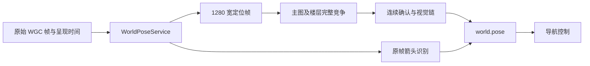

# 小地图定位

本文说明当前定位服务、v3 原生瓦片资源与导航接入。导航规划见 [网格导航](网格导航.md)，资源格式见 [nav-grid-data 数据](nav-grid-data格式.md)。

## 服务与职责

`WorldPoseService` 是 executor 级的位置服务，消费者通过 `world_pose()` 请求位置。视觉定位和实验抓包是独立来源，不混合两者坐标。没有导航消费者时，不启动持续视觉采样。

| 模块 | 当前职责 |
| --- | --- |
| `position_service.py` | 来源生命周期、原帧时间、位置发布及导航采样作用域 |
| `visual_frame.py` | 等比归一化视觉定位输入 |
| `calibrated_map_store.py` / `localization_bundle.py` | 校验并读取 v3 发布资源 |
| `native_tile_image.py` / `tiled_map_image.py` | 按需读取原生瓦片、保留缩放相位、限制驻留像素 |
| `composite_floor_image.py` | 合成当前楼层与压暗主图，并提供楼层覆盖掩码 |
| `layer_search_index.py` | 读取发布的楼层排序图，产生待验证提议 |
| `minimap_map_locator.py` / `template_correlation.py` | 彩色 ZNCC 搜索、峰值竞争及局部跟踪 |
| `layered_minimap_locator.py` / `map_set_locator.py` | 楼层与主图完整竞争、后台资源及搜索协调 |
| `visual_position_source.py` | 连续帧确认、绝对锚、视觉链与可信度判定 |
| `minimap_visual_anchor_chain.py` | 有界视觉约束窗口、连接证据和误差预算 |
| `visual_pose_sampling.py` / `visual_capture_coordination.py` | 导航期间独立采样与前后台截图协调 |
| `localization_workers.py` | 后台资源任务、匹配任务和共享解码内存预算 |
| `composite_overview_cache.py` / `localization_cache.py` | 可重建概览缓存的读写、配额与清理 |



## 坐标与输入

世界水平位置为 `(x, z)`，单位为游戏世界米；朝向采用罗盘角：北 0°、东 90°、南 180°、西 270°。图像原点在左上，整数像素坐标表示像素中心，列向右、行向下。基础图的 `matrix` 将像素映射到世界 X/Z，`inverse_matrix` 执行逆变换。

视觉定位输入等比缩放为 **1280 宽**，使用 `INTER_AREA` 和四舍五入后的高度；小地图几何直接从缩放后尺寸重建，不额外移动圆心。箭头识别保留原始帧，WGC 呈现时间也取自原始帧。原始分辨率变化会重置定位基准，即使两种分辨率归一化后的尺寸相同。

`MinimapPositionRecorder` 的圆环切片、图像尺寸与里程计使用相同的归一化尺度。当前实现不启用连续求峰或 LCN。

## 资源加载

视觉资源目录指向定位包的 `maps/`。运行端只接收 `kind=okef-tiled-localization`、`schema_version=3` 的包，不在启动时转换整图或生成搜索宽度。全局搜索必须使用发布包内精确尺度的概览；缺失所需尺度时返回不可用状态。

资源路径相对定位包根目录。读取器拒绝绝对路径、父目录跳转、Windows 驱动器路径及越出包根的链接。清单绑定资源长度与 SHA-256，图像索引还校验逻辑尺寸、瓦片覆盖、坐标、标定、ROI 和搜索尺度。

基础图保持 BGR，楼层保留 alpha。`full` 瓦片的 alpha 来自完整载荷，包括不透明黑色和半透明区域；`roi` 只用于裁剪载荷，不能用非零 BGR 区域替代楼层覆盖。`zero` 明确表示全透明或全零块。稀疏搜索图恢复逻辑坐标，不改变像素原点。

所有声明主图参与竞争。损坏的主图或待加载的竞争楼层不能被静默排除并据此证明唯一性。后台加载失败保留失败原因并退避重试；取消、重置或关闭后的迟到结果不再发布。

## 搜索与楼层判定

定位器从小地图圆环构建彩色地形模板，遮蔽图标并检查有效纹理和扇区覆盖。粗搜产生候选，精搜复核位置与完整地形；同地图远距离别名、不同楼层及不同主图都保留独立竞争身份。

楼层提议使用当前层纹理和压暗主图信息排序。排序分数只安排验证次序，不是可信定位结果。单侧暗区可以提供提议，但不能跳过原始提议或完整竞争。主图结果和楼层结果仅在同一帧、同一次搜索中复用；跨帧只保留待复核的身份提示。

全局搜索在同一帧完成所有地图和已声明楼层的竞争，排序列表遗漏的楼层也必须验证。首个强候选不能提前结束搜索；竞争未完成时不能保留活动地图提示。已完成的竞争才能为后续新帧提供局部复核提示。

当前层匹配图按 `alpha * 当前层 + (1-alpha) * 0.3 * 主图` 合成。当前层覆盖掩码限制当前位置，压暗主图用于验证周围几何。楼层之外的暗区峰值不能冒充当前层位置。缺少重叠层资源时等待加载完成，不重新执行已完成的同帧精搜。

导航在视觉识别出地图后提供该地图的网格拓扑；目的地图和目标层不作为视觉先验。已确认的拓扑锚可以限制可达楼层，无法证明可达的候选不得发布为替代位置。同层空间歧义和所有仍可达的竞争者继续保留。

彩色定位的评分、完整地形评分、竞争差值和连续帧确认共同决定是否接受。提议、后台结果或资源加载完成都不能绕过接受门槛。后台搜索只提供提示，必须用当前新帧重新确认。

## 跟踪与可信度

强匹配建立绝对锚。短期移动由圆环里程计和视觉约束链连接到该锚，视觉链受窗口、纹理、响应、时间连续性及误差预算约束。弱匹配不能刷新绝对锚有效期。禁用视觉链时仍执行绝对锚失效限制。

`connected_to_anchor` 表示当前约束窗口与保留锚约束的连接证据，不保证真实绝对观测节点仍留在窗口内。窗口淘汰可以保留约束基准，但不能刷新最后绝对观测时刻、预算或独立真值。

加载画面、非良性重锚、地图或分辨率变化、时间回退和真实观测断档会清空相应基准与恢复先验。旧链不能跨场景继续限制全局搜索。恢复搜索也必须通过当前位置、楼层及竞争复核。

导航作用域内，独立采样器在规划、转向和输入等待期间继续取得新观测。前台与后台协调截图所有权；前台可以使用较新的已完成状态，同一 WGC 呈现时间不重复累计确认或位移。缓存姿态保留原时间，不重标为新观测。

导航退出会释放前进输入并关闭采样器。阻塞的原生调用无法强行取消时，资源继续由未退出的线程持有，迟到结果不得发布；下一次作用域不能覆盖仍在退出的采样器。

## 位置契约

`RuntimeStateHub` 的 `world.pose` 提供以下主要字段：

| 字段 | 含义 |
| --- | --- |
| `x` / `z` / `y` | 世界位置；未知高度保持未知 |
| `map_id` / `tier_id` | 视觉识别的地图和楼层；主图为 `__main__` |
| `position_trusted` / `trust_reason` | 是否可消费位置及拒绝原因 |
| `tier_trusted` / `tier_evidence_required` | 楼层证据与导航是否必须等待该证据 |
| `absolute_position_valid` | 当前帧是否具有有效绝对位置 |
| `frame_t` / `frame_time_source` | 原始观测时间及其来源 |
| `visual_duplicate_frame` | 当前调用是否复用同一观测 |
| `heading` / `heading_score` | 原帧箭头朝向及质量 |
| `sync_seq` | 定位重锚/来源世代对应的同步序号 |

消费者同时检查位置可信度、楼层证据和观测新鲜度。坐标存在不代表允许移动，二维同位置也不能替代目标层或高度的到达判定。导航按已知可行走网格规划，未知格不可通行。

## 磁盘缓存

发布瓦片位于 `assets/nav-grid-data/localization/`，是必需资源，不属于清理对象。运行时只持久化可重建的楼层合成概览，目录为 `cache/localization/composite-overviews/`。

- 概览总量上限为 **256 MiB**，最多 **128 个文件**，未使用 **30 天**后删除；成功读取定期刷新使用时间。
- 写入使用同目录唯一临时文件与原子替换，随后执行容量清理；超过单文件预算时不写缓存。
- 启动后台清理过期或超额概览，以及超过一天的残留临时文件，不阻塞首定位。
- 不再使用的 `layer-index/`、`tiled-images/` 内，仅清理符合生成器文件名约定的缓存；不递归删除任意目录。
- 清理跳过符号链接、目录联接及无关文件，不访问缓存根以外的路径。文件被占用、无权限或磁盘不可写时失败软化，下次维护再尝试。
- 缓存读取先校验成员、数组形状、类型和字节上限，再按已验证的长度读取，不允许 pickle，也不按未经验证的数组头分配内存。

缓存被淘汰只导致重建概览，不得删除资源、缩减竞争范围或改变定位门槛。截图、录制和导航验证输出是显式诊断产物，不由定位缓存清理器删除。

## 实验抓包来源

开启实验抓包配置后，`CapturePoseMixin` 使用独立后端坐标。后端程序由安装与启动模块负责获取、校验和启动；配置端口决定本机连接地址。该模式不会同时融合视觉地图坐标，也不依赖 WS 位置 mixin。

抓包坐标属于具体 TCP 会话。连接、场景或地图不匹配时返回不可用，不能把上一次会话的位置当作当前位置。游戏运行期间不通过重启后端补抓握手；需要恢复会话时使用现有登录恢复流程。导航前的会话检查与视觉定位彼此独立。

抓包目录、安装缓存和会话产物由抓包模块自身管理，不属于本节的视觉概览清理范围。日志和分享内容不得包含 token、账户数据或原始敏感配置。

## 配置与验证入口

持久化设置位于 `Position Config` 和 `Nav Config`。位置服务在来源、资源根、地图选择或视觉链设置变化时重建来源；消费者不自行维护另一份定位器。

```powershell
# 校验当前发布包、文件摘要、标定和稀疏载荷
uv run --locked python -X utf8 scripts/nav/verify_localization.py --root assets/nav-grid-data/localization

# 定位及资源回归
uv run --locked python -X utf8 -m unittest tests.TestVisualPositionSource tests.TestLocalizationTileBundle -v

# 检查测试职责分组
uv run --locked python -X utf8 scripts/testing/run_ci_test_group.py --validate

# 完整回归
scripts/testing/run_tests.ps1
```

`validate_visual_grid.py` 与 `validation_task.py` 用正式导航链路记录视觉观测和独立抓包参考，只在显式执行模式下移动。参考坐标只用于健康检查和事后评分，不输入视觉位置、选点或转向。参考空档不计作精度通过，迟到参考会重新配对；输出必须与输入路径分离。`MinimapPositionRecorder` 用于保存归一化定位帧与元数据，诊断录制失败不应改变核心定位判定。
