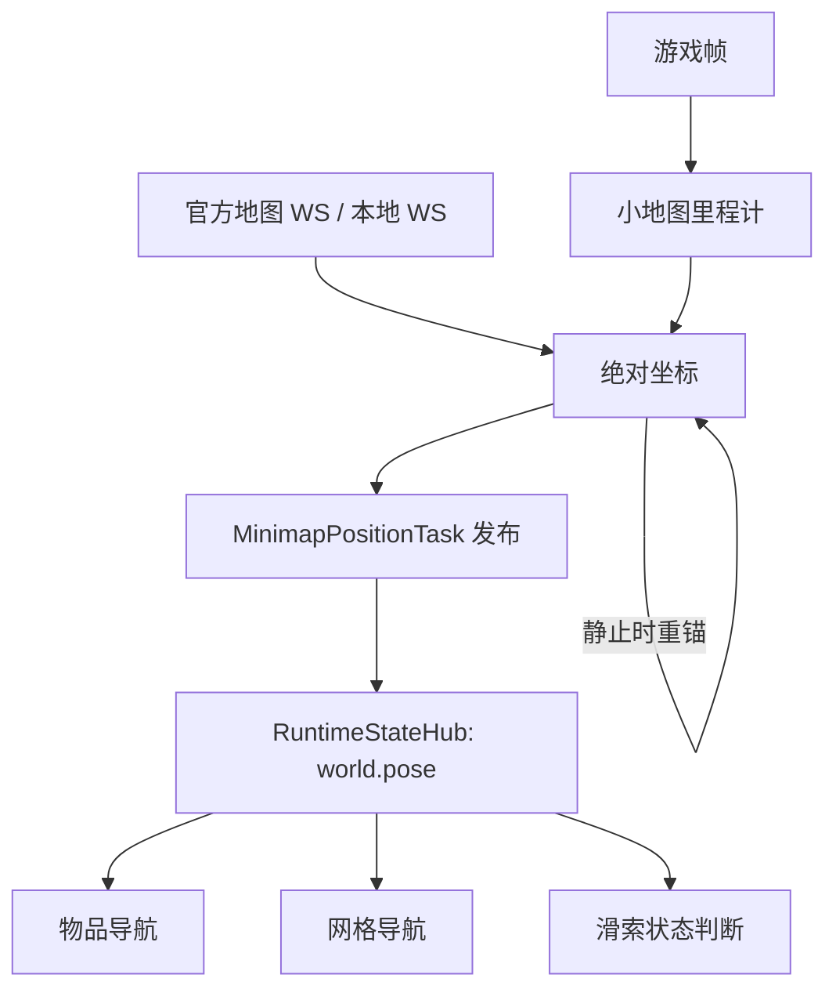

# 小地图定位

返回：[文档索引](../zh-CN/README.md) / [API 参考](API.md) / [开发指南](DEVELOPMENT.md) /
[网格导航](网格导航.md)

本文只说明实时定位链路。路径规划、路线跟随和游戏输入见[网格导航](网格导航.md)。

## 1. 职责边界

定位由唯一的 `MinimapPositionTask` 维护：

- 接收官方地图 WS 或本地 WS 的绝对坐标；
- 从小地图纹理估计高频相对位移；
- 在静止时用 WS 坐标重锚；
- 同时产出水平坐标、高度、朝向、可信状态和诊断字段；
- 通过 `RuntimeStateHub` 发布 `world.pose`。

物品导航、网格导航、滑索和其他任务只读取 `world.pose`，不直接启动 WS、里程计或融合器。

## 2. 模块

| 模块 | 职责 | 不负责 |
|---|---|---|
| `src/tasks/localization/MinimapPositionTask.py` | 常驻定位生产者；维护位置源并发布状态 | 路径规划、游戏输入 |
| `src/localization/minimap_position_mixin.py` | 编排里程计、融合、位置源和可信状态 | A* 与动作执行 |
| `src/localization/minimap_odometry.py` | 从小地图纹理估计相对位移 | WS 校准、绝对坐标 |
| `src/localization/minimap_position_fusion.py` | 用静止 WS 坐标重锚并融合位移 | 网格通行判断 |
| `src/localization/ws_position_mixin.py` | 官方地图 WS、本地 WS 和认证协议 | 路径与业务判断 |
| `src/tasks/mixin/runtime_state_mixin.py` | 向业务任务提供统一坐标读取接口 | 定位算法 |
| `src/runtime_state/` | 保存 latest-value 状态快照与主题契约 | 采样和融合 |

## 3. 数据流



ok-script 执行器是单线程协作调度。长任务运行期间，其他 TriggerTask 不会并行运行，因此
消费者通过 `RuntimeStateMixin.world_pose(frame=...)` 请求定位所有者采样一帧并发布快照。

## 4. 坐标系

### 4.1 世界系

- 水平位置统一为 `(x, z)`，单位为米；
- 朝向使用罗盘方位角：正北 `0°`、正东 `90°`、正南 `180°`、正西 `270°`；
- 世界 `+x` 为东，世界 `+z` 为北。

### 4.2 地图系

- 图像坐标使用 OpenCV 约定：`x` 向右、`y` 向下；
- 小地图纹理移动方向与玩家移动方向相反；
- 相位相关得到内容位移 `(dx, dy)` 后，玩家地图系位移为 `(-dx, -dy)`；
- 轴映射负责把地图系像素转换为世界米：

```text
world_delta = map_to_world_px @ map_delta_px
```

## 5. 位置源

### 5.1 官方地图 WS

全局 `Nav Config` 的「真值content」或「真值地图账号」提供登录凭证。客户端执行：

```text
content -> HG OAuth -> 地图 cred/token -> 角色绑定 -> WebSocket token
        -> wss://ws.skland.com/ws/v1/game/endfield/map
```

位置消息来源于 `type=1012`，解析 `mapId` 和 `pos.x/y/z`。

### 5.2 本地 WS

没有官方真值时，定位任务监听 `ws://127.0.0.1:3001`。油猴脚本拦截官方地图页的
WebSocket，并把原始 JSON 转发给本地端口。该模式也需要保持网页地图和位置同步开启。

### 5.3 抓包直通（实验技术）

另一条路完全绕开上面两条：游戏主 TCP 连接里周期性上报主控角色的世界坐标，
一个**独立的外部程序**被动抓包并离线解密后，通过本地 HTTP 暴露**同一个世界坐标系**的坐标
——与官方地图 WS 逐位一致，并且额外自带真实高度、朝向与速度。

```text
endfield-capture-backend.exe serve --no-dashboard --no-map-ws --port 8765
        ▲                                    │
        └──── GET /api/state（轮询）──────────┘
```

| 模块 | 职责 |
|---|---|
| `src/localization/capture_position_source.py` | 只读后端，翻成定位契约。**不含**任何抓包/解密代码，因此应用侧不需要新增依赖 |
| `src/localization/capture_backend_launcher.py` | 按需拉起后端 exe，并做探活、冷却重试与整棵进程树的收尾 |
| `src/patches/capture_backend_autostart_patch.py` | 在**游戏启动之前**触发上面那个拉起器 |

**顺序是成败关键**：后端必须**早于游戏的主连接**就绪，否则拿不到登录握手，后端会明确报
「缺少连接起点」而不是解出错数据。

拉起的时机不能放在定位任务里——触发任务要等游戏窗口能截屏才会被执行（`can_capture()`），
那时登录握手早就过去了。所以补丁包装了 `StartController.do_start`，那是游戏进程存在之前的
最后时机；`MinimapPositionTask.run()` 里那次调用只作兜底（后端中途挂了、或玩家在游戏已经跑
起来之后才打开开关）。

直通模式下整条校准体系都不参与（坐标本来就是绝对值，没有锚点可设、没有漂移可修），
所以只要坐标可用 `sync_needed` 就恒为假——否则导航的 `CALIBRATE` 状态会停下来等一个永远
不会到来的静止校准。

#### 会话边界：坐标是绑在一条 TCP 连接上的

「绝对」不等于「当前」。坐标由**某一条** TCP 连接解出，而那条连接会随离开游戏、换账号、
重启游戏而结束。后端把最后一条坐标一直留着（它的 `state.last` 没有清空点），于是：

> 旧会话结束之后、新会话报出第一条坐标之前，`/api/state` 给的仍是**上一局**的坐标。

那可能是另一张地图、乃至另一个账号的位置。多账号日常任务正好撞在这条路上：
`BaseEfTask.iter_multi_account_context` 对每个账号先调 `login_flow`，紧接着就跑送货等导航任务。
**切号的实际动作是离开游戏再重新进入**（`login_flow` 走 UI：退出到登录界面 → 选账号 → 进入），
而重新进入会建立新的 TCP 连接，所以每一轮切号都自带一次"旧连接结束 + 新连接就绪"的交替。

这条对实现是有利的：**切号不会复用连接**，因此后端侧那个"同四元组复用会让 flow 永久失效"
的隐患在真实切号路径上不会出现（见下文反面情形）。但它同时说明空窗期是**真实存在且必然发生**
的——游戏退到登录界面、选账号、再进入，这段时间里 `lastPosition` 一直是上一个账号的坐标。

所以直通模式的信任是**两条一起判**，任一不成立就不给导航用（`_capture_trust`）：

| 判据 | `trust_reason` | 说明 |
|---|---|---|
| 产出这条坐标的连接已不再喂数据 | `capture_session_ended` | 连接的 `flows[].status` 是终态（`连接已结束` / `解码停止：…`），或它在 `flows` 里已查不到，或这条连接已 30 秒没收到任何报文（兜住终态没被捕捉到的情形） |
| 认不出地图 | `capture_no_parent_map` / `capture_unknown_map` | 见 5.3 下方「不猜」一节 |

两条都**只扣信任、不清空坐标**：`x`/`z` 照给，让导航停在 `WAIT_TRUST` 时能把真正的原因
打出来，而不是含糊地报「未锚定」。网络侧信息不足时（老版本后端不报 `flows`）一律**当活着的
处理**——缺信息不等于会话已死，没有证据就不扣信任。

换连接时 `sync_seq` **一定**推进（连接的 id 参与判定），所以"登出后在原地重新登录"这种坐标
逐位相同的重登也会让导航失效已走过的已知格。

**三类终态由两条判据分别接住**，缺一不可——后端的 `snapshot` 会把状态**计算覆盖**成
`等待 TCP 补包`（`any(gaps) and not flow.failed` 时顶替真实状态），而收到 FIN 的连接并不是
`failed`，所以**连接结束时若还有没补齐的 TCP 空洞，它的终态就被遮住了**：

- `解码停止：…` 只可能出现在 `failed` 时 → 覆盖不生效 → 状态判据接住（立即）；
- `连接已结束` 被空洞覆盖遮住时 → 此时 `lastPacket` 已停止更新 → 30 秒静默判据接住。

30 秒是个刻意偏松的值：误判为「还活着」只是让陈旧窗口变长，误判为「已死」却会把一条正常
连接的导航停掉；而活着的游戏连接不会这么久完全静默（移动中约 0.27 秒一条，静止时仍有其他
对象的报文）。代价是登出后最长 30 秒的陈旧窗口——但比改动前的「永久信任」已经是严格改善。

后端侧还有几条边界值得记着（核实的是 `endfield-capture-backend` 的 `decoder.py` / `server.py`）：

- **只抓 30000 / 40000 两个端口**。重登若换到别的端口，后端看不见那条连接，"自动接管新连接"
  也就不成立；
- `flows[]` 只回**最近 12 条**，更早的连接查不到——这也是"查不到即判死"的依据；
- **`--seed-pcap` 不是重登录的解法**：它只能把*同一条仍在使用的连接*的密钥流接上（所以
  "上次 `runs/` 里的 `capture.pcap`"可用）。游戏重启换了连接后，重放出来的是另一条已经死掉的
  连接，反而会解出一批陈旧坐标；
- 契约**没有任何版本字段**，也没有 reset / 重连 / 健康检查端点（`/api/state` 200 即探活，
  应用侧 `probe_backend` 用的就是它）；
- 每次轮询都会**全量返回** `trajectory`（最多 1200 点，且跨连接混在一起）。应用侧不消费它，
  但会在 0.2 秒的轮询周期里反复传输与解析——真嫌这个开销，就换成后端的命名管道
  （`serve --pipe --no-http`，事件驱动、不占端口，字段与 `lastPosition` 完全一致），
  应用侧目前还没接。

#### 会话交替是自愈的：离开游戏再进入会新建一条 TCP 连接

**离开游戏再重新进入（含多账号切号）走新 TCP 连接**。所以整条恢复路径是顺的，不需要任何额外处理：

```
离开游戏  → 旧连接收 FIN → 旧 flow 终态 → 应用扣掉信任（WAIT_TRUST），导航停车
重新进入  → 新连接 SYN → 后端按四元组新建 flow → 抓到新握手 → 报出新坐标
          → 新 flow 活着且地图认得出 → 信任恢复，导航接着走
```

关键在于**后端不需要重启**：它按 TCP 四元组归档连接，新连接自然是一条新 flow，
只要后端还在抓包，新一轮握手就会被捕获。这也是"默认不在停止定位时关闭后端"更有力的理由
——后端的客户端材料（DLL 私钥、公钥模数）是进程级的，会话 key/nonce 才是每连接现解的，
所以它可以跨掉线一直用下去。同理，应用侧**不需要**在切号时做任何特殊处理（也不必去拉一次
后端）：`do_start` 若被再次调用，补丁只会探到后端已在跑并直接采用。

中间那段空窗期就是上面那条 `capture_session_ended` 生效的窗口：旧 flow 已经结束、新 flow
还没报出坐标，此时 `lastPosition` 仍是上一局的。窗口长度就是离开游戏到重新进入的耗时。

> 反面情形（后端侧尚未处理的边界，实际不会碰到）：若游戏**复用**同一条四元组发起新会话，
> 后端的 `Reassembler.feed` 只在基线为空时才接受 SYN，新明文握手会被当成加密帧、整条 flow
> 永久失效（重开游戏才能恢复，重启后端也没用）。这种情况由 30 秒静默判据接住。
> **真实的切号与重登都走新连接，所以这条不构成风险**——但如果是用 `kill_game` 那种
> `TerminateProcess` 强杀游戏（危险状态守卫、任务完成后勾选的「仅退出游戏」走的就是它），
> 对端来不及发 FIN，旧 flow 会一直停在「正在解码」、`lastPacket` 也停更，这时**只剩 30 秒
> 静默判据**在兜底，窗口内旧坐标仍会被当成可信。

#### 绝不要在游戏运行期间重启后端

比上面那条更硬的一条约束：**会话密钥由服务端在登录响应里下发，每个账号、每次登录都不同**
（后端用客户端内嵌的 RSA 私钥从登录响应里解出 32 字节 key + 12 字节 nonce）。所以
"重新登录"在协议上就是一次**全新的握手**，密钥只在那一刻出现过一次。

推论：**重启后端不能解决任何解码问题，只会制造问题**——它把一个本来会被自动接管的局面
（新连接新握手）变成必须重开游戏才能恢复（新后端看到的是一条没有 SYN 的连接，只会报
`缺少连接起点`）。同理，「停止定位时关闭后端」打开后如果应用在游戏还开着时退出，下一次
开启应用时后端虽然会被重新拉起，但**当次登录已经救不回来了**，只能重开游戏。

应用侧对这条约束的复查（结论：满足）：

- `stop_capture_backend()` 在生产代码里**只有一个调用点** —— `MinimapPositionTask.on_destroy()`；
- `on_destroy()` 只由 ok 框架的 `TaskExecutor.destroy()` 触发，而它来自**执行器循环结束或
  `MainWindow.closeEvent`**，即**应用退出**，不会因为任务禁用/重新加载/切号而触发；
- 真正杀进程还要 `实验技术停止定位时关闭后端` 为真，**默认为假**——所以默认连应用退出都不会
  动后端（这也正是它默认为假的原因）；
- 反之，`ensure_capture_backend()` 每拍都会走一遍，但它**只会拉起、从不重启**已在跑的后端
  （`BackendLauncher.running` 挡住重复启动，健康期 5 秒内连探活都省掉）。

唯一残留的坑是**人为**的：若用户打开了「停止定位时关闭后端」，又在游戏还开着时退出应用，
就必须重开游戏才能恢复定位。这条已写在那个配置项的说明里。

`map_id` 参与导航的换图判定，而导航侧算的是
`str(pose.get("map_id") or session.request.map_id or "")`——**会静默回退到调用方请求的地图**。
所以「认不出地图」必须在定位源里就扣掉信任，不能只靠导航自己判断：实测场景 463 是**自带独立
坐标空间的可走区域**（那 11 秒里角色以 5.0 的速度正常行走，坐标在 `(16, 107, -41)` 附近，
而 map02 的 y≈320、相距约 1400 个世界单位），拿它当 map02 会在错的网格上、从错的起点规划
路线。这条与 `_resolve_map_id` 的「不猜」是同一条原则，只是贯彻到了 pose 的信任位上。

上报是**事件驱动**的：移动中约每 0.27 秒一条，**完全静止时没有位置包**，同图传送会有数秒到
数十秒的空档。`CaptureSample.age_seconds`（后端 Unix 墙钟减去当前墙钟）因此**只显示不拦截**
——静止时年龄大是正常的。它不进信任判定，它的用处是出现「坐标跳变」或「导航拿着旧位置走」时
一眼看出数据源当时到底有没有在更新。后端跑在本机、需要 Npcap 驱动与客户端文件，属于用户自行
选择开启的功能（开关带风险确认，见 `src/patches/danger_switch_patch.py`）。

## 6. 融合策略

WS 坐标绝对但有延迟，小地图里程计高频但会漂移。融合规则是：

```text
静止时：P0 = WS(x, z)，并清零里程计
移动时：P = P0 + map_to_world @ odometry_delta
再次静止：用新的 WS 坐标重新校准
```

静止判定要求：

- 小地图里程计低速；
- 已经收到至少两次 WS 样本时，WS 相邻样本的位移也必须足够小。

移动途中收到的 WS 样本不会暂存，也不会在以后补用，否则会把已推进的位置拉回。

### 6.1 关键帧视觉锚定链校正（导航位置修正）

静止重锚只能把漂移限制在两个静止点之间；移动距离越长，累计错位越大。实时链路额外维护
一个关键帧视觉锚定链校正器，只输出位置，不落盘、不截图、不绘图：

- 每拍把当前小地图圆环加入局部滑动窗口；
- 新切片和最近若干拍建立相位相关相对平移边；
- 静止校准的 WS 坐标作为高权重绝对锚点，并向后续关键帧传播；
- 关键帧之间继续建立视觉重叠边，使 WS 绝对基准沿 `A -> B -> C -> ...` 传递；
- 用 Huber IRLS + PCG 求解局部窗口和关键帧锚定链，把最新位置发布为 `world.pose.x/z`。

原始融合坐标保留在 `raw_x/raw_z`，关键帧视觉锚定链校正量、边数、锚点数、残差和原因记录在
`visual_anchor_chain_*` 字段。校正失败或超过安全上限时回退原始融合值。

离线的 `MinimapPositionRecorder` 和 `stitch_records()` 只用于事后诊断与参考图，
不进入导航实时链路。

## 7. 配置

定位的标定与真值参数集中在全局 `Nav Config`：

- `真值content` / `真值地图账号`：绝对坐标来源；
- `比例尺常数(米)`：非标准档位的兜底比例尺；
- `1K/2K/4K比例尺(米/像素)`：对应 `1920/2560/3840` 宽；
- `1K/2K/4K轴映射(逗号4值)`：地图系像素到世界米的矩阵；

运行时参数保存在「小地图定位」任务配置：

- `WS等待稳定秒数` / `WS稳定最小位置数`；
- `航点校准最小距离(米)`；
- `位移提交阈值(像素)`。
- `关键帧视觉锚定链校正`：是否启用实时位置修正；
- `关键帧视觉锚定链校正窗口(拍)` / `关键帧视觉锚定链校正边间隔(拍)` /
  `关键帧视觉锚定链校正最小响应`；
- `关键帧视觉锚定链校正锚点权重` / `关键帧视觉锚定链校正修正上限(米)`；
- `关键帧视觉锚定链校正关键帧间隔(拍)` / `关键帧视觉锚定链校正关键帧边数` /
  `关键帧视觉锚定链校正关键帧最小响应` / `关键帧视觉锚定链校正关键帧锚点权重`。

实验技术（抓包直通，见 5.3）另有一组，默认关闭；打开风险开关后才出现：

- `使用实验技术`：总开关，带风险确认；
- `实验技术后端端口`：默认 `8765`，探活与拉起都用它；
- `实验技术后端程序路径`：留空则自动探测（同级 `endfield-capture-backend/dist/`、
  环境变量 `EF_CAPTURE_BACKEND`、`PATH` 等）；
- `实验技术自动启动后端`：默认开；
- `实验技术停止定位时关闭后端`：**默认关**。后端状态绑在当前这一局连接上，关掉再拉起等于
  丢了登录握手，必须重启游戏才能恢复。

分辨率、比例尺或轴映射变化时，定位器会重建。真值来源变化时，绝对锚点会清空并等待重新校准。

## 8. `world.pose` 契约

主要字段：

| 字段 | 含义 |
|---|---|
| `x` / `y` / `z` | 世界坐标；`y` 为最新 WS 高度 |
| `heading` / `heading_score` | 罗盘方位角和置信度 |
| `map_id` | 当前地图 |
| `position_trusted` / `trust_reason` | 绝对坐标是否可信 |
| `anchor_set` / `rest` | 是否已锚定、当前是否静止 |
| `odom_ok` / `odom_reason` | 是否有有效位移样本 |
| `sync_seq` / `sync_checked` / `sync_needed` | 静止校准状态 |
| `sync_supported` | 这个数据源上「静止校准」这个概念是否成立。默认 `True`；抓包直通这类绝对坐标源给 `False`，导航据此不断言要等校准。**刻意做成契约字段**，好让导航依赖 pose 的接口而不是某个定位实现的名字（见 §5.3） |
| `sync_residual` | 校准前原始融合误差，以及上一拍关键帧视觉锚定链校正输出误差 |
| `ws` / `ws_xyz` | 最新 WS 水平坐标和完整坐标 |
| `sample_t` / `source` | 采样时间和数据源 |
| `raw_x` / `raw_z` | 关键帧视觉锚定链校正前的原始融合坐标 |
| `visual_anchor_chain_x` / `visual_anchor_chain_z` | 校正后的坐标（仅有效时） |
| `visual_anchor_chain_correction_px` / `visual_anchor_chain_correction_m` | 本拍校正量 |
| `visual_anchor_chain_nodes` / `visual_anchor_chain_edges` / `visual_anchor_chain_anchors` | 局部窗口节点、边和 WS 锚点数 |
| `visual_anchor_chain_min_response` / `visual_anchor_chain_median_response` | 新边的相关响应（最小值 / 中位数） |
| `visual_anchor_chain_residual_median` / `visual_anchor_chain_residual_max` | 校正后的边残差 |
| `visual_anchor_chain_reason` | 局部校正结果（`ok` / `no_edges` / `correction_too_large` 等） |
| `visual_anchor_chain_keyframe_reason` | 关键帧视觉锚定链校正的关键帧更新结果 |

消费者必须检查 `position_trusted`。快照超过 `max_age` 后返回 `None`，不能继续拿旧坐标执行动作。

## 9. 调试与测试

定位相关调试任务位于 `src/tasks/localization/`：

- `MinimapRealtimePosition`：逐拍查看融合坐标、朝向、速度、WS 和里程计位移；
- `MinimapPositionRecorder`：逐拍落盘融合状态、原始里程计位移、校准残差和小地图切片，
  结束后生成 `fused` / `odom` 两种像素对齐拼接图；
- `MinimapRegionCheck`：检查当前分辨率下的小地图环带区域；
- `MinimapScaleCapture`：采集静止截图与 WS 坐标，用于比例尺标定；
- `MinimapTurnToHeading`：验证朝向读取和转向闭环。

采样记录的产物在 `logs/minimap_position_recorder/<时间戳>/`：`samples.jsonl` 是逐拍
数据，`calibrations.jsonl` 是每次静止校准的残差，`patches/` 是 BGRA 圆环切片，
`stitch_*_fused*.png` / `stitch_*_odom*.png` 分别是按融合坐标和连续里程计轨迹拼接的
参考图。需要换拼接参数时用：

```powershell
uv run --locked python scripts/data-capture/stitch_minimap_recorder.py `
  logs/minimap_position_recorder/<时间戳>
```

常用测试：

```powershell
uv run --locked python -m unittest tests.TestMinimapOdometry tests.TestMinimapPositionFusion tests.TestMinimapPositionMixin -v
uv run --locked python -m unittest tests.TestRuntimeStateHub tests.TestRuntimeStateMixin -v
uv run --locked python -m unittest tests.TestCapturePositionSource tests.TestCaptureBackendLauncher -v
```

定位异常排查顺序：

1. `world.pose` 是否存在且未过期；
2. `anchor_set` 和 `position_trusted` 是否为真；
3. `odom_reason` 是否长期不是 `ok` 或 `shift_too_small`；
4. 静止校准后的 `error` 是否接近零；
5. 比例尺、轴映射和 `map_id` 是否匹配当前分辨率与地图。

开了实验技术时改看这几条：

1. `trust_reason` 是不是 `capture_unavailable`——是就说明后端没数据，先看后端本身；
2. 后端日志 `logs/capture_backend/backend-<端口>.log`：缺 Npcap 驱动、客户端目录不对、
   「缺少连接起点」（抓包晚于登录握手，需重开游戏或用后端的 `--seed-pcap`）都会写在那里；
3. `capture_age` 是不是一直很大——上报是事件驱动的，静止时没有新包属正常，**不拦截**；
4. `trust_reason` 是 `capture_session_ended`——坐标还在，但它来自已经结束的一条连接
   （离开游戏、换账号、重启游戏）。等新连接报出第一条坐标即可自愈；一直不变就说明新连接没解出来，
   回去看第 2 条；
5. `capture_flow` 是不是变了——切号会换一格，这是判断「换了一局」最直接的现场信息；
6. `capture_map_id_source` 是 `no_parent_map` 或 `capture_unknown_map`——该场景没有可用的导航
   网格，导航会明确停车（前者是**正确结果**：试炼场这类场景本就不属于任何大地图，不是故障）。

日志里那句「还没有解出角色坐标」会**自动分成两种**，因为它们的处理方式正好相反：

- 一般情形 → 提示确认后端早于本局连接启动；
- `flows[]` 里有一条停在「缺少连接起点」→ 直接提示**重开游戏**，并说明**重启后端没有用**
  （它看到的仍是一条没有 SYN 的连接）。这条的典型成因就是后端被重启过——而后端**绝不该在
  游戏运行期间被重启**，见上文。
