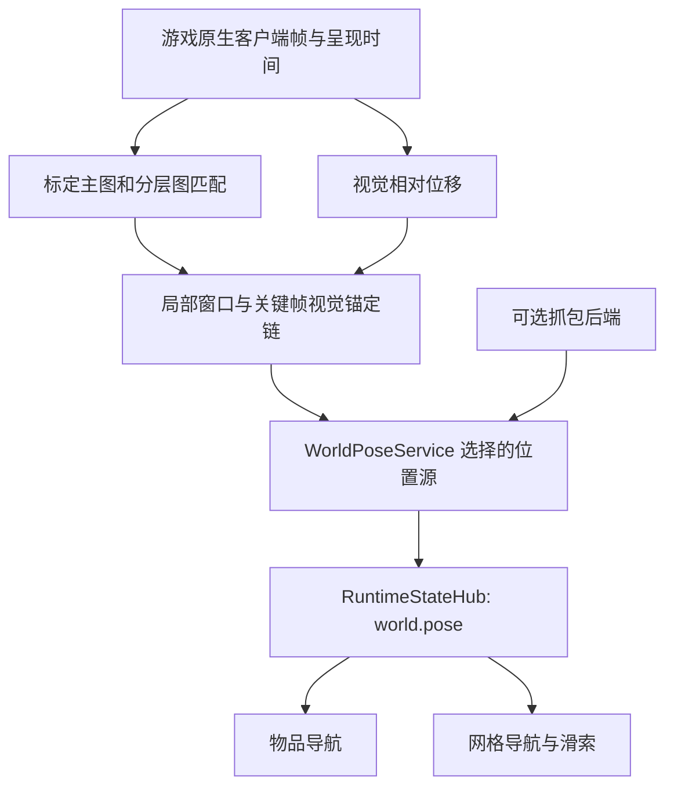

# 小地图定位

返回：[文档索引](../zh-CN/README.md) / [API 参考](API.md) / [开发指南](DEVELOPMENT.md) /
[网格导航](网格导航.md)

本文只说明实时定位链路。路径规划、路线跟随和游戏输入见[网格导航](网格导航.md)。

## 1. 职责边界

`WorldPoseService` 在首次读取时懒创建，由执行器共享，支持两个独立位置源：

- 视觉源：标定地图匹配提供绝对 X/Z，里程计、局部窗口和关键帧视觉锚定链约束相对位移；
- 抓包源：可选后端直接提供角色 X/Y/Z、地图、速度和朝向。

生产定位不再启动或读取官方地图 WS、本地 WS，也不以抓包坐标引导视觉搜索。
物品导航、网格导航和滑索通过 `RuntimeStateMixin.world_pose()` 读取 `world.pose`，
检查可信状态后再执行动作。视觉源不能测量真实高度，`y=None`，界面显示“高度未知”。

## 2. 模块

| 模块 | 职责 |
|---|---|
| `position_service.py` | 选择独立位置源、处理帧时间、发布统一契约 |
| `calibrated_map_store.py` / `map_set_locator.py` | 加载资源、在已安装地图中自动选择地图 |
| `minimap_map_locator.py` | ROI 掩膜缓存、图标排除、绝对匹配、自适应局部搜索和连续帧确认 |
| `layered_minimap_locator.py` | 将主图与分层图变换到相同世界坐标并竞争楼层证据 |
| `visual_position_source.py` | 将标定地图锚点与视觉位移链组合成独立视觉源 |
| `capture_pose_mixin.py` | 抓包后端的生命周期、会话和坐标可信状态 |
| `wgc_frame_timing.py` | 将 WGC SystemRelativeTime 与具体 NumPy 帧关联 |
| `runtime_state/world_pose.py` | 对外世界坐标契约 |
| `data/official_map_client.py` | 可选设施资源的 HTTP 认证与查询；与定位无关 |

`minimap_position_mixin.py`、`ws_position_mixin.py` 和旧融合器保留供历史工具/测试使用，
不在生产 `WorldPoseService` 的继承链中。物品导航也不再挂载旧版 WS 导航实现。

## 3. 数据流



消费者按需请求采样；没有消费者时不会在后台固定频率截图。切换来源、地图或资源目录，
修改视觉链配置、分辨率变化和帧时间回退都会清空旧基准。切换源不融合两个源的坐标。

## 4. 坐标系

### 4.1 世界系

- 水平位置统一为 `(x, z)`，单位为米；
- 朝向使用罗盘方位角：正北 `0°`、正东 `90°`、正南 `180°`、正西 `270°`；
- 世界 `+x` 为东，世界 `+z` 为北。

### 4.2 地图系

- 图像坐标使用 OpenCV 约定：`x` 向右、`y` 向下；
- 小地图纹理移动方向与玩家移动方向相反；
- 相位相关得到内容位移 `(dx, dy)` 后，玩家地图系位移为 `(-dx, -dy)`；
- 轴映射负责把地图系像素转换为世界米：

```text
world_delta = map_to_world_px @ map_delta_px
```

## 5. 位置源

### 5.1 标定地图与视觉链

全局 `Position Config` 的 `视觉地图资源目录` 默认为 `assets/nav-grid-data/localization/maps`。
安装资源时保留以下布局，也可显式指向另一个项目导出的资源根目录：

```text
<root>/maps/map02/4/map02_4.webp
<root>/maps/map02/4/map02_4_mapping.json
<root>/layers/catalog.json
<root>/layers/map02/.../<layer>.webp
```

配置填写 `<root>/maps`。生产代码没有对开发机或相邻仓库路径的隐式依赖，也不会下载资源。
标准资源包位于 `nav-grid-data` 子模块的 `localization/` 目录。源码安装需初始化子模块并
拉取 LFS 内容：`git submodule update --init -- assets/nav-grid-data`，然后执行
`git -C assets/nav-grid-data lfs pull`。发布同步流程会展开整个子模块，并通过 `deploy.txt`
中的 `assets` 条目包含地图与分层资源；不依赖标注资源仓库自动更新。
已有自定义目录或仍存在的旧资源目录保持原值；失效的旧默认目录 `assets/localization/maps`
会在配置加载前备份并迁移至新的打包资源目录。
图片路径由清单指定，兼容旧 PNG；图片尺寸必须与 mapping 的 `image_size` 一致。地图 ID 留空时自动比较已安装标定图；
`Nav Config` 指定地图 ID 可缩小首次搜索范围。自动搜索先比较主图，只展开候选主图的分层。
主图证据不足时，每拍轮流探测一个分层；强候选随后进入附近所有重叠分层的竞争。
当前搜索范围内的重叠分层会保留在缓存中，移出范围后再按内存目标淘汰，避免初始化循环淘汰。
首轮加载和解码大型资源会较慢，超过两秒的结果不会对外发布为可信坐标。

首次定位和丢失后重新定位要求至少两帧时间相邻且空间一致的观察。彩色匹配要求完整蒙版
ZNCC ≥0.45、候选差距 ≥0.10，不作残差裁剪；保留的灰度算法要求 robust NCC ≥0.85、
未裁剪 NCC ≥0.65、候选差距 ≥0.08。这是不同评分空间的门槛，不能直接比较数值。
灰度差距允许由完整环带或鲁棒证据给出，但所用证据必须
与所有其他候选都拉开差距，不能从不同候选各取一个有利分数。图标排除掩膜由当前画面独立生成，至少保留 55% 环带和
每象限 35% 环带。图标与环带有任一重叠像素即生成排除掩膜，不设覆盖率激活阈值。
白色设施图标以亮白或彩色核心为种子，扩展到相连的浅色抗锯齿边缘，再按小地图尺寸排除
黑色描边。彩色路径再剔除纯白及周围 2 px，若剩余覆盖率或分布纹理不足则拒绝；
灰度路径保留原有掩膜回退。策略只由当前画面决定，
不按候选匹配分数挑选掩膜，也不降低 NCC、候选差距或连续帧确认门槛。
灰度鲁棒评分相对未裁剪分数最多提高 0.20，限制相似地形的虚高候选。加载画面、纹理不足、遮挡过多、过期帧或资源错误均拒绝发布坐标。
通过严格证据门槛、仅等待连续帧确认时，视觉源标记 `visual_confirmation_pending`。
网格导航在 WGC 呈现时间有效时立即请求下一帧，省去固定控制周期等待；同一呈现时间的
重复帧保留已有证据但不增加确认次数，并短暂等待最多 1/60 秒，防止空转。
资源未齐、弱候选、无真实时间戳及抓包来源仍按原控制周期等待；确认帧数、最长帧间隔、
搜索范围和识别门槛不会因等待确认而放宽。
局部搜索窗口按标定仿射矩阵换算世界米半径，并在世界坐标下过滤候选，避免非 4 px/m
或非等向标定缩小搜索范围。里程计未采样时不重复加入缓存环带帧；新的绝对锚点仍可发布。
存在有效视觉链时固定在同地图周围 80 米内恢复匹配，未知楼层不触发跨地图扫描。
没有有效视觉链时，跟踪器保留随帧间隔和最大运动速度扩大局部范围、失败后全图搜索的流程。

### 5.2 分层资源与楼层证据

与 `nav-grid-editor` 协作确认的 `layers/catalog.json` 当前使用 schema 1。
只将 `map_category=layered` 的图层与对应 `map_name` 主图共同定位；独立场景不能仅凭归档目录
推断共享坐标系，必须有自己的标定后再接入。图层边界按以下公式转换：

```text
X = west + u * (east - west) / width
Z = north - v * (north - south) / height
```

图层会重采样到 4 px/m，变换包含 OpenCV 像素中心偏移。主层契约 ID 为 `__main__`。
视觉目录 `localization/layers/catalog.json` 与导航层声明索引是不同入口。导航从网格目录
优先读取 `catalog.json`，不存在时读取数据仓的 `levels.json`；层 ID 须与网格元数据的
`tier` 一致。目录声明不代表该层已有可走网格，缺少网格时仍须保留 `no_grid` 语义。
X/Z 相同但楼层不同的候选不能合并成一个楼层证据。楼层差距不足、相关资源缺失或目录声明
缺失楼层时，仍可接受有充分证据的水平位置，但必须发布 `tier_id=None`、`tier_trusted=False`。
视觉源声明 `tier_evidence_required=True`；网格导航在楼层未确认或没有对应网格时拒绝猜主层。
抓包源有真实 Y，可继续使用现有高度范围和拓扑规则。不能把视觉未知高度补成零。

### 5.3 抓包直通（实验技术）

另一条路完全绕开上面两条：游戏主 TCP 连接里周期性上报主控角色的世界坐标，
一个**独立的外部程序**被动抓包并离线解密后，通过本地 HTTP 暴露**同一个世界坐标系**的坐标
——与官方地图 WS 逐位一致，并且额外自带真实高度、朝向与速度。

```text
endfield-capture-backend.exe serve --no-dashboard --no-map-ws --port 8765
        ▲                                    │
        └──── GET /api/state（轮询）──────────┘
```

| 模块 | 职责 |
|---|---|
| `src/localization/capture_position_source.py` | 只读后端，翻成定位契约。**不含**任何抓包/解密代码，因此应用侧不需要新增依赖 |
| `src/localization/capture_backend_installer.py` | 从 GitHub Release **下载** exe 并检查更新；校验 sha256、原子落盘、失败不阻断 |
| `src/localization/capture_backend_launcher.py` | 按需拉起后端 exe，并做探活、冷却重试与整棵进程树的收尾 |
| `src/patches/capture_backend_autostart_patch.py` | 在**游戏启动之前**触发上面那个拉起器 |

#### 后端程序的获取与更新

exe 不再需要用户手工放置：打开「使用实验技术」后由本应用从
`luqing233/endfield-capture-backend` 的 Release 下载，并在有新版时**静默更新**。

| 时机 | 做什么 |
|---|---|
| 勾上风险开关（确认后） | **后台**预下载，不阻塞界面。那时用户还没启动游戏，正好用这段时间 |
| 点「启动游戏」前 | **阻塞**补齐（缺了就下载/更新）。宁可启动多等十几秒，也不能让游戏先连上 |
| 点「检查并更新后端」 | 手动触发一次，忽略节流 |

安装位置是 `<应用目录>/downloads/capture_backend/`。**不能放 `configs/`**：那里的东西会被配置
导出整个打包，而导入侧对单个成员硬性限制 16 MB（`config_transfer_patch._MAX_IMPORT_MEMBER_BYTES`），
18 MB 的 exe 一旦进去，导出的配置包就再也导不回来。`downloads/` 已被 `.gitignore` 覆盖。

取版本有两条路，主用 GitHub REST API（额外给出官方 sha256 摘要，可校验完整性）；实测**未认证**
访问会按 IP 限流（撞到过 403），所以拿不到就退回不加 API 的 `/releases/latest` 302 重定向拿 tag
——这条路不消耗配额，代价是没有官方摘要，只校验文件大小并告警一次。

下载**下到哪儿都不会阻断游戏**：拿不到新版就用手上这个旧的，一个都没有就报「后端不可用」。
下载先落到 `.download` 暂存文件，校验通过才 `os.replace` 成正式 exe——不存在"半截 exe 被拉起"
的窗口。

指定了「实验技术后端程序路径」或环境变量 `EF_CAPTURE_BACKEND` 时**完全跳过联网**：用户自带后端
就不该再去下载。同理「自动启动后端」关掉时也不下载。

#### 运行产物的保留策略

后端每局建一个 `runs/<YYYYMMDD-HHMMSS>/`，里面是 `capture.pcap` + `positions.jsonl`
（+ `service.json`），**一局约 20 MB**，不设上限能攒到几个 GB。

我们拉起**自己下载的那份**时显式传 `--runs-dir` 指到 `<托管目录>/runs`，并在每次拉起**探活成功
之后**按「只留最近 5 局」清理一次。顺序很关键：后端是先建目录、再起 HTTP 服务的，所以端口应答
时新目录必然已存在——放在 `_launch` 之后立刻清会早于它建目录，稳态会留成 6 份而不是 5 份。

清理**只动名字像时间戳的目录**（`^\d{8}-\d{6}$`）。认不出的一律不碰：这个函数会删东西，宁可漏删
也不能误删用户放在那儿的东西。时间戳定宽，所以字典序就是时间序。

用户**自带**的后端不加 `--runs-dir`——那会把它自己的产物挪到我们的目录里，属越界。

**顺序是成败关键**：后端必须**早于游戏的主连接**就绪，否则拿不到登录握手，后端会明确报
「缺少连接起点」而不是解出错数据。

拉起的时机不能放在普通任务里——任务要等游戏窗口能截屏才会被执行（`can_capture()`），
那时登录握手早就过去了。所以补丁包装了 `StartController.do_start`，那是游戏进程存在之前的
最后时机；`WorldPoseService` 的按需采样会再兜底一次（后端中途挂了、或玩家在游戏已经跑起来
之后才打开开关）。

直通模式下整条校准体系都不参与（坐标本来就是绝对值，没有锚点可设、没有漂移可修），
所以只要坐标可用 `sync_needed` 就恒为假——否则导航的 `CALIBRATE` 状态会停下来等一个永远
不会到来的静止校准。

#### 会话边界：坐标是绑在一条 TCP 连接上的

「绝对」不等于「当前」。坐标由**某一条** TCP 连接解出，而那条连接会随离开游戏、换账号、
重启游戏而结束。后端把最后一条坐标一直留着（它的 `state.last` 没有清空点），于是：

> 旧会话结束之后、新会话报出第一条坐标之前，`/api/state` 给的仍是**上一局**的坐标。

那可能是另一张地图、乃至另一个账号的位置。多账号日常任务正好撞在这条路上：
`BaseEfTask.iter_multi_account_context` 对每个账号先调 `login_flow`，紧接着就跑送货等导航任务。
**切号的实际动作是离开游戏再重新进入**（`login_flow` 走 UI：退出到登录界面 → 选账号 → 进入），
而重新进入会建立新的 TCP 连接，所以每一轮切号都自带一次"旧连接结束 + 新连接就绪"的交替。

这条对实现是有利的：**切号不会复用连接**，因此后端侧那个"同四元组复用会让 flow 永久失效"
的隐患在真实切号路径上不会出现（见下文反面情形）。但它同时说明空窗期是**真实存在且必然发生**
的——游戏退到登录界面、选账号、再进入，这段时间里 `lastPosition` 一直是上一个账号的坐标。

所以直通模式的信任是**两条一起判**，任一不成立就不给导航用（`_capture_trust`）：

| 判据 | `trust_reason` | 说明 |
|---|---|---|
| 产出这条坐标的连接已不再喂数据 | `capture_session_ended` | 连接的 `flows[].status` 是终态（`连接已结束` / `解码停止：…`），或它在 `flows` 里已查不到，或这条连接已 30 秒没收到任何报文（兜住终态没被捕捉到的情形） |
| 认不出地图 | `capture_no_parent_map` / `capture_unknown_map` | 见 5.3 下方「不猜」一节 |

两条都**只扣信任、不清空坐标**：`x`/`z` 照给，让导航停在 `WAIT_TRUST` 时能把真正的原因
打出来，而不是含糊地报「未锚定」。网络侧信息不足时（老版本后端不报 `flows`）一律**当活着的
处理**——缺信息不等于会话已死，没有证据就不扣信任。

导航等待态的文案会带上 pose 里的 `trust_reason` / `odom_reason`（形如
`等待坐标: capture_unavailable`），所以一眼能分清是「融合链还没锚定」还是「抓包源没数据」——
这两种情况该查的东西完全不同。

**抓包模式不启动小地图定位链**：`start_minimap_position()` 在本模式下直接返回，
`minimap_position_ready` 也恒为真。两处短路缺一不可——导航入口
（`navigate_grid_to` → `ensure_runtime_position_service`）会**无条件**调前者、紧接着检查后者，
而抓包根本不需要比例尺/里程计/融合/地图 WS。不短路的话有两重代价：拿不到比例尺时导航会
**立刻失败**并报一条指向全局「导航配置」和游戏窗口的错（该查的其实是抓包后端）；拿得到时也会
白建两个对象并启动地图 WS——正是本模式声明要绕开的那一整套。

`sync_seq` 在抓包源上的含义是"**坐标基准变了**"，不是"坐标变了"：换连接时它**一定**推进
（连接的 id 参与判定），所以"登出后在原地重新登录"这种坐标逐位相同的重登也会让导航失效
已走过的已知格；而**同一连接内怎么移动都不推进**。后者是必须的——导航把 `sync_seq` 变化当
"真重锚 → 世界坐标整体平移"，抓包源移动时每拍坐标都在变，若按"采样变了"推进，移动本身就会
每拍清空导航的"走过的已知格"，偏航回退（网格导航文档 §7.5）会退化成"没有已知格可返回"。

**三类终态由两条判据分别接住**，缺一不可——后端的 `snapshot` 会把状态**计算覆盖**成
`等待 TCP 补包`（`any(gaps) and not flow.failed` 时顶替真实状态），而收到 FIN 的连接并不是
`failed`，所以**连接结束时若还有没补齐的 TCP 空洞，它的终态就被遮住了**：

- `解码停止：…` 只可能出现在 `failed` 时 → 覆盖不生效 → 状态判据接住（立即）；
- `连接已结束` 被空洞覆盖遮住时 → 此时 `lastPacket` 已停止更新 → 30 秒静默判据接住。

30 秒是个刻意偏松的值：误判为「还活着」只是让陈旧窗口变长，误判为「已死」却会把一条正常
连接的导航停掉；而活着的游戏连接不会这么久完全静默（移动中约 0.27 秒一条，静止时仍有其他
对象的报文）。代价是登出后最长 30 秒的陈旧窗口——但比改动前的「永久信任」已经是严格改善。

后端侧还有几条边界值得记着（核实的是 `endfield-capture-backend` 的 `decoder.py` / `server.py`）：

- **只抓 30000 / 40000 两个端口**。重登若换到别的端口，后端看不见那条连接，"自动接管新连接"
  也就不成立；
- `flows[]` 只回**最近 12 条**，更早的连接查不到——这也是"查不到即判死"的依据；
- **`--seed-pcap` 不是重登录的解法**：它只能把*同一条仍在使用的连接*的密钥流接上（所以
  "上次 `runs/` 里的 `capture.pcap`"可用）。游戏重启换了连接后，重放出来的是另一条已经死掉的
  连接，反而会解出一批陈旧坐标；
- 契约**没有任何版本字段**，也没有 reset / 重连 / 健康检查端点（`/api/state` 200 即探活，
  应用侧 `probe_backend` 用的就是它）；
- 每次轮询都会**全量返回** `trajectory`（最多 1200 点，且跨连接混在一起）。应用侧不消费它，
  但会在 0.2 秒的轮询周期里反复传输与解析——真嫌这个开销，就换成后端的命名管道
  （`serve --pipe --no-http`，事件驱动、不占端口，字段与 `lastPosition` 完全一致），
  应用侧目前还没接。

#### 会话交替是自愈的：离开游戏再进入会新建一条 TCP 连接

**离开游戏再重新进入（含多账号切号）走新 TCP 连接**。所以整条恢复路径是顺的，不需要任何额外处理：

```
离开游戏  → 旧连接收 FIN → 旧 flow 终态 → 应用扣掉信任（WAIT_TRUST），导航停车
重新进入  → 新连接 SYN → 后端按四元组新建 flow → 抓到新握手 → 报出新坐标
          → 新 flow 活着且地图认得出 → 信任恢复，导航接着走
```

关键在于**后端不需要重启**：它按 TCP 四元组归档连接，新连接自然是一条新 flow，
只要后端还在抓包，新一轮握手就会被捕获。这也是"默认不在停止定位时关闭后端"更有力的理由
——后端的客户端材料（DLL 私钥、公钥模数）是进程级的，会话 key/nonce 才是每连接现解的，
所以它可以跨掉线一直用下去。同理，应用侧**不需要**在切号时做任何特殊处理（也不必去拉一次
后端）：`do_start` 若被再次调用，补丁只会探到后端已在跑并直接采用。

中间那段空窗期就是上面那条 `capture_session_ended` 生效的窗口：旧 flow 已经结束、新 flow
还没报出坐标，此时 `lastPosition` 仍是上一局的。窗口长度就是离开游戏到重新进入的耗时。

> 反面情形（后端侧尚未处理的边界，实际不会碰到）：若游戏**复用**同一条四元组发起新会话，
> 后端的 `Reassembler.feed` 只在基线为空时才接受 SYN，新明文握手会被当成加密帧、整条 flow
> 永久失效（重开游戏才能恢复，重启后端也没用）。这种情况由 30 秒静默判据接住。
> **真实的切号与重登都走新连接，所以这条不构成风险**——但如果是用 `kill_game` 那种
> `TerminateProcess` 强杀游戏（危险状态守卫、任务完成后勾选的「仅退出游戏」走的就是它），
> 对端来不及发 FIN，旧 flow 会一直停在「正在解码」、`lastPacket` 也停更，这时**只剩 30 秒
> 静默判据**在兜底，窗口内旧坐标仍会被当成可信。

#### 绝不要在游戏运行期间重启后端

比上面那条更硬的一条约束：**会话密钥由服务端在登录响应里下发，每个账号、每次登录都不同**
（后端用客户端内嵌的 RSA 私钥从登录响应里解出 32 字节 key + 12 字节 nonce）。所以
"重新登录"在协议上就是一次**全新的握手**，密钥只在那一刻出现过一次。

推论：**重启后端不能解决任何解码问题，只会制造问题**——它把一个本来会被自动接管的局面
（新连接新握手）变成必须重开游戏才能恢复（新后端看到的是一条没有 SYN 的连接，只会报
`缺少连接起点`）。同理，「停止定位时关闭后端」打开后如果应用在游戏还开着时退出，下一次
开启应用时后端虽然会被重新拉起，但**当次登录已经救不回来了**，只能重开游戏。

应用侧对这条约束的复查（结论：满足）：

- `stop_capture_backend()` 的生产调用点是 `WorldPoseService.on_destroy()`；
- 服务销毁由包装后的 `TaskExecutor.destroy()` 触发，而它来自**执行器循环结束或
  `MainWindow.closeEvent`**，即**应用退出**，不会因为任务禁用/重新加载/切号而触发；
- 真正杀进程还要 `实验技术停止定位时关闭后端` 为真，**默认为假**——所以默认连应用退出都不会
  动后端（这也正是它默认为假的原因）；
- 反之，`ensure_capture_backend()` 每拍都会走一遍，但它**只会拉起、从不重启**已在跑的后端
  （`BackendLauncher.running` 挡住重复启动，健康期 5 秒内连探活都省掉）。

唯一残留的坑是**人为**的：若用户打开了「停止定位时关闭后端」，又在游戏还开着时退出应用，
就必须重开游戏才能恢复定位。这条已写在那个配置项的说明里。

#### 校验抓包是否真的接上了，没接上就重建连接

坐标缺失有好几种成因，**混在一起就没法决定该做什么**——所以 `CapturePositionSource.health()`
把连接状态单独分类出来（`CaptureHealth`），只看连接、不看坐标：

| 状态 | 含义 | 该做什么 |
|---|---|---|
| `ok` / `decoding` | 有坐标 / 握手已成、坐标在路上 | 正常 |
| `no_connection` | 后端在跑，但一条游戏连接都没看到 | **重建连接** |
| `handshake_pending` | 连接已发现，握手还没完成 | 等 |
| `backend_down` | 后端不可达 | 查后端本身 |
| `missed_handshake` | **抓包晚于该连接建立** | **重建连接** |

判定口径是"**后端在跑、但当前没有坐标且不会自己恢复**"：`no_connection`（这一局的位置源已经
没了）与 `missed_handshake`（后端没看到 SYN，推不出密钥流）都属于这一类，换一条连接让它从头抓
握手就行。`handshake_pending`（握手正在进行）再等一会就好，`backend_down`（后端根本没起来）
重建也没用——对它们动手只会白白打断玩家。`连接已结束`（人家正常结束）与 `解码停止`（这条流真
出问题了）也不值得重建。

**「一条死连接 + 一条活连接」必须判成正常**：后端把历史连接一直留着，拿旧的死连接判断会让
每一次正常抓包都被误判成需要重建。

重建动作是**回登录界面再进入**（`force_new_capture_connection`），**不切换账号**——用户口径是
"这个流程不需要重新选择账号"，所以不走会点「最近」、重选账号的 `login_flow`。实际动作委托给
`LoginMixin.relogin_same_account`：回到主界面 → 点 `main_out` 登出入口 → 通用确认 → 回到登录
界面（这时能匹配到 `fL.logout`，游戏显示"点击任意位置继续"）→ 点一下屏幕中央继续进入。拿不到
可用的重进实现、或没回到登录界面，都**干净失败**并提示手动进入一次，绝不乱点。

> 登录界面的「最近 / 登录」按钮仍只能走 `click_text`（`login_ocr` → `login_screenshot`，**从屏幕
> 截窗口**；普通帧通道在那种界面上取不到有效画面）——那条路是 `login_flow` 切号用的，本重进流程
> 不用它。为此 `WorldPoseService` 混入了 `LoginMixin`（它没有 `__init__`/`default_config`，
> 不会带进「多账户模式」那套配置），重进直接用它现成的 `relogin_same_account`。

两次重建之间至少隔 `CAPTURE_RELOGIN_INTERVAL_SECONDS`（20 秒）。`ensure_capture_session` 在
"没坐标"时每拍都会被调，没有这个间隔三次尝试会在一分钟内打光——实测两次只隔了 14 秒，而每次
都要把玩家从游戏里踢回登录界面。

三个时机都会校验（`ensure_capture_session`）：**启用后第一拍**、**每次导航前**、**每次切号后**。
最后一条值得说明：切号本身会重建连接、后端会自动接管（登录密钥随之重抓），**不需要为它做特殊
处理**——但"应该会发生"和"确实发生了"是两回事，所以还是要校验。

最多尝试 **3 次**，**成功即清零**（重登后能正常抓包，下次再出问题理应还能修）；用尽就停手并
报错——无人值守时反复登出比不修更糟。可用「抓包失败时自动重新登录」关掉。

> **首次使用建议盯一眼**：重建动作依赖游戏界面的特征模板（登出入口 `main_out`、登录界面的
> `fL.logout`）。版本不符时匹配不到，这一步会干净失败并提示"请手动退回登录界面再进入一次"，
> 而不会乱点。这种情况把它关掉、手动退一次即可。

`map_id` 参与导航的换图判定，而导航侧算的是
`str(pose.get("map_id") or session.request.map_id or "")`——**会静默回退到调用方请求的地图**。
所以「认不出地图」必须在定位源里就扣掉信任，不能只靠导航自己判断：实测场景 463 是**自带独立
坐标空间的可走区域**（那 11 秒里角色以 5.0 的速度正常行走，坐标在 `(16, 107, -41)` 附近，
而 map02 的 y≈320、相距约 1400 个世界单位），拿它当 map02 会在错的网格上、从错的起点规划
路线。这条与 `_resolve_map_id` 的「不猜」是同一条原则，只是贯彻到了 pose 的信任位上。

上报是**事件驱动**的：移动中约每 0.27 秒一条，**完全静止时没有位置包**，同图传送会有数秒到
数十秒的空档。`CaptureSample.age_seconds`（后端 Unix 墙钟减去当前墙钟）因此**只显示不拦截**
——静止时年龄大是正常的。它不进信任判定，它的用处是出现「坐标跳变」或「导航拿着旧位置走」时
一眼看出数据源当时到底有没有在更新。后端跑在本机、需要 Npcap 驱动与客户端文件，属于用户自行
选择开启的功能（开关带风险确认，见 `src/patches/danger_switch_patch.py`）。

## 6. 视觉链与时间

标定地图的强匹配是绝对锚点，里程计给相邻帧的相对位移。局部窗口和关键帧图使用视觉重叠边
约束漂移，再将位置转换回世界 X/Z；绝对锚点超过两秒未刷新时撤销定位可信状态。
加载、传送、地图变化和定位丢失不能延续旧视觉链。两个来源都不要求导航停车等待 WS 校准，
发布 `sync_supported=False`；`sync_seq` 只在坐标基准改变时推进。

WGC 的 `SystemRelativeTime` 是 QPC 100 ns 时间，使用带前后界限的本机时钟观察转换到 UTC。
本机实测 WGC 回调可能比其帧时间早数毫秒，因此允许最多 20 ms 的领先；保留原时间戳，
不平移或拟合延迟，超出领先界限或落后两秒的时间戳拒绝使用。
时间戳关联具体图像根数组，保留帧在下一次截图后仍可读到原来的时间；不会给新帧套旧时间。
其他截图方式或缺少元数据时使用标明 `sample_time_fallback` 的接收时间，不能宣称真实呈现时间。
`frame_t` 与 `position_t` 是 UTC；`sample_t` 仍为执行器活动时钟，用于运行时快照新鲜度。

抓包时间是本机收包时间，仍可能与游戏模拟和小地图刷新不同步。验证仅在同一会话/场景且
相邻包间隔不超过 0.5 秒时插值，不外推，不应用固定延迟补偿。残差同时包含地图标定、
小地图刷新和收包延迟，不能称为纯视觉误差。

## 7. 配置

全局 `Nav Config` 的地图 ID 是视觉搜索的可选提示。地图查询接口的凭证继续用于物品资源等业务，
生产定位不需要这些凭证，也不再读取旧的 WS/手工轴映射标定值。

运行时参数保存在全局 `Position Config`：

- `视觉地图资源目录`；
- `位移提交阈值(像素)`；
- `关键帧视觉锚定链校正` 及其窗口、边间隔、响应、锚点权重和修正上限；
- 关键帧间隔、边数、响应和局部软锚点权重。

退役的 WS 等待和航点静止校准设置会在框架删除旧键前备份到配置目录下的
`position_source_migration_backup/v1/Position Config.json`。物品导航旧版实现选项与账号覆盖
迁移到“统一定位”，其他设置保留。

实验技术（抓包直通，见 5.3）另有一组，默认关闭；打开风险开关后才出现：

- `使用实验技术`：总开关，带风险确认；
- `实验技术后端端口`：默认 `8765`，探活与拉起都用它；
- `实验技术后端程序路径`：留空则自动探测（**托管下载目录**、同级
  `endfield-capture-backend/dist/`、环境变量 `EF_CAPTURE_BACKEND`、`PATH` 等）。填了就完全
  不联网——用户自带后端；
- `实验技术自动启动后端`：默认开；
- `实验技术停止定位时关闭后端`：**默认关**。后端状态绑在当前这一局连接上，关掉再拉起等于
  丢了登录握手，必须重启游戏才能恢复；
- `检查并更新后端`：按钮，立刻查一次更新（见 5.3「后端程序的获取与更新」）。

分辨率、来源、地图资源或视觉链配置变化时，定位器重建并重新确认。

## 8. `world.pose` 契约

主要字段：

| 字段 | 含义 |
|---|---|
| `x` / `z` / `y` / `height_available` | 世界坐标；视觉源 Y 未知，抓包源有真实高度 |
| `heading` / `heading_score` | 同帧箭头或抓包朝向及置信度 |
| `map_id` / `source` | 当前地图和独立位置源 `visual_map` / `capture` |
| `position_trusted` / `trust_reason` | 水平位置可信状态和原因 |
| `tier_id` / `tier_trusted` / `tier_margin` | 独立于水平位置的楼层证据 |
| `tier_evidence_required` | 视觉网格导航必须等待楼层证明 |
| `sample_t` / `frame_t` / `position_t` | 执行器活动采样时间 / UTC 呈现时间 / UTC 收包时间 |
| `frame_time_source` / `frame_clock_uncertainty_s` | 呈现时间来源和时钟映射不确定度 |
| `visual_confidence` / `visual_margin` | 绝对匹配分数和空间竞争差距 |
| `speed` / `rest` / `odom_ok` / `odom_reason` | 运动及里程计状态 |
| `sync_seq` / `sync_supported` | 坐标基准序号；两个来源均不需要停车静止校准 |
| `visual_anchor_chain_*` | 视觉图的校正量、节点/边/锚点及求解状态 |

历史 `ws` 等字段为兼容旧记录格式保留，不是生产定位的数据来源。
消费者必须检查 `position_trusted`。快照过期后不得拿旧坐标执行动作。

## 9. 调试与测试

定位相关调试任务位于 `src/tasks/localization/`：

- `MinimapRealtimePosition`：逐拍查看位置、来源、朝向、速度、匹配分数和楼层可信状态；
- `MinimapPositionRecorder`：逐拍落盘融合状态、原始里程计位移、校准残差和小地图切片，
  结束后生成 `fused` / `odom` 两种像素对齐拼接图；
- `MinimapRegionCheck`：检查当前分辨率下的小地图环带区域；
- `MinimapScaleCapture`：采集静止截图与 WS 坐标，用于比例尺标定；
- `MinimapTurnToHeading`：验证朝向读取和转向闭环。

采样记录的产物在 `logs/minimap_position_recorder/<时间戳>/`：`samples.jsonl` 是逐拍
数据，`calibrations.jsonl` 是每次静止校准的残差，`patches/` 是 BGRA 圆环切片，
`stitch_*_fused*.png` / `stitch_*_odom*.png` 分别是按融合坐标和连续里程计轨迹拼接的
参考图。需要换拼接参数时用：

```powershell
uv run --locked python scripts/data-capture/stitch_minimap_recorder.py `
  logs/minimap_position_recorder/<时间戳>
```

常用测试：

```powershell
uv run --locked python -m unittest tests.TestMinimapOdometry tests.TestMinimapPositionFusion tests.TestMinimapPositionMixin -v
uv run --locked python -m unittest tests.TestRuntimeStateHub tests.TestRuntimeStateMixin -v
uv run --locked python -m unittest tests.TestCapturePositionSource tests.TestCaptureBackendLauncher tests.TestCaptureBackendInstaller -v
```

定位异常排查顺序：

1. `world.pose` 是否存在且未过期；
2. `anchor_set` 和 `position_trusted` 是否为真；
3. `odom_reason` 是否长期不是 `ok` 或 `shift_too_small`；
4. `visual_confidence`、`visual_margin` 和 `tier_trusted` 是否足够；
5. 资源目录、mapping 尺寸和 `map_id` 是否匹配当前地图。

视觉源冷启动需要解码基础地图，再检查候选坐标附近的重叠分层；`layer_scan_pending`
表示这次检查尚未完整，不能提前发布坐标。若长时间循环出现
`insufficient_acquisition_evidence`，查看 DEBUG 日志 `Visual acquisition rejected`
里的 `ncc/full/margin/search_s`，区分匹配证据不足与资源初始化耗时，不能当成正常预热一直等。
这些拒绝诊断只记录评分，候选坐标仍不会作为可信位置发布。

图标遮罩由当前画面生成，对所有候选使用同一套像素，满足覆盖率、四象限和纹理检查后
持续启用。不能设置“图标面积达到 10% 才启用”的开关：图标动画跨过该边界会让整套遮罩
突然消失，导致同一地点从通过首次确认变成反复全图搜索。首次确认仍要求严格匹配与连续两帧。

开了实验技术时改看这几条：

1. `trust_reason` 是不是 `capture_unavailable`——是就说明后端没数据，先看后端本身；
2. 后端日志 `logs/capture_backend/backend-<端口>.log`：缺 Npcap 驱动、客户端目录不对、
   「缺少连接起点」（抓包晚于登录握手，需重开游戏或用后端的 `--seed-pcap`）都会写在那里；
3. exe 没下下来：看日志里那句「拿不到抓包后端的发布信息」（网络不通或 GitHub 接口被限流）
   或「下载抓包后端 vX 失败」。装到哪儿了、装的是哪个版本看
   `downloads/capture_backend/installed.json`；点「检查并更新后端」可立刻重试；
3. `capture_age` 是不是一直很大——上报是事件驱动的，静止时没有新包属正常，**不拦截**；
4. `trust_reason` 是 `capture_session_ended`——坐标还在，但它来自已经结束的一条连接
   （离开游戏、换账号、重启游戏）。等新连接报出第一条坐标即可自愈；一直不变就说明新连接没解出来，
   回去看第 2 条；
5. `capture_flow` 是不是变了——切号会换一格，这是判断「换了一局」最直接的现场信息；
6. `capture_map_id_source` 是 `no_parent_map` 或 `capture_unknown_map`——该场景没有可用的导航
   网格，导航会明确停车（前者是**正确结果**：试炼场这类场景本就不属于任何大地图，不是故障）。

日志里那句「还没有解出角色坐标」会**自动分成两种**，因为它们的处理方式正好相反：

- 一般情形 → 提示确认后端早于本局连接启动；
- `flows[]` 里有一条停在「缺少连接起点」→ 直接提示**重开游戏**，并说明**重启后端没有用**
  （它看到的仍是一条没有 SYN 的连接）。这条的典型成因就是后端被重启过——而后端**绝不该在
  游戏运行期间被重启**，见上文。

独立视觉链真实帧回放（抓包仅在预测完成后作评估）：

```powershell
uv run --locked python -X utf8 scripts/replay_world_pose.py --map-root <root>/maps --dataset <采样目录> --output logs/dual_source_replay
uv run --locked python -X utf8 scripts/testing/run_ci_test_group.py --group localization-minimap
```

回放报告区分可信发布数量、可插值真值数量、超过两米的误接受、不同速度误差和冷/热耗时。
分层像素坐标与合成竞争测试通过不等于真实游戏楼层切换已通过；必须另采独立楼层标签或真实 Y 对照。

发行定位资源使用原分辨率彩色 WebP Q90，通过 manifest 与楼层 catalog 解析图片路径，
兼容旧 PNG 资源。基础图解码为 BGR；楼层保留颜色，匹配前将 alpha==0 的像素置零。
粗匹配采用 0.5 尺度彩色 NCC，精匹配采用逐通道去均值的带蒙版 ZNCC。
截图蒙版在原有图标排除规则上叠加纯白（B=G=R=255）及其周围 2 px（5×5 膨胀）排除。
彩色候选使用完整蒙版分数，不作残差裁剪加分；采纳要求分数至少 0.45、候选分差至少 0.10，
并继续经过地图/楼层竞争、连续帧确认和时效检查。manifest 记录实际文件大小与 SHA-256。

定位资源由 `nav-grid-editor` 导出并在导航数据仓库发布，本项目只通过 `assets/nav-grid-data`
引用资源。加载器以清单中的图片路径为准，避免残留 PNG 抢先于新 WebP 被加载；没有清单的
旧目录仍可读取。可在仓库根目录运行以下只读校验，检查路径、摘要、尺寸、标定矩阵和目录关联：

```powershell
uv run --locked python -X utf8 scripts/nav/verify_localization.py --root assets/nav-grid-data/localization
```

绝对匹配暂时失效时，有效视觉链提供同地图、以当前视觉预测位置（不可用时取最后可信位置）
为中心的 80 米搜索范围。只比较与该圆相交的楼层区域；目录完整且附近没有分层区域时，
不加载楼层资源。楼层暂时未知不会清空已有视觉链，也不会更新绝对锚点或重置累计误差预算；
此时楼层仍不可信。已确认换层、换地图、视觉连续性断裂、采样超时或误差预算耗尽会撤销旧链。
这条局部恢复路径要求已有有效视觉证据，不能用来给首次冷启动猜测搜索坐标。

2026-11-11 两次失败的证据与处理范围：

- 木桥约 `(-589, -301)` 的失锁同时暴露了灰度候选不准确和未知楼层清空视觉链的问题。
  同批 80 帧的彩色 WebP Q90 回放中，66 帧有坐标参考，65 帧正确采纳，木桥 4/4 通过，
  8 帧加载画面全部拒绝。工厂困难帧仍未达到采纳门槛；这些是离线证据，不能代替实际换层验证。
- 首墩约 `(-1366.81, -1651.33)` 是没有历史锚点的冷启动问题。原灰度主图首选偏离约
  847 米、分差仅 0.0073；正确楼层 `scene_map02_lv004_layer_tips_1` 在该地图轮询的第 15 位。
  整理后的彩色实现用 3 张历史截图循环搜索 18 次，约 39.8 秒仍未建锚，错误候选仍被拒绝。
  此回放只核对冷启动搜索行为，重复截图不构成新的独立定位证据。WebP 加载适配、彩色匹配和
  80 米链恢复没有解决该逐层扫描延迟，后续需要优化冷启动候选获取，并保留重叠楼层竞争与确认。

冷启动分为基础地图解码、跨地图粗匹配、附近楼层解码与竞争、连续帧确认。
当前已用 `coarse_factor=0.5` 粗匹配后局部精匹配，并缓存粗图与楼层；首次定位仍需检查
候选地图和重叠楼层，不能用减少必要比较或放宽可信门槛换取更短启动。

生产服务通过 `CalibratedMapStore.load(..., background=True)` 使用有界工作线程：单个资源线程
依次预热基础图，获得视觉候选区域后预热附近楼层；跨基础图全局搜索最多两路并行。
每次地图比较共享同一份只读截图快照，全部任务完成后按原地图顺序统一比较，不能用最先完成
的候选提前发布。预热未完成仍返回不可用或 `layer_scan_pending`；弱主图的全局楼层轮询会
等待当前楼层加载，避免不断切换候选而取消尚未完成的解码。坏基础图等待五秒后重试。

后台解码只返回独立资源对象，缓存接收、楼层判断、跟踪器和视觉锚定链仍顺序运行；
地图发现排除非法目录名和损坏标定；已确认加载失败的基础图在退避期间不阻塞其他有效地图。
其他候选地图只要仍有楼层扫描未完成，合并结果也不能提前接受。失败楼层解码退避五秒再试。
视觉源用可重入锁串行化采样、重置和关闭。关闭会取消未开始的工作，正在解码的任务
可完成，但结果不能写回已关闭的源；资源线程使用守护线程，其中挂起的解码 I/O 不阻塞解释器退出。
明确指定单张地图时保留其原仿射标定。
默认资源读取与离线回放仍可采用同步模式，便于对照；并行模式不修改 OpenCV 全局线程数，
避免影响应用内其他视觉任务。后续可继续试验候选优先级与粗图预生成，并保留全量回退。
