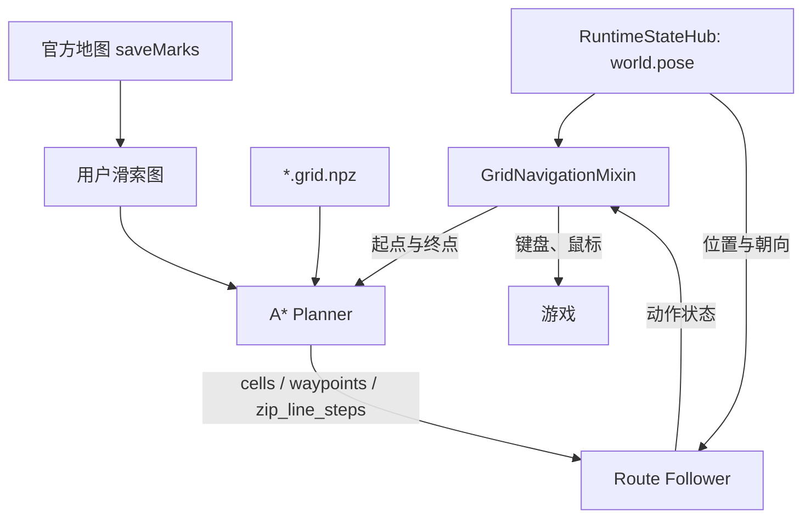
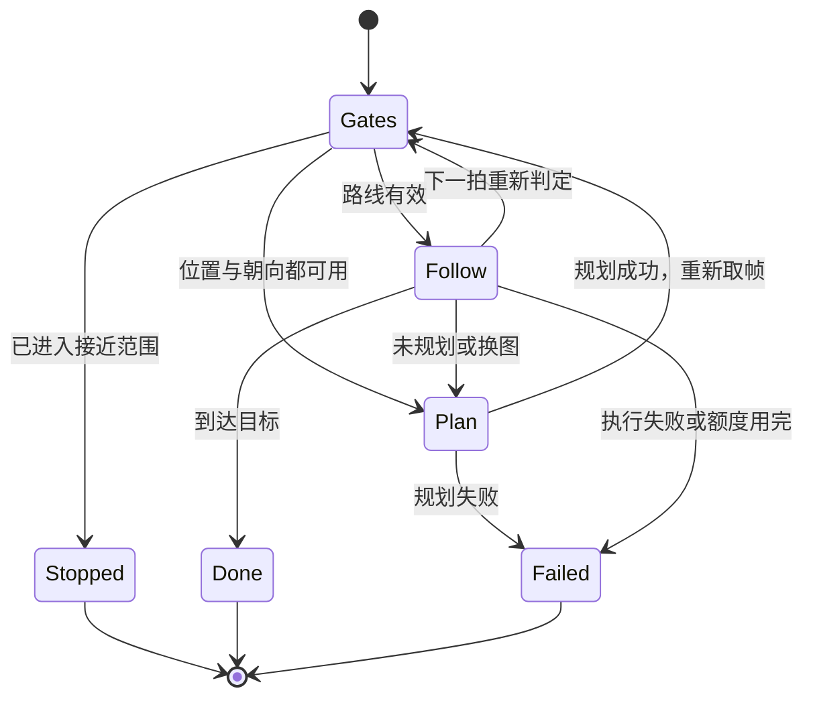
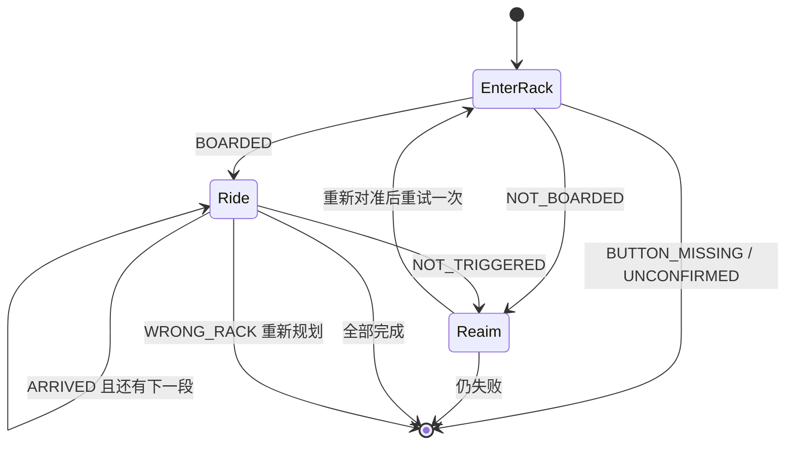

# 网格导航

返回：[文档索引](../zh-CN/README.md) / [API 参考](API.md) / [开发指南](DEVELOPMENT.md) /
[小地图定位](小地图定位.md)

地图数据格式、扩区域和最小上传集合见 [nav-grid-data 数据与上传约定](nav-grid-data格式.md)。

本文只说明二维网格规划、路线跟随和游戏输入。坐标来源、融合和校准见
[小地图定位](小地图定位.md)。

## 1. 职责边界

网格导航接收目标世界坐标，消费可信的 `world.pose`，然后：

- 加载当前地图的 `*.grid.npz`；
- 在可行走网格上做 A*；
- 把路径转换成 `TURN/WALK/ZIP_LINE/WAIT/STUCK/REPLAN/DONE`；
- 执行键盘、鼠标和滑索操作；
- 处理重规划、卡住、脱困和周期校准。

它不直接读取物品点位，也不启动 WS、小地图里程计或融合器。

导航代码不导入 `src/localization/`。位置、朝向和朝向控制通过 `PoseProvider`
接口获得，具体实现由运行状态适配层注入。

## 2. 模块

| 模块 | 职责 | 不负责 |
|---|---|---|
| `src/nav/grid_io.py` | 稠密网格、坐标换算、`*.grid.npz` 读写 | 路径规划 |
| `src/nav/grid_planner.py` | A*、风险与墙距代价、起终点吸附、滑索图接入 | 游戏输入 |
| `src/nav/route_follower.py` | 把航点转换成动作状态 | 直接操作游戏 |
| `src/nav/nav_state.py` | 导航主循环每一拍的状态、会话数据与输入快照 | 判定与执行 |
| `src/nav/zip_line_graph.py` | 用户滑索点解析和连接图 | 网格规划 |
| `src/tasks/navigation/mixin/grid_navigation_mixin.py` | 组织定位、规划、动作、重规划和脱困 | 纯算法实现 |
| `src/tasks/navigation/mixin/zip_line_mixin.py` | 登索、上下索 UI 和滑索执行 | 网格规划 |

`src/nav/` 是纯 Python 模块，不依赖 `ok` 框架，可独立测试。

## 3. 数据流



网格导航主循环必须先确认定位可信，再允许路线跟随器继续行走或重新规划。

`src/nav/` 只包含纯算法，不依赖定位实现；导航任务和导航 Mixin 也只依赖
`world.pose` 与 `PoseProvider` 接口。

## 4. 坐标与网格

```text
world = origin + (i, j) * cell_size
```

- `i` 是行，沿世界 `z`；
- `j` 是列，沿世界 `x`；
- `origin` 是数组下标 `(0, 0)` 格最小角的世界坐标；
- 当前导航网格是二维的，`origin[1]` 只作溯源记录，不参与换算。

`*.grid.npz` 包含：

| 成员 | 内容 |
|---|---|
| `cells` | `uint8` 二维数组，`0=未知`、`1=可行走`、`2=阻挡` |
| `meta` | UTF-8 JSON，包含 `origin`、`cell_size`、`map_name`、`zoom` 和 schema 版本 |

读取时会校验 `magic`、`schema_version`、数组维度和状态值。

### 4.1 用实走轨迹补充路线

1. **MCP 采集路线**：
   - 用 `screenshot` 核对实际传送点；任务执行期间截图可能是缓存帧，应检查返回时间和缓存状态。
   - 用 `run_task` 运行 [采集任务示例](../../scripts/navigation/mcp_record_walk.py) 的绝对路径；它先用 `ensure_main` 返回大世界，不主动移动或拍照；遇到登录界面或抓包需要重新登录时停止并报错。它只将可信的地图 ID、`x/z` 和时间写到 `logs/navigation/manual_walk.jsonl`（每次覆盖，需保留时先备份）。
   - 查看该 JSONL，确认已有起点可信样本后再手动行走；结束时用 `stop_task` 停止，通过 `get_run_status` 等待终态后读取轨迹。示例会逐条刷新文件，最长运行五分钟。
2. **补充网格**：
   - 在 `assets/nav-grid-data` 对应地图中结合实走轨迹和底图标记可走格，保留原有阻挡格；采样缺口不能仅凭连线认定可走。
   - 深水、悬崖等边缘尽量留一格；已确认可通行的浅水不按颜色排除，窄路结合实际地形处理。
3. **验证和提交**：
   - 更新子仓库 `dataset.json` 中对应文件大小与 SHA-256，检查路线预览、离线规划及起终点吸附，再从同一传送点实测。离线连通不等于实机走通。
   - 修改已注册任务后，用 MCP `list_tasks` 查找、`reload_tasks` 重载并等待完成；修改独立路线辅助模块后须重启运行时，再确认游戏状态并复测。定位失败时结合日志、地图标记和画面排查。
   - 先合并导航数据子仓库，再将主仓库子模块指针更新到已合并的提交。

## 5. 配置

网格参数集中在全局 `Nav Config`：

- `地图id(留空自动)`；
- `网格目录`、`网格文件(可选)`、`网格Zoom(可选)`；
- `使用滑索路径`；
- `仅规划不移动`；
- `等待定位超时(秒)`；
- 规划、代价、转向、冲刺、卡住和脱困参数。

`MinimapNavigateToPoint` 的任务配置只保留目标 `X/Z`，其余参数从 `Nav Config` 读取。

## 6. A* 规划

规划器核心规则：

- 可行走格基础代价为 `1`，斜向为 `sqrt(2)`；
- 未知格可通行时乘以 `risk_cost`；
- 阻挡格不可通行，斜向移动不能穿过阻挡墙角；
- `margin` 和 `wall_penalty` 提供离墙偏好，但不会封死窄路；代价在 `clearance >= margin`
  处饱和，因此只会把路线拉到离墙 `margin` 格以内（默认 `3`，可让宽约 5 格以内的走廊
  从正中穿过），开阔区域不受影响、不会为了居中绕远；
- `frontier_margin` 和 `frontier_penalty` 偏好已知自由区域内部；
- 宽度只有一格的通路由 `GridPlanner.is_narrow_corridor` 识别（正对两侧被界内阻挡格夹住），
  入口前后两格会被强制保留为航点，入口航点下标写入 `PlanResult.narrow_entries`；
- 精确搜索超过 `max_expand` 时自动加权重搜一次（权重取 `max(risk_cost, 1/启发式缩放)`），
  降级只改扩展顺序，路线依旧不穿墙、不切角，代价最优性不再保证并记入 `notes`；
- 失败原因区分搜索触顶、禁止穿越未知格和可达区域穷尽。

加载了用户滑索时，规划耗时会明显上升，这是刻意付的代价：滑索边的单价是
`zip_line_cost_factor`（默认 `0.2`）乘距离，比步行便宜得多，octile 启发只有在整体乘上
同一系数之后才仍是**代价下界**，因此 A* 会退得更接近均匀代价搜索。实测同一张 520 万格
网格上一条 535m 路线，扩展节点数从 10.7 万升到 34.7 万；未开启「允许穿越未知格」时搜索
只覆盖已知可行走区（本仓库随附网格最大约 3.7 万格），影响有限，开启后长路线可能顶到
`max_expand`。缩放系数记录在 `GridPlanner.zip_line_stats()["heuristic_scale"]`，导航日志
会在接入滑索时打印它；触顶诊断里也会带上这条说明，避免误判成"网格数据有问题"。

## 7. 路线跟随与执行

任务层主循环是显式状态机，每拍只做三步：`_grid_nav_poll` 取输入快照、
`_grid_nav_classify` 判定这一拍的状态、`_GRID_NAV_HANDLERS` 里的处理器执行它。
状态没有跨拍记忆——每拍都按下面的固定优先级重新判定一次，所以表里的“状态”是
“这一拍走哪个分支”。状态、会话数据和快照类型都在 `src/nav/nav_state.py`；
状态到处理器的登记必须一一对应，`tests.TestGridNavigationMixin` 会检查。

### 7.1 每一拍的状态

| 优先级 | 状态 | 进入条件 | 处理 |
|---:|---|---|---|
| 1 | `WAIT_POSE` | 拿不到 `world.pose` | 停车等下一拍 |
| 2 | `WAIT_ANCHOR` | `x/z` 未锚定 | 停车等下一拍 |
| 3 | `WAIT_TRUST` | `position_trusted=False` | 停车；静止且过了重试点则请求校准 |
| 4 | `WAIT_ODOM` | 本拍既无有效位移样本，也无独立确认的绝对坐标 | 停车等下一拍 |
| 5 | `CALIBRATE` | 定位服务要求校准且过了重试点 | 停车等一次真实重锚 |
| 6 | `WAIT_HEADING` | 朝向不可用或质量低于阈值 | 停车等下一拍 |
| 7 | `STOP_REACHED` | 已进入 `stop_distance` | 停车并按成功结束 |
| 8 | `PLAN` | 没有路线，或检测到换图 | 停车规划；成功后重新取位置和朝向 |
| 9 | `ZIP_LINE_APPROACH` | 跟随器给出了待乘滑索段 | 先接近入口并登索，否则落回普通派发 |
| 10 | `REPLAN` | 跟随器报 `REPLAN` | 停车；按是否在已知格决定原地校准或回退 |
| 11 | `ZIP_LINE` | 跟随器报 `ZIP_LINE` | 执行滑索段 |
| 12 | `WAYPOINT_ARRIVED` | 到达一个航点 | 记录后立即执行新动作；仅支持静止校准的源按间隔停车 |
| 13 | `DONE` | 跟随器报 `DONE` | 还在回退目标上就先校准，否则判定到达 |
| 14 | `STUCK` | 跟随器报 `STUCK` | 按脱困序列尝试；额度用完则失败 |
| 15 | `NARROW_CALIBRATE` | 跟随器报 `NARROW_CALIBRATE` | 停车校准 + 对准入口，连续失败到上限才继续 |
| 16 | `TURN` | 跟随器报 `TURN` | 大角度或贴近航点时停车转，否则边走边转 |
| 17 | `WALK` | 跟随器报 `WALK` | 按住 `W` 前进 |
| 18 | `WAIT` | 跟随器报 `WAIT` | 松开 `W` 等状态稳定 |
| 19 | `FAILED` | 跟随器报 `FAILED` | 松开 `W` 并按失败结束 |

第 13-19 项在派发前会先记一次目标距离进展（有进展就归还重规划与脱困额度）。



`Gates` 是 7.1 表里的第 1-6 项，`Follow` 是第 9-19 项；两者都只是“这一拍命中哪一组”，
不是可以停留在里面的长期状态。

### 7.2 跟随器输出

下面是 `GridRouteFollower` 每拍输出的动作，其中执行类状态与它们同名同值，
所以动作可以直接映射成状态：

- `TURN`：转向；
- `WALK`：按住 `W` 移动；
- `ZIP_LINE`：执行滑索步骤；
- `NARROW_CALIBRATE`：进入一格宽通路前停车校准；
- `WAIT`：等待状态稳定；
- `STUCK`：进入脱困；
- `REPLAN`：偏航或路径失效后重新规划；
- `DONE`：到达目标。

普通行走开始后，如果当前规划航段与剩余航段都超过 `15m`，导航会在按住 `W` 时按一次
`shift` 进入冲刺。松开 `W` 后冲刺状态清除，接近拐点时不会重新开启冲刺。

导航测量每次取帧与定位的耗时，并保留最近一次可信移动速度（增加 20% 余量）。
接近航点时为当前画面延迟和下一次识别留出距离，缩短 W 持续时间、松键后再采样；
长直道继续按住 W。首次尚无速度观测时按 8m/s 留余量，静止后的零速度不会覆盖移动估计。

对距当前点 5 米以内、转折不超过 20 度的中间航点，跟随器可提前看向下一点，
前提是完整直连线可通行且不增加未知格风险；不会越过未确认的窄道入口或滑索断点。
关闭路径点捷径时也关闭这项前瞻。该规则不改变终点到达半径或 A* 规划代价。
不超过 20 度的小角度修正还会按移动速度、两次采样耗时和输入时间计算制动距离，
允许在原近点停车阈值内继续移动转向；速度未知、采样较慢或大角度时继续保守停车。

如果已进入航点半径，但安全直连检查仍不允许切到下一段，继续用不超过剩余距离一半的
短步靠近当前格，不再因固定刹车余量而一直停在半径内。未知格、禁切角和碰撞检查仍有效。

### 7.3 静止校准

静止校准入口统一在 `_grid_nav_sync(ctx, reason)`，
六个触发原因见 `SyncReason`：定位重新校准、定位服务请求、航点间隔、偏航后原地校准、
回到已知格后校准、窄道入口前。原因会写进状态提示与超时告警，便于回答“为什么又停下来校准”。
等待本身由 `_wait_for_minimap_sync` 完成，上限 8 秒（覆盖一个 WS 推送周期），
超时或“已对齐”都按未校准处理，调用方据此决定退避 30 秒还是继续。

独立视觉源与抓包源声明 `sync_supported=False`，不进入这套旧式静止校准流程。
视觉地图匹配和锚定链在移动中持续更新；首次确认、真正失去可信位置、加载画面或
楼层证据不足时，仍先停车等待有效定位。规划、大角度转向与窄道入口也可能需要停车。

窄道入口是最特别的一个触发点：当当前目标航点是一格宽通路的入口
（`PlanResult.narrow_entries`）、角色已接近到「窄道前校准距离(米)」以内时，跟随器输出
`NARROW_CALIBRATE`：主循环先停车校准，再对准入口航点方位，随后才继续走向入口，
避免带着累积定位误差进入没有横向余量的通路。入口前最后一格也是捷径保护点，
不会被 `shortcut_radius` 跳过；关闭「窄道前停车校准」即恢复旧行为。

### 7.4 卡住脱困

脱困动作序列是显式数据（`_GRID_STUCK_RECOVERY`）：后退 → 后退 + 侧移 → 对准目标后
跳跃。尝试次数超出序列长度时重复最后一步，所以把「卡住脱困次数」调大不会越界；
日志里的“第几次/共几次”跟随配置，不再写死 `3/3`。

### 7.5 转向收敛

地面停车转向首轮使用已标定的输入比例，不把首轮角色朝向变化用于重新估计系数：
角色可能尚未朝向镜头，首轮变化包含两者的初始偏差。按 W 后连续读取新画面，等朝向
稳定再判断到位或按剩余角度补转；仍在变化时交回下一拍采样，不连续追加鼠标输入。
稳定观测复用原「角度刷新等待」，正常转向不额外叠加一次固定等待。

第二轮及之后才允许用同基准的稳定反馈微调本次转向比例；小位移、反向或接近半圈的
角差不用于校准，避免取绝对值掩盖方向或跨圈歧义。滑索纯视角对准仍沿用其原有流程。

普通地面导航每拍最多执行一轮停车转向，之后立即重新采样位置、楼层和朝向，重新计算
目标方向。转向中的 W 点按会改变位置，因此不能连续多轮追逐旧航点方位。
会话内保留已经稳定的转向反馈，使分拍转向仍可修正输入比例；输入设置变化、朝向
不连续、定位失效或其他控制动作会使旧反馈失效。独立的定向工具仍可使用多轮闭环。

增益观测还要求实际转角至少 6 度，实际与预期输入转角均小于 135 度，方向一致；
保存最近三次有效读数，使用相互一致读数的中位数。孤立异常值不替换已有增益；
超过配置比例 0.5–2 倍的变化需至少两次一致反馈。极端配置误差可能比此前多用一轮确认，
避免用一次可疑读数改变后续输入。会话反馈超过两秒后不再沿用。

地面导航向转向器传入本次 `max_probe_s`，把 W 探步限制为预计剩余路程的一半，速度按
最近观测且至少 6m/s 估计；探步最低为 1/30 秒，仍不得超过用户原有的长按时间。
若截图处理期间的预计前进距离已经耗尽余量，先松开 W 换帧，再决定是否需要转向。
短探步仍必须通过实际朝向反馈校验，不能直接把目标方向当成已到位。
若短探步后箭头仍未响应，随后最多两拍只补有距离上限的 W 探步和朝向确认，不重复
发送镜头旋转；已出现目标朝向时只等待稳定，无需再按 W。仍无有效响应则清除该会话，
重新使用配置比例；探步继续计入通用卡住检测。没有针对具体坐标或人为障碍的特殊处理。

航点切换后，跟随器已经算出下一动作，导航在同一拍执行它，避免继续持有旧方向直到
下一次完整定位结束。规划或实际静止校准会耗时，结束后必须先换帧，不能复用旧快照。

### 7.6 偏航回退

偏航时若当前位置不在已知可行走格，先规划回最近走过的已知格（`session.recovery_goal`），
走到之后由 `DONE` 触发一次静止校准，校准完成再清空回退目标、继续原目标。
真重锚会整体平移世界坐标，因此每次 `sync_seq` 变化都会清空“走过的已知格”。


## 8. 定位协作

网格导航消费 `world.pose` 时按以下顺序判断：

1. `anchor_set=True` 且本轮存在 `x/z`；
2. `position_trusted=True`；
3. 本拍存在有效里程计样本，或 `absolute_position_valid=True`；
4. 以上条件满足后，路线跟随器才允许 `WALK` 或重新规划。

`absolute_position_valid` 只表示当前画面提供了通过严格确认的绝对定位。它允许刚建立
里程计基线时直接使用绝对坐标，不绕过 `position_trusted`、朝向或楼层检查，也不改变
加载画面拒绝、首次连续帧确认和两秒画面过期门槛。

转向后的采样间隔略超两秒时，仅当间隔不超过四秒、地图和明确楼层未变、当前画面
通过严格匹配门槛，且独立相位相关位移有效（响应至少 0.4）并与绝对定位相差不超过
一米，才允许保留原跟踪链。它不输出旧坐标，也不允许依靠抓包或恒速外推通过确认；
加载、弱匹配、楼层不明、位移失效和长时间断帧仍须重新确认。

转向执行器只要实际按过前进键，就向路线跟随器报告移动尝试。连续转向而位置始终没有
推进时，应计入脱困计时，不能每次因状态仍为 `TURN` 就清零；纯相机旋转不算移动失败。

### 8.1 日志与界面状态

高频界面值使用 `info_set(..., log=False)` 更新，保持账号后缀与原有显示格式。
导航 INFO 进度每 5 秒汇总；STUCK、REPLAN、DONE、FAILED 立即记录。航点细节、完整路径
与单轮转向诊断放在 DEBUG。定位丢失、恢复、地图或楼层变化立即记录，健康位置每 30 秒
汇总，持续无定位时每 5 秒汇总。定位 DEBUG 快照每 2 秒采样，可信状态变化不等待采样周期。
`rest`、`shift_too_small` 和锚定链小数变化不再重置节流计时；输入比例提示最多每 30 秒一次。
参数适配和导航决策仍逐拍执行，日志限频不影响控制频率。

## 9. 用户滑索

### 9.1 数据

滑索点来自官方地图接口：

```text
GET /web/v1/game/endfield/map/mark/list?mapId=...&roleId=...&serverId=...
```

只读取 `data.saveMarks`，通过 `data.markTemplates` 映射：

| 模板名 | 最大连接距离 |
|---|---:|
| `滑索架` | 80m |
| `长距滑索架` | 110m |

连接约束：

- 仅连接同一 `mapId`；
- 两端都有 `levelId` 时必须同层；
- 使用三维欧氏距离；
- 距离不超过两端连接半径的较大值。

### 9.2 规划

每个滑索点会吸附到最近的可通行格。可连接滑索对生成双向转移边：

```text
普通滑索边：distance * zip_line_cost_factor + zip_line_boarding_cost
```

规划器支持把中间滑索链合成一条 A* 边。例如 `A -> B -> C` 中若 `B` 位于未知格，
只要 `A/C` 可到，仍可规划成 `A -> C`，执行时依次乘坐两段。若 `B` 本身能映射到
可行走格，正常情况下仍保持 `A -> B -> C` 连续执行，不在中间点重复按 `F`。只有
后续连接确认失败并封禁后，重规划才会改为在 `B` 下索并使用普通网格路线。

### 9.3 执行

执行分两段：先把角色弄上滑索架（登索），再按段轮询骑乘状态。两段各有独立的判定，
共用「登上滑索架」模板（`_zip_line_on_rack_visible`）与最新 WS 坐标。

#### 9.3.1 登索阶段

`_grid_zip_line_enter_rack` 负责“按「登上滑索架」按钮并用 `fL.esc` 确认”，
一次尝试的结果是 `ZipLineBoardAttempt`：

| 结果 | 判定 | 动作 |
|---|---|---|
| `BOARDED` | `fL.esc` 已消失 | 记「已成功登上滑索」，进入骑乘阶段 |
| `BUTTON_MISSING` | 没找到「登上滑索架」按钮 | 直接失败：重新对准解决不了按钮不存在 |
| `UNCONFIRMED` | 点了按钮但 `fL.esc` 判定超时 | 直接失败，不重试 |
| `NOT_BOARDED` | `fL.esc` 仍在 | 重新对准入口滑索架后重试一次，再失败才放弃 |

重试只有一次，且只有 `NOT_BOARDED` 才值得重试。重试轮的失败文案与首轮不同
（「重新对正后仍未找到…」「重新对正后仍检测到 fL.esc…」），日志里能直接看出是第几次。

走向入口滑索架的过程由 `_approach_grid_zip_line_for_boarding` 负责：

| 状态 | 判定 | 动作 |
|---|---|---|
| 待登索 | 距计划上索点 `<=5m` | 按一次 `ctrl` 切步行；保持 `W` 连续接近，在移动中读取最新 WS 并持续搜索模板；模板出现立即停车并按 `F` |
| 待续乘 | 错误落点重规划后仍在同一滑索架 | 跳过登索，直接对准下一段 |
| 接近搜索超时 | 连续接近 `20s` 仍未检测到模板 | 先在入口附近短距 W/A/D/S 搜索；多轮仍失败才短暂后退约 `0.6s`，不直接长距离远离 |
| 按 `F` 后未登索 | `fL.esc` 在约 `1.5s` 后仍存在 | 短暂按 `S` 后退约 `0.6s`，下一轮从最新 WS 重新计算入口方位后再走 |

#### 9.3.2 骑乘阶段

`_wait_zip_line_motion` 每拍轮询一次，按下面五种情况处理。调用方负责点击并按一次 `E`，
本函数只轮询状态、不重复发送按键：

| 状态 | 判定 | 动作 |
|---|---|---|
| `MOVING` | 两个移动模板都不存在 | 等待，不重复发送 `E` |
| `ARRIVED` | 模板存在且 WS 进入目标范围 | 进入下一段 |
| `WAITING_TEMPLATE` | 已停稳在目标附近但到达模板还没出现 | 继续等模板，既不算到达也不算失败 |
| `NOT_TRIGGERED` | 已停稳且 WS 仍在起点范围 | 返回失败，交给外层重新对准后重试 |
| `WRONG_RACK` | 停稳后 WS 既不在起点也不在目标附近 | 不下索，从实际滑索架重新规划 |



模板是“是否在滑索架上”的视觉依据；网格登索只使用最新 WS 与入口滑索坐标计算接近方位。
下索前必须检查滑索节点的实际坐标是否落在可通行格：可通行时 A* 会比较“原地下索步行”和“继续乘坐滑索”；不可通行时不能下索，只能继续沿滑索图移动。滑索链的目标节点也必须是可通行格，否则不能把该节点作为实际下索终点。

### 9.4 重规划

错误落点重规划不变量：

1. 错误落点一定是滑索架，无需先下索；
2. 最新 WS 使用三维坐标优先匹配最近滑索节点，避免同 X/Z、不同楼层误认；
3. 目标始终是原最终目标；
4. 未映射网格的滑索节点可作为起点；
5. 前缀链和后续链合并为一次执行；
6. 候选路线比较完整实际代价，不只看节点距离；
7. 直接对准失败时保留本段实际起终点的三维坐标，只封禁该连接；
8. 同一连接连续 5 次未触发后，本次任务实例内标记不可用；
9. 未映射起点的续接只尝试代价下界最小的前
   `zip_line_start_max_candidates`（默认 4）个可映射落点：每个候选都要跑一次完整 A*，
   在 `map02` 这种 520 万格的图上单次就是 1~2 秒。被截断时 `PlanResult.notes` 会写明，
   按提示调大上限即可；截断的代价是可能选到更绕的那条（例如先滑到一个落点再原路滑回）。

## 10. 调试与测试

导航调试任务：

- `MinimapNavigateToPoint`：按世界坐标规划；开启「仅规划不移动」可只检查路径；
- 滑索日志重点查看：`执行滑索链`、`已到达下一滑索附近`、`到达了非目标滑索架`、
  `滑索连接不可用`、`错误落点已匹配滑索架节点`。

常用测试：

```powershell
uv run --locked python -m unittest tests.TestNavGridIO tests.TestNavGridPlanner tests.TestNavZipLineGraph tests.TestNavRouteFollower tests.TestGridNavigationMixin tests.TestFindZipLineBoardButton -v
```

排查顺序：

1. 先确认 `world.pose` 可信；
2. 检查当前地图、缩放与网格文件是否唯一匹配；
3. 判断规划失败是搜索触顶、未知格策略还是连通性问题；
4. 检查跟随器动作、滑索步骤、卡住判定和输入权限。
