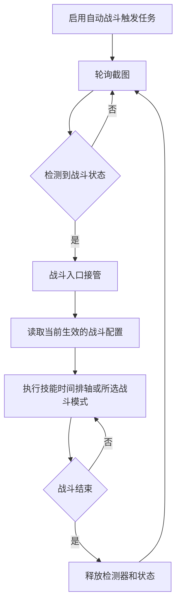

# 自动战斗

返回：[文档索引](index.md) / [README](https://github.com/AliceJump/ok-end-field/blob/master/README.md)

## 概述

在“业务与战斗 → 大世界”页启用自动战斗。
自动战斗检测到至少 1 格技力且队伍界面存在时接管。
战斗结束后，自动战斗继续等待下一场。

战斗逻辑与“刷体力”相同，详见[体力本](体力本.md)。
“日常一条龙 → 战斗”的抽屉保留体力、关卡和入场设置。

## 触发流程

---

## 使用要求

> 确保游戏画面宽高比为 **16:9**，且分辨率至少为 **1600x900（900P）**，低于 900P 不保证正常运行

## 战斗配置

战斗参数集中在“业务与战斗 → 自动战斗”。
“保存敌人检测调试帧”位于同页的“敌人检测”分组。
“配置范围”列出通用设置、任务和已有的账号专用设置。
页面注明当前范围使用的配置来源。
点击卡片的“配置”，在右侧面板编辑参数。
按 Esc、点击遮罩或关闭按钮可关闭面板。
切换页面或配置范围时，面板关闭。

- 通用设置：修改后自动保存，影响沿用通用设置的任务。
- 专用设置：修改后点击面板中的“保存并关闭”。切换范围或离开页面时也会保存。
- 改用专用设置：恢复当前范围已保存的专用参数。
- 改用通用设置：停止使用专用参数，保留已保存的值。

账号的战斗配置开关覆盖任务开关。
启用专用设置时，账号参数覆盖任务参数。
其余范围读取通用设置。
任务运行时，页面禁止修改参数和切换配置范围。

主题入口为“系统与环境 → 设置 → 应用主题”。
浅色使用纸白与墨黑；深色使用中性灰与浅墨，两套主题的元素一一对应。
勾选框、编号牌和主按钮使用墨色。
黄色只用于当前导航项、当前页签、已开启的开关和按钮悬停。
卡片悬停使用中性边框，页签焦点显示虚线框。
禁用按钮和选项使用灰色，已选状态保留勾选标记。
配置来源提示左侧有黄色竖条。
任务状态同时显示边框和文字，切换主题后立即换色。
等待执行显示虚线框，运行中显示实线框，已暂停显示黄底。
英文眉标和编号使用内置 Saira 字体。
中文使用系统界面字体。
开关可通过 Tab 键聚焦，按空格键切换。
“恢复默认大小”按钮位于标题栏，在最小化按钮左侧。
点击后，窗口恢复为 1440×900 并居中。
屏幕空间不足时，窗口按可用区域缩小。
缩窄窗口后，页签和操作区换行。
单行任务说明和网址显示省略号，悬停可查看全文。
配置表单按已有依赖关系缩进子项。
一级项之间有分隔线；同组子项之间不加线。
各页配置使用同一个侧边面板。
面板保留原有字段、重置操作和保存规则。
没有可编辑内容的项目隐藏“配置”入口。
配置标题省略星号，保存时沿用原有配置键。
日常页签依次为“帝江号、战斗、奖励、其他”。
账号页从“账号基础设置”开始编号。
账号列表和任务选择通过各自的“配置”编辑。
“任务属性配置”直接打开当前账号的任务参数。
账号基础面板的“保存并关闭”会保存账号列表。
入口卡片的说明显示在标题右侧；窄窗下省略长文本。

### 终结技释放方式

可以选择终结技释放方式：

- 长按技能按键（默认）
- Alt + 技能按键

---

### 技能时间排轴与战斗模式

「技能时间排轴」默认关闭。开启后使用独立的时间排轴调度，详见 [技能时间排轴说明](../dev/skill-timing-mode.md)。关闭时显示「战斗模式」下拉框，同一时刻只选择一种策略：

| 战斗模式 | 行为 | 展开的子配置 |
| --- | --- | --- |
| 普通模式 | 按指定角色顺序循环释放战技 | 技能释放、启动技能点数、自动释放推荐技能 |
| 自动技能列表 | 识别队伍，并按角色增强链过滤技能列表 | 无 |
| 伤害优先排轴 | 识别队伍，按伤害生成可重复循环的自动排轴；默认选项 | 无 |
| 固定排轴 | 按手写序列执行；连续 5 秒动作失败时本场回退普通模式 | 排轴序列 |
| 实时条件 | 按实时条件选择动作；序列为空或全部非法时回退普通模式 | 实时条件序列、立即释放终结技、立即释放连携技 |

「启用排轴」「启用实时条件」「自动技能列表」「伤害优先排序」旧布尔开关只保留用于配置兼容，不再作为独立开关显示。普通模式的相关设置如下。

### 技能释放

「战技」释放角色顺序是可排序列表，默认 `1,2,3`，可从 1 至 4 中选择且不允许重复。普通模式在连携技和终结技均未释放时按该列表循环出技。

---

### 启动技能点数

当「技力条」达到该数值时，开始执行技能序列。取值范围 1–3。

---

### 完成通知

战斗结束后是否发送系统通知。

---

### 无数字操作间隔

战斗中周期触发锁敌 + 向前闪避的最小间隔秒数，默认 6；运行时限制为 1 至 30 秒。

---

### 进入战斗后的初始等待时间

进入战斗后等待该时间（秒）后才开始释放技能。该配置属于战斗入口控制，不属于技能策略；即使启用「技能时间排轴」，也仍然生效。

### 仅协议空间启用初始等待

默认关闭。关闭时保持原行为：所有战斗都使用「进入战斗后的初始等待时间」。

开启后，仅协议空间保留这段等待；普通战斗检测到战斗 UI 后直接开始自动操作。协议空间优先复用战斗逻辑现有的终结技就绪检测：当前可见队员的终结技全部就绪时视为热启动；左上角「撤离」按钮仍作为兜底特征。

这个选项用于协议空间“战斗 UI 已出现，但敌人尚未正式进场”的开局阶段，避免因为战斗状态提前成立而过早释放技能。

---

### 固定排轴

将「战斗模式」选为「固定排轴」后，按照「排轴序列」中定义的顺序使用技能。某个动作连续 5 秒未成功时，本场战斗永久回退普通逻辑。

详见 [排轴.md](./排轴.md)。

---

### 排轴序列

技能释放的自定义顺序字符串，仅在「战斗模式」选择「固定排轴」时显示并生效。

格式和用法详见 [排轴.md](./排轴.md)。

---

### 实时条件

将「战斗模式」选为「实时条件」后，可在面板编辑触发条件和序列。

当实时条件序列为空或全部非法时，自动回退普通模式。

---

### 立即释放终结技 / 立即释放连携技

本帧无条件动作产出时，按开关尝试立即释放终结技或连携技。优先级：终结技 > 连携技。

仅在「战斗模式」选择「实时条件」时显示并生效。

相关文档：[体力本](体力本.md) / [排轴](排轴.md) / [API 参考](../dev/API.md)
